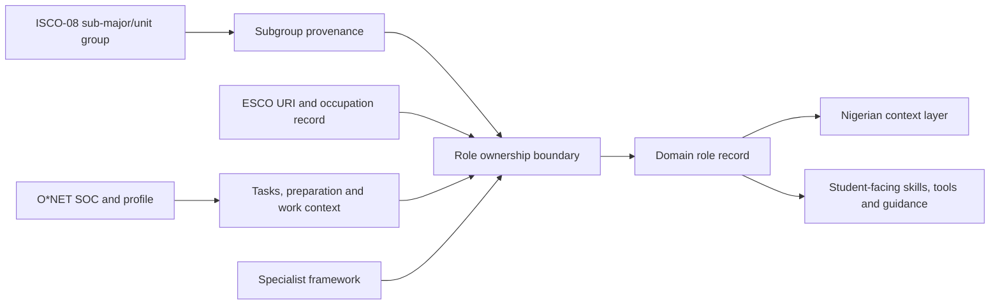

# Subgroup and role source traceability audit — 2026-08-31

## Result

The current subgroup layer has recorded provenance for every subgroup row. The current role layer is a deduplicated union of the cleaned role library and specialist overlays; its counts do not equal the base library or the O*NET work-profile count. This audit exposes those populations separately.

## Counts

- Domains: **168**.
- Subgroups: **555**; with recorded source provenance: **555**.
- Base role-library rows: **4703**.
- Overlay rows: **511**; duplicate role keys removed during merge: **5**.
- Merged role records: **5209**.
- O*NET work-profile rows: **5096**; role records with a work-profile row: **5090**.
- Merged roles with an explicit ESCO code: **4739**.
- Merged roles with an explicit O*NET code: **4389**.
- Roles whose previously missing code was recovered by an exact O*NET 31.0 title match in this audit: **329**.
- Merged roles with a source link in their work-profile record: **5090**.
- Merged roles with any role-field or profile-link source evidence: **5209**.
- Merged roles without any recorded anchor, provenance, or profile source link: **0**.
- Merged roles assigned to a matching subgroup: **5088**.
- Merged roles using the intentional direct domain-to-role fallback because their ISCO sub-major has no matching subgroup: **121**.
- Merged roles in domains without a subgroup taxonomy: **0**.

## Lineage map



## Interpretation rules

- ISCO is the occupational grouping spine; it is not a complete description of each role.
- ESCO is the primary normalized role/skill evidence where a valid ESCO URI/code is recorded.
- O*NET contributes task, preparation, tool and work-context evidence where a valid O*NET code/profile is recorded.
- Specialist frameworks fill emerging or thin domains where the general taxonomies do not describe the field sufficiently.
- Nigerian source overlays remain separate. A global role record is not relabelled as Nigerian demand.
- Missing work profiles are not missing roles; they mean the O*NET work-profile join is unavailable and the role’s other evidence must remain visible.
- A profile source link is recorded evidence even when the role object has not been populated with a machine-readable ESCO/O*NET code; it must not be reported as an entirely unanchored role.

## Reproducibility

Run from the repository root:

```text
python data/career-mapping/_audit_subgroup_role_source_traceability.py
```

The full per-domain, per-subgroup and per-role result is `data/career-mapping/_audit/subgroup_role_source_traceability_2026-08-31.json`.
