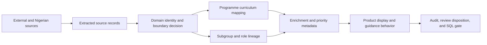
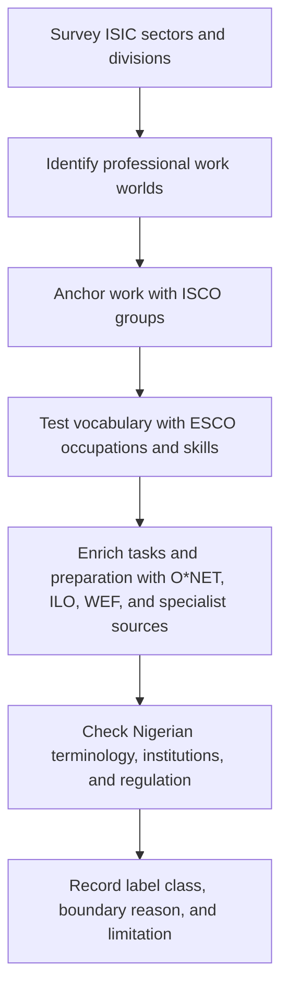
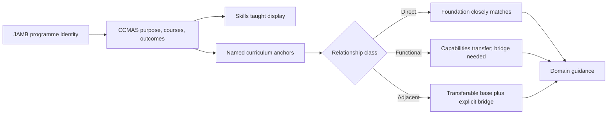
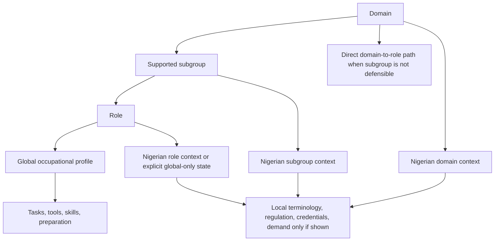
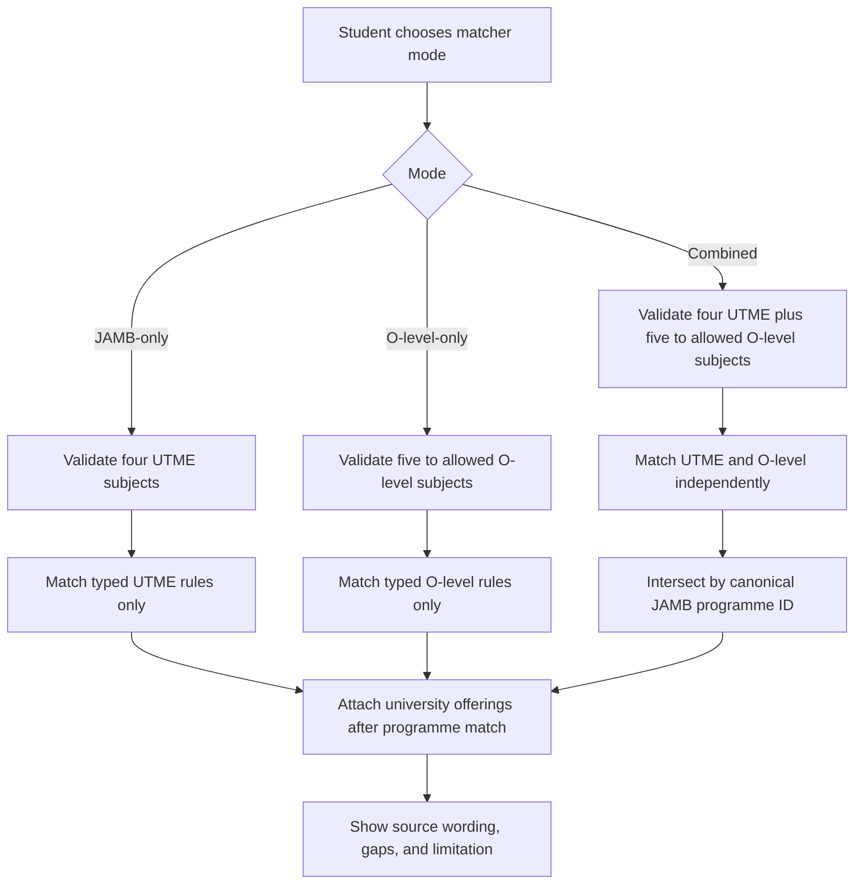
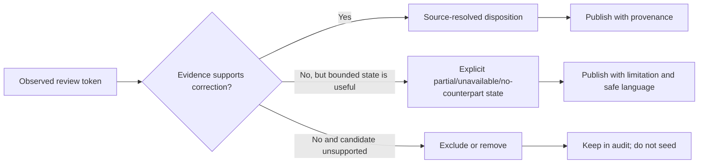
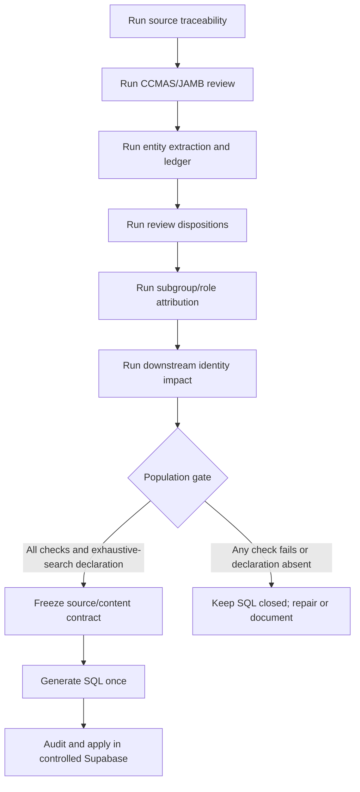

# Sifter Career Taxonomy — Academic Methodology

**Document ID:** `METHODOLOGY-2026-09-01`  
**Status:** working methodology and reproducibility handoff  
**Scope:** domain identity, Nigerian programme-to-domain mapping, subgroups,
roles, enrichment, and evidence boundaries

## 0. How to read this document

This document is organised as a traceable chain. Every important decision has a
stable key that can be searched in the audit JSON files and followed into the
product data path.



| Stage | Stable key | Authoritative detail |
|---|---|---|
| Source | `SRC-*` | [§1 Source register](#1-source-register) |
| Domain identity | `DOM-*` | [§2 Domain derivation](#2-domain-derivation-and-identity) |
| Programme mapping | `MAP-*` | [§3 Programme-to-domain evidence](#3-programme-to-domain-evidence) |
| Entity enrichment | `ENT-*` | [§4 Subgroup, role, and Nigerian context](#4-subgroup-role-and-nigerian-context) |
| Review disposition | `REV-*` | [§5 Review closure](#5-review-closure) |
| Verification | `CHK-*` | [§6 Reproducibility and release gate](#6-reproducibility-and-release-gate) |

## 1. Source register

<a id="src-isic"></a>

| Source key | Canonical source/version | What it supports | What it does not prove | Repository/audit detail |
|---|---|---|---|---|
| `SRC-ISIC` | [UNSD ISIC Rev.5](https://unstats.un.org/unsd/classifications/Econ/ISIC.cshtml), with Rev.4 correspondence retained | Industry context, activity boundaries, completeness survey | Occupations, skills, programme suitability, or Nigerian demand | [ISIC crosswalk](../data/career-mapping/_audit/ISIC_DOMAIN_CROSSWALK_2026-08-31.md) |
| `SRC-ISCO` | [ILO ISCO-08](https://isco.ilo.org/en/isco-08/) | Occupational hierarchy, work-function and skill-level anchors | Sifter domain names, local demand, or learner readiness | [ISCO crosswalk](../data/career-mapping/_audit/ISCO_DOMAIN_CROSSWALK_2026-08-31.md) |
| `SRC-ESCO` | ESCO v1.2.1 classification archive | Normalised occupation labels, aliases, URIs, descriptions, and skills | Nigerian licensing or demand | [Source traceability](../data/career-mapping/_audit/DOMAIN_SOURCE_TRACEABILITY_AUDIT_2026-08-31.md) |
| `SRC-ONET` | [O*NET 31.0](https://www.onetcenter.org/database.html) | Tasks, tools, work activities, preparation, job zones, and skill proxies | Nigerian requirements or demand | [O*NET reconciliation](../data/career-mapping/_audit/ONET_VERSION_RECONCILIATION_2026-08-31.md) |
| `SRC-ILO` | [ILO/ILOSTAT](https://ilostat.ilo.org/data/) | International occupational and labour-statistics context | A Nigerian role or vacancy without a Nigeria-specific series | [Source-layer review](../data/career-mapping/_audit/SOURCE_LAYER_ENRICHMENT_REVIEW_2026-09-01.md) |
| `SRC-WEF` | [WEF Future of Jobs 2025](https://www.weforum.org/publications/the-future-of-jobs-report-2025/) | Global trend, emerging-role, and future-skill signals | A complete occupation list or Nigerian market demand | [WEF normalization](../data/career-mapping/_audit/WEF_ROLE_NORMALIZATION_2026-09-01.md) |
| `SRC-CCMAS` | NUC/CCMAS extracts and JAMB-linked programme data | What a Nigerian programme teaches and its stated outcomes | Automatic eligibility beyond the applicable JAMB/university rules | [CCMAS reviewed links](../data/career-mapping/_audit/CCMAS_NIGERIAN_REVIEWED_LINKS_2026-09-01.md) |
| `SRC-NG` | Nigerian regulators, professional bodies, universities, and checked local sources | Nigerian terminology, institutions, regulation, credentials, curriculum, and directly shown local signals | A local demand claim when the source does not show demand | [Nigerian coverage](../data/career-mapping/_audit/NIGERIAN_CONTEXT_COVERAGE_REPORT.md) |

Source registration is not ingestion proof. A published claim must point to the
source record, file, page, section, URL, or exact extracted row that supports it.
The complete 96-entry source catalog, all JAMB/CCMAS source-file names, and
available source hashes,
and layer-by-layer source ownership are reproduced in the standalone
[source and behavior inventory](CAREER_TAXONOMY_SOURCE_INVENTORY_2026-09-01.md).
The academic handoff packet must distribute that inventory with this document;
the links below are the public source locations and the inventory identifies
which local source files were actually checked.

### Complete source-family register for the academic packet

The following register is reproduced here so this methodology remains useful
when read without repository access. It is the source-family register used for
domain, subgroup, role, skill, competency, tool, certification, resource, and
Nigerian-enrichment routing. A routed source is not automatically an extracted
fact; the evidence state is recorded separately.

| ID | Source family | Public reference |
|---|---|---|
| `global_esco` | ESCO occupations and skills | [ESCO](https://esco.ec.europa.eu/en/use-esco) |
| `global_onet` | O*NET 31.0 Database | [O*NET](https://www.onetcenter.org/database.html) |
| `global_isco` | ILO ISCO-08 | [ISCO](https://isco.ilo.org/en/isco-08/) |
| `global_wef` | World Economic Forum Future of Jobs 2025 | [WEF](https://www.weforum.org/publications/the-future-of-jobs-report-2025/) |
| `global_sfia` | SFIA 9 | [SFIA](https://sfia-online.org/en/sfia-9) |
| `global_nice` | NIST NICE Workforce Framework | [NICE](https://www.nist.gov/itl/applied-cybersecurity/nice/nice-framework-resource-center) |
| `global_supply_chain` | ASCM supply-chain body of knowledge | [ASCM](https://www.ascm.org/) |
| `global_cips` | CIPS Global Standard for Procurement and Supply | [CIPS](https://www.cips.org/intelligence-hub/global-standard-for-procurement-and-supply) |
| `global_project_management` | Project Management Institute standards | [PMI](https://www.pmi.org/standards) |
| `global_health` | WHO health workforce resources | [WHO](https://www.who.int/teams/health-workforce) |
| `global_fao` | FAO agriculture and food-systems resources | [FAO](https://www.fao.org/) |
| `global_woah` | WOAH animal-health standards | [WOAH](https://www.woah.org/) |
| `global_icao_iata` | ICAO and IATA aviation standards | [ICAO](https://www.icao.int/) / [IATA](https://www.iata.org/) |
| `global_imo_imarest` | IMO and IMarEST maritime standards | [IMO](https://www.imo.org/) / [IMarEST](https://www.imarest.org/) |
| `global_built_environment` | RICS built-environment and property standards | [RICS](https://www.rics.org/) |
| `global_energy` | SPE petroleum-engineering competency resources | [SPE](https://www.spe.org/en/training/competency-management/) |
| `global_nuclear` | IAEA nuclear and radiation resources | [IAEA](https://www.iaea.org/) |
| `global_unesco` | UNESCO education, science, and culture resources | [UNESCO](https://www.unesco.org/) |
| `global_creative` | ScreenSkills creative-industry role profiles | [ScreenSkills](https://www.screenskills.com/) |
| `global_game_dev` | International Game Developers Association resources | [IGDA](https://igda.org/resources/) |
| `tesda_psf_game_development` | Philippine Skills Framework for Game Development | [TESDA](https://www.tesda.gov.ph/Uploads/File/Philippine%20Skills%20Framework/PSF%20-%20Game%20Development.pdf) |
| `global_xr` | Khronos Group open standards | [Khronos](https://www.khronos.org/) |
| `qt_cfqt` | European Competence Framework for Quantum Technologies v3.0 | [Quantum Flagship](https://qt.eu/media/pdf/Competence_Framework_for_QT_v3.0_2025_official-version.pdf) |
| `nac_arts_technical_theatre` | Singapore National Arts Council technical-theatre framework | [Skills Framework](https://www.skillsfuture.gov.sg/docs/default-source/skills-framework/skills-framework-for-arts-%28technical-theatre-production%29.pdf) |
| `skills_england_live_event` | Skills England Live Event Technician standard | [Skills England](https://occupational-maps.skillsengland.education.gov.uk/maps/occupation/OCC1297A) |
| `mqa_performing_arts` | Malaysian Qualifications Agency Performing Arts standards | [MQA](https://www2.mqa.gov.my/qad/v2/pekeliling/2025/Programme%20Standards_Performing%20Arts%20FINAL_26.3.25.pdf) |
| `jff_xr` | JFF XR and Immersive Learning career pathways | [JFF](https://www.jff.org/idea/immersive-learning-xr-technology-skills-and-careers/) |
| `arm_robotics_career` | ARM RoboticsCareer competency pathways | [RoboticsCareer](https://www.roboticscareer.org/careers) |
| `skills_england_robotics` | Skills England Robotics Engineer maps | [Robotics](https://occupational-maps.skillsengland.education.gov.uk/maps/occupation/OCC1317) |
| `british_esports` | British Esports career pathways | [British Esports](https://britishesports.org/esports-and-education/career-pathways/) |
| `pearson_esports` | Pearson BTEC Esports career pathways | [Pearson](https://qualifications.pearson.com/content/dam/pdf/BTEC-Higher-Nationals/esport/2024/specification-and-sample-assessments/9781292467900-btec-hnc-hnd-l45-esports-spc.pdf) |
| `global_esports` | Hitmarker esports and gaming jobs | [Hitmarker](https://hitmarker.net/) |
| `global_music` | IFPI global music-industry resources | [IFPI](https://www.ifpi.org/) |
| `global_wipo` | WIPO intellectual-property resources | [WIPO](https://www.wipo.int/) |
| `global_cfa_finance` | CFA Institute investment-profession resources | [CFA](https://www.cfainstitute.org/) |
| `global_garp_risk` | Global Association of Risk Professionals | [GARP](https://www.garp.org/) |
| `global_driver_training` | DVSA National Standard for Driver and Rider Training | [DVSA](https://www.gov.uk/government/publications/national-standard-for-driver-and-rider-training/national-standard-for-driver-and-rider-training) |
| `ng_jobberman` | Jobberman Nigeria jobs | [Jobberman](https://www.jobberman.com/jobs) |
| `ng_myjobmag` | MyJobMag Nigeria feeds | [MyJobMag](https://www.myjobmag.com/feeds) |
| `ng_nbs` | National Bureau of Statistics Labour Force Survey | [NBS](https://microdata.nigerianstat.gov.ng/index.php/catalog/151/study-description) |
| `ng_national_ai` | Nigeria National Artificial Intelligence Strategy 2025 | Local checked source document |
| `ng_nbte` | NBTE National Occupational Standards and curricula | [NBTE](https://web.nbte.gov.ng/downloads) |
| `ng_cpn_syllabus_2021` | CPN 2021 Examination Syllabus | [CPN syllabus](https://www.cpn.gov.ng/download/2021_CPN_Examination_Syllabus%28Reviewed%29.pdf) |
| `ng_ncs` | Nigeria Computer Society | [NCS](https://www.ncs.org.ng/) |
| `ng_nsqf_nos` | NBTE NSQF and National Occupational Standards | [NSQF](https://www.web.nbte.gov.ng/nsqf) |
| `ng_cieeen` | Council for Innovative Engineering and Emerging Engineering | [CIEEEN](https://cieeen.gov.ng/) |
| `ng_health_ministry` | Federal Ministry of Health and Social Welfare | [FMoHSW](https://health.gov.ng/hospital-services/) |
| `ng_mls` | Medical Laboratory Science Council of Nigeria | [MLSCN](https://mlscn.gov.ng/publications/mlscn-approved-documents) |
| `ng_clmis_corbon` | CORBON construction labour-market information and NOS | [CORBON](https://www.clmis.corbon.gov.ng/nos) |
| `ng_qsrbn` | Quantity Surveyors Registration Board of Nigeria | [QSRBN](https://qsrbn.gov.ng/registration/) |
| `ng_nnra` | Nigerian Nuclear Regulatory Authority | [NNRA](https://nnra.gov.ng/) |
| `ng_trcn` | Teachers Registration Council of Nigeria | [TRCN](https://trcn.gov.ng/) |
| `ng_nogicjqs` | Nigerian Oil and Gas Industry Content Joint Qualification System | [NOGIC JQS](https://nogicjqs.gov.ng/) |
| `ng_cmd` | Centre for Management Development Nigeria | [CMD](https://www.cmd.gov.ng/) |
| `ng_nasrda` | National Space Research and Development Agency | [NASRDA](https://central.nasrda.gov.ng/departments/institute-of-space-science-engineering/) |
| `ng_nema` | National Emergency Management Agency | [NEMA](https://nema.gov.ng/) |
| `ng_fmacce` | Federal Ministry of Arts, Culture and Creative Economy | [FMaCCE](https://www.fmacce.gov.ng/department/entertainment-and-creative-economy-ece) |
| `ng_ican_syllabus` | Institute of Chartered Accountants of Nigeria 2026 syllabus | [ICAN](https://icanig.org/ican/assets/docs/ICAN_SYLLABUS_2026_Final_Updated_NEW.pdf) |
| `ng_cibn` | Chartered Institute of Bankers of Nigeria competency framework | [CIBN](https://portal.cibng.org/cb_competencyframework.asp) |
| `ng_nuj` | Nigeria Union of Journalists professional ethics | [NUJ](https://nuj.org.ng/code-of-ethics-for-nigerian-journalists/) |
| `ng_nla` | Nigerian Library Association and LRCN context | [NLA](https://nla.org.ng/public/) |
| `ng_nicfost` | Nigerian Council of Food Science and Technology | [NICFOST](https://nicfost.gov.ng/) |
| `ng_nihotour` | NIHOTOUR RIVAC registration portal | [RIVAC](https://rivac.nihotour.gov.ng/) |
| `ng_fmafs` | Federal Ministry of Agriculture and Food Security | [FMAFS](https://agriculture.gov.ng/about-us/) |
| `ng_npa_psychology` | Nigerian Psychological Association | [NPA](https://npafct.org/) |
| `ng_fashion_council` | Nigerian Fashion Council and FADAN | [FADAN](https://fadan.ng/registration/) |
| `ng_sports_context` | Nigeria Olympic Committee sports-sector context | [NOC](https://nigeriaolympic.org/athletes-commission/commissions/) |
| `ng_public_health_context` | NPHCDA and Nigerian public-health sources | [NPHCDA](https://nphcda.gov.ng/brief-history-mandate/) |
| `ng_nemet` | Nigeria Meteorological Agency (legacy registry key) | [NiMet](https://nimet.gov.ng/foi) |
| `ng_nimet` | Nigerian Meteorological Agency | [NiMet](https://nimet.gov.ng/foi) |
| `ng_nmdpra` | Nigerian upstream and midstream petroleum regulators | [NUPRC](https://www.nuprc.gov.ng/) / [NMDPRA](https://www.nmdpra.gov.ng/) |
| `ng_legal_context` | Nigerian legal, immigration, diplomacy, and IP source set | [NBA](https://nigerianbar.org.ng/) |
| `ng_cipsmn` | Chartered Institute of Purchasing and Supply Management of Nigeria | [CIPSMN](https://www.cipsmn.org.ng/about) |
| `ng_nas_research` | Nigerian Academy of Science and national research sources | [NAS](https://nas.org.ng/) |
| `ng_nuc` | National Universities Commission CCMAS and standards | [NUC](https://www.nuc.edu.ng/) |
| `ng_cpn` | Computer Professionals Registration Council of Nigeria | [CPN](https://www.cpn.gov.ng/) |
| `ng_telecom` | NCC and NITDA ICT ecosystem sources | [NCC](https://www.ncc.gov.ng/) / [NITDA](https://nitda.gov.ng/) |
| `ng_engineering` | COREN and Nigerian Society of Engineers | [COREN](https://coren.gov.ng/) / [NSE](https://www.nse.org.ng/) |
| `ng_built_environment` | Nigerian built-environment regulators and bodies | [ARCON](https://arcon.gov.ng/) / [SURCON](https://surcon.org.ng/) |
| `ng_health` | Nigerian health-profession regulators | [MDCN](https://www.mdcn.gov.ng/) / [NMCN](https://www.nmcn.gov.ng/) |
| `ng_finance` | Nigerian finance and accounting bodies/regulators | [SEC](https://sec.gov.ng/) / [CBN](https://www.cbn.gov.ng/) |
| `ng_business` | CIPM Nigeria and Nigerian Institute of Management | [CIPM](https://cipmnigeria.org/) |
| `ng_supply_chain` | CILT Nigeria and Nigerian supply-chain bodies | [CILT Nigeria](https://ciltnigeria.org/) |
| `ng_legal` | Nigerian Bar Association and legal regulators | [NBA](https://nigerianbar.org.ng/) |
| `ng_education` | NUC, NCCE and Nigerian education standards | [NCCE](https://ncce.gov.ng/) |
| `ng_agriculture` | Nigerian agriculture, food and veterinary authorities | [NAFDAC](https://www.nafdac.gov.ng/) / [VCN](https://vcn.gov.ng/) |
| `ng_energy` | Nigerian upstream, midstream and downstream energy regulators | [NUPRC](https://www.nuprc.gov.ng/) |
| `ng_aviation_maritime` | Nigerian aviation and maritime authorities | [NCAA](https://ncaa.gov.ng/) / [NIMASA](https://nimasa.gov.ng/) |
| `ng_creative` | Nigerian creative-industry and media sources | [NFVCB](https://www.nfvcb.gov.ng/) / [NUJ](https://www.nuj.org.ng/) |
| `ng_gaming` | National Lottery Regulatory Commission and gaming ecosystem | [NLRC](https://nlrc-gov.ng/) |
| `ng_environment` | NESREA and Nigerian environmental regulators | [NESREA](https://nesrea.gov.ng/) |
| `ng_surcon` | Surveyors Council of Nigeria | [SURCON](https://www.surcon.gov.ng/) |
| `ng_mdcn` | Medical and Dental Council of Nigeria | [MDCN](https://www.mdcn.gov.ng/) |
| `ng_transport` | Federal Ministry of Transportation | [Transportation Ministry](https://transportation.gov.ng/about/) |
| `ng_aviation` | Federal Ministry of Aviation and Aerospace Development | [Aviation Ministry](https://aviation.gov.ng/index.php/about) |
| `ng_choice_game_developer_2026` | Choice Talents Nigeria game-developer vacancy | [Dated listing](https://ng.linkedin.com/jobs/view/game-developer-at-choice-talents-ltd-4453073421) |

The source registry also contains the local JAMB brochure set and the original
CCMAS PDF set. The exact filenames are listed in the [source and behavior
inventory](CAREER_TAXONOMY_SOURCE_INVENTORY_2026-09-01.md), alongside hashes and
the distinction between a checked source document, a checked extract, and a
registry-only route.

For a standalone academic copy, the primary Nigerian document inputs are also
listed here.

**JAMB/IBASS brochure files:** `Administration.pdf`, `Agriculture.pdf`, `Arts _
Humanities.pdf`, `Education.pdf`, `Engineering _ Enviromental _ Technology.pdf`,
`Law.pdf`, `Medica_Pharmaceutical Health Science.pdf`, `Sciences.pdf`, `Social
Management Science.pdf`, and `Specific Entry Requirements.pdf`.

**Original CCMAS/NUC files:**

```text
Administration-and-Management.pdf
Agriculture-2023.pdf
Allied-Health-Sciences-2023.pdf
Architecture-CCMAS-2023-FINAL.pdf
Arts-CCMAS-2023-FINAL.pdf
Basic-Medical-Sciences-CCMAS-FINAL-December-26-2022.pdf
Communication-and-Media-Studies-CCMAS-2023-FINAL.pdf
Computing-CCMAS-2023-FINAL.pdf
Education-CCMAS-2023-New.pdf
Engineering-Technology-CCMAS-2023-FINAL.pdf
Environmental-Sciences-CCMAS-2023-FINAL.pdf
Law-ALL.pdf
Medicine-and-Dentistry-CCMAS-2023-FINAL.pdf
Pharmacy-and-Pharmaceutical-Sciences-CCMAS-2023-FINAL.pdf
Sciences-CCMAS-2023-FINAL.pdf
Social-Sciences-CCMAS-FINAL-2023-A.pdf
Veterinary-Medicine-CCMAS-2023-FINAL.pdf
```

The original documents are the authoritative material; the checked-in JSON
and text files are extraction and audit artifacts that preserve the relevant
course codes, source text, outcomes, and locators.

## 2. Domain derivation and identity

### 2.1 Derivation flow



The domain library is a product ontology, not a replacement for an official
classification. ISIC provides the economic completeness anchor; ISCO, ESCO,
O*NET, ILO, WEF, specialist frameworks, and Nigerian evidence support different
occupational or contextual claims.

### 2.2 Domain identity row contract

<a id="dom-row"></a>

| Row key | Required fields | Decision question | Downstream links |
|---|---|---|---|
| `DOM-D001` … `DOM-D166` | Sifter ID, current label, source-library label, cluster, ISIC raw values, ISCO raw values, ESCO role count, label class, boundary reason, limitation | Is this exact source terminology, a source-supported umbrella, or a curated addition? | `domain_meta.json`, `domain_structure.json`, programme links, subgroup/role rows |
| `DOM-D167`, `DOM-D168` | Same fields plus later-addition source registry and limitation | Is the later addition in scope and supported without pretending it is an official ISIC/ISCO label? | Same downstream path, with curated status visible |

### 2.3 Boundary classes

| Class key | Meaning | Minimum defensible basis | Product language |
|---|---|---|---|
| `DOM-EXACT` | The label occurs as the source's own terminology | Exact source label plus source locator | “This name is used by the source.” |
| `DOM-UMBRELLA` | A practitioner-facing label groups source-recognised occupations | Shared learning foundation, entry route, outputs, tools, employer context, and coherent occupational anchors | “This is a Sifter umbrella for related source occupations.” |
| `DOM-CURATED` | A product addition closes a documented coverage gap | Supporting source records, explicit boundary rationale, and limitation | “This is a curated product category, not an official classification.” |

### 2.4 Current domain identity result

| Check key | Result | Evidence |
|---|---:|---|
| `DOM-COUNT` | 168 domain records; 160 visible in the current product scope | `domain_meta.json` and [domain traceability JSON](../data/career-mapping/_audit/domain_source_traceability_2026-08-31.json) |
| `DOM-EXACT` | 7 | [Naming provenance audit](../data/career-mapping/_audit/DOMAIN_NAMING_PROVENANCE_AUDIT_2026-08-31.md) |
| `DOM-UMBRELLA` | 159 | Same audit |
| `DOM-CURATED` | 2 later additions, D167–D168 | Same audit |
| `DOM-ISCO-RAW` | 8 raw ISCO values absent from the supplied workbook | [ISCO crosswalk](../data/career-mapping/_audit/ISCO_DOMAIN_CROSSWALK_2026-08-31.md); parent/sibling candidates are recorded without silent replacement |

The eight raw ISCO values are a provenance/code-quality boundary, not evidence
that the associated domains are invalid. The raw value and its disposition must
remain visible until the original source meaning supports a canonical correction.

## 3. Programme-to-domain evidence

### 3.1 Mapping flow



### 3.2 Mapping row contract

<a id="map-row"></a>

| Row key | Nigerian evidence required | Decision | Student-facing explanation | Stored detail |
|---|---|---|---|---|
| `MAP-DIRECT` | At least two specific CCMAS course/objective anchors closely support the domain foundation | Direct | “Your programme teaches a foundation closely related to this domain.” | Course code, title, outcome/content text, source locator, domain anchor, review state |
| `MAP-FUNCTIONAL` | At least two specific CCMAS course/objective anchors support capabilities used in the domain | Functional | “Your programme gives you useful preparation, but you will need additional domain-specific capability.” | Same evidence fields plus bridge explanation |
| `MAP-ADJACENT` | At least one domain-specific prerequisite plus relevant transferable P7/P8 evidence | Adjacent | “This is a possible pivot. Your current foundation helps, but you need this bridge before specialising.” | Same evidence fields plus explicit bridge requirement |

“Strong” means named, source-backed curriculum anchors support the relationship.
It is not a similarity score, employment prediction, or guarantee of competence.
Global occupational evidence can explain the target domain, but cannot repair a
weak Nigerian programme-to-domain link.

### 3.3 The 153 and remaining CCMAS occurrences

<a id="rev-ccmas"></a>

The 711 candidate-link occurrences were reviewed as follows:

| Review key | Count | Final disposition | Product/seed rule |
|---|---:|---|---|
| `REV-CCMAS-CERTIFIED` | 547 | Certified Nigerian curriculum link | May publish as the applicable relationship class with source evidence |
| `REV-CCMAS-BRIDGE` | 163 | Explicit Nigerian bridge link | Publish as guided preparation; never present as automatic qualification |
| `REV-CCMAS-REMOVED` | 1 | Unsupported candidate removed | Do not seed or display as an active mapping |
| `REV-CCMAS-FOLLOWUP` | 0 | No current follow-up records | Preserve the review artifact and rerun the audit after any source change |

The earlier **153 insufficient** count was a before-state diagnostic. It is not
an unresolved queue: those occurrences are represented in the final
certified/bridge/removed dispositions above.

### 3.4 Downstream impact contract

<a id="impact-row"></a>

| Impact key | What is checked | Current result | Authoritative artifact |
|---|---|---|---|
| `IMPACT-ID` | Domain IDs and ownership remain stable | No invalid domain references | [Downstream impact audit](../data/career-mapping/_audit/DOMAIN_IDENTITY_DOWNSTREAM_IMPACT_2026-09-01.md) |
| `IMPACT-LABEL` | Display labels match canonical IDs | No label mismatches | Same audit |
| `IMPACT-PROGRAMME` | Programme-domain links remain connected | 1,683 programme links | Same audit |
| `IMPACT-JAMB` | Reviewed JAMB overlay remains connected | 3,163 active JAMB links; 710 reviewed links | Same audit and [reviewed JAMB JSON](../data/career-mapping/_audit/ccmas_nigerian_reviewed_links_2026-09-01.json) |
| `IMPACT-INHERITANCE` | Skills, tools, competencies, and certification inheritance remains attached by ID | No invalid downstream references reported | Same audit |

## 4. Subgroup, role, and Nigerian context

### 4.1 Entity lineage flow



### 4.2 Entity row contract

| Entity key | Global sources | Nigerian layer | Safe display behavior |
|---|---|---|---|
| `ENT-DOMAIN` | ISIC/ISCO/ESCO/O*NET/ILO/WEF as applicable | Local terminology, institutions, regulation, credentials, and local signals | Show domain meaning and portable foundation; separate global context from Nigerian evidence |
| `ENT-SUBGROUP` | ISCO/ESCO/O*NET or specialist framework | Local work-family evidence where supported | Explain what the specialization adds beyond the domain foundation; do not invent a subgroup for symmetry |
| `ENT-ROLE` | ESCO/ISCO/O*NET/WEF/specialist framework | Exact local role-family evidence, or explicit reviewed global-only state | Show work, outputs, preparation, progression, essential/optional items, sources, and limitation |

If no defensible subgroup exists, use `domain → role`. This is an intentional
product route and not a data failure.

### 4.3 Current coverage snapshot

| Check key | Full/current scope | Visible Nigerian scope | Interpretation |
|---|---:|---:|---|
| `ENT-SUBGROUP-PROVENANCE` | 555/555 | 542/542 | All visible subgroups have actual local enrichment |
| `ENT-ROLE-MERGED` | 5,209 | — | Every merged role has some source evidence |
| `ENT-ROLE-ANCHOR` | 5,130 explicit source anchors; 5,090 work-profile anchors | — | Anchor types are retained separately |
| `ENT-ROLE-CONTEXT` | — | 5,093/5,093 valid context | 5,089 have actual local enrichment |
| `ENT-ROLE-GLOBAL-ONLY` | — | 4 | Snowboard instructor, ski instructor, snow-clearing worker, and hop farmer remain explicitly global-only; no direct Nigerian counterpart is asserted |

“Actual local enrichment” means at least one source-backed local skill, tool,
competency, credential, regulation, or role-family record. It does not mean the
exact canonical title is a regulated Nigerian title or that demand is proven.

## 5. Admission subject-matching method

The admission matcher is a three-mode method, not one flattened subject list.
The same canonical JAMB programme ID is the join key throughout.



- **JAMB-only:** Use exactly four normalized UTME subjects, including Use of
  English. Match required items and one-of groups in typed `utme` records only.
- **O-level-only:** Use five to the configured early-guidance maximum O-level
  subjects. Match typed `olevel` records only, including named credits and the
  total minimum where the source supplies it.
- **Combined:** Match the two layers independently, intersect only on the same
  canonical JAMB programme ID, and preserve O-level missing subjects or an
  unparsed O-level state. Do not count a UTME match as full eligibility.

The API and UI fail closed when the subject catalogue, structured options, and
typed rule records disagree. Unparsed brochure prose remains inspectable on
programme detail but does not become an exact subject match. After a canonical
programme is selected, university offerings supply address, requirements, and
notes; they do not create a new programme version. The behavior is implemented
in `backend/routes/student_pipeline_routes.py` and
`src/screens/careerIntelligence/AdmissionBrowseScreen.tsx`, and independently
checked by `backend/tests/test_student_pipeline_match.py` and
`docs/manual-review/subject-selection-matrix-run-2026-08-18.md`.

## 6. Worked source-to-rule examples

These examples show the level of explanation required for every published
relationship. Each example names the source fact, the rule applied, the link
to the repository evidence, and the reason the result is safe to display.

### 6.1 Domain identity: D001 Software Engineering

| Stage | Evidence or decision |
|---|---|
| Source fact | The supplied domain-definition library has `D001 · Software Engineering` in its Information & Communication Technology cluster, with a defined boundary based on shared work outputs, learning foundation, entry routes, and occupational anchors. |
| Industry rule | ISIC is used as an industry-context completeness check, not as the literal domain name. The trace record preserves the library's raw `K620` and `K630` values and records that they require revision/granularity crosswalk review in the local Rev.5 workbook. |
| Occupational rule | The library anchors the domain to ISCO sub-major 25 and unit groups `2512`, `2513`, `2514`, and `2519`; the local ISCO workbook validates those unit groups. ESCO is then filtered under those anchors for normalized occupation and skill evidence. |
| Repository link | [domain traceability JSON](../data/career-mapping/_audit/domain_source_traceability_2026-08-31.json), domain `D001`; [ISIC crosswalk](../data/career-mapping/_audit/ISIC_DOMAIN_CROSSWALK_2026-08-31.md); [domain metadata](../data/career-mapping/domain_meta.json). |
| Rationale | “Software Engineering” is not claimed to be an official ISIC label. It is an exact label in the supplied Sifter library, supported by a coherent occupational anchor and linked role vocabulary. The invalid/missing ISIC values stay visible until the canonical Rev.5 crosswalk is frozen; no code is silently replaced. |

This example is defensible because it distinguishes label provenance from code
validation. It does not pretend that an ISIC code automatically generated the
human-facing label.

### 6.2 Domain identity and occupational boundary: D023 Medicine

| Stage | Evidence or decision |
|---|---|
| Source fact | The library record is `Medicine & Clinical Practice`, displayed in the product as the source-supported umbrella `Medicine`, with Health & Biomedical as its cluster. |
| Industry rule | The record retains the raw health-activity anchors `R861`, `R862`, and `R863` for an explicit ISIC crosswalk; the audit records that `R863` is not found as a direct value in the supplied local Rev.5 workbook. |
| Occupational rule | The record includes ISCO sub-major 22 and medical unit-group anchors. The official ISCO-08 structure identifies `2211 Generalist Medical Practitioners` and `2212 Specialist Medical Practitioners`; the supplied local workbook does not contain raw `2213`-`2216`, so those raw values remain review findings rather than invented specialist codes. |
| Nigerian curriculum rule | The reviewed JAMB/CCMAS link for `Medicine and Surgery (Human Medicine)` points to D023 as direct and retains named course anchors such as Introductory Physiology, History of Medicine, Multidisciplinary Healthcare, and Introductory Pharmacology. |
| Repository link | [D023 traceability record](../data/career-mapping/_audit/domain_source_traceability_2026-08-31.json); [reviewed JAMB/CCMAS links](../data/career-mapping/_audit/ccmas_nigerian_reviewed_links_2026-09-01.json); [downstream impact audit](../data/career-mapping/_audit/DOMAIN_IDENTITY_DOWNSTREAM_IMPACT_2026-09-01.md). |
| Rationale | “Medicine” is a usable display umbrella because the source library explicitly groups clinical practice and the occupational anchors support the work family. The product must still distinguish doctors, technical health roles, public health, and biomedical pivots at subgroup/role level; it must not claim that every role is a doctor or that a programme guarantees licensure. |

The official ISCO-08 PDF gives an independent locator for the occupational fact:
Volume 1, printed PDF page 36 lists the Health Professionals structure, and
the unit-group definition for `2211` appears on printed pages 135-136. The
repository crosswalk is the controlling record for the absent raw values.

### 6.3 Programme-to-domain mapping: Computer Science to Software Engineering

| Stage | Source fact -> rule -> link -> rationale |
|---|---|
| Source fact | `Computing-CCMAS-2023-FINAL.pdf`, extracted as `data/career-mapping/_ccmas_txt/computing.txt`, B.Sc. Computer Science overview, printed page 27, says the programme covers computer programming, networking, algorithms, computing systems, and software development. Its objectives include a broad foundation, problem solving with appropriate tools, software/algorithm design, teamwork, communication, and lifelong learning. |
| Rule | A Direct relationship requires at least two specific Nigerian CCMAS course or objective anchors closely supporting the destination domain foundation. |
| Applied link | The reviewed map links `Computing::Computer Science` to `D001 Software Engineering` using `COS 201 Computer Programming I`, `COS 202 Computer Programming II`, and `SEN 201 Introduction to Software Engineering`; the occurrence is `certified_nigerian_curriculum_link`. |
| Rationale | The mapping is not based on the words “Computer Science” alone. The named programming and software-engineering courses are direct curriculum evidence. The domain card can therefore explain the connection, while still saying the student may need role-specific practice and evidence. |

The same programme maps functionally to Data Science using mathematics,
statistics, and project-management anchors, and to Robotics Engineering using
mathematics, physics, software engineering, and project-management anchors.
Those are separate links because the curriculum supports useful capabilities
without being the complete foundation for those occupations. See the
[active reviewed map](../data/career-mapping/jamb_domain_map.json) under
`Computer Science` and the [CCMAS extracted source](../data/career-mapping/_ccmas_txt/computing.txt),
printed pages 27-28 and 50.

### 6.4 Programme alias and Nigerian source handling: Criminology and Security Studies

| Stage | Source fact -> rule -> link -> rationale |
|---|---|
| Source fact | The JAMB brochure audit finds the canonical name in the Arts/Humanities brochure page 126, Law brochure page 13, and Social Management Sciences brochure pages 1, 36, 39, 41, 42, 44, 45, 49, and 50. One catalogue row is printed under a Law faculty block. |
| Rule | Preserve the canonical JAMB programme identity; treat the faculty-placement wording as a declared display alias, not as a new programme. Preserve source variants when their requirements differ. |
| Applied link | The reviewed map links the programme directly to `D151 Criminology, Criminal Justice` using named CCMAS courses including Introduction to Criminology and Security Studies, Introduction to Criminal Justice System, Nigerian Law Enforcement and Security System, Criminal Procedure and Evidence, Forensic Science, and Intelligence and Investigation Management. |
| Rationale | This prevents a catalogue layout error from changing the academic identity. The student sees one programme, the source variants remain inspectable, and the destination domain is justified by actual course anchors rather than the word “Law” in a faculty block. |

Evidence: `Social Management Science.pdf`, `Arts _ Humanities.pdf`, and `Law.pdf`
in the local JAMB brochure set; [JAMB brochure source audit](../data/career-mapping/_audit/jamb_brochure_source_audit_2026-08-17.json),
[reviewed link record](../data/career-mapping/_audit/ccmas_nigerian_reviewed_links_2026-09-01.json),
and [the active map](../data/career-mapping/jamb_domain_map.json).

### 6.5 The historical 153 and remaining bounded records

The earlier complement audit reported 547 sufficient, 153 insufficient, and
11 missing-anchor occurrences. Those numbers were diagnostic findings, not a
final publication state. The reviewed artifact now accounts for all 711
occurrences: 547 certified, 163 explicit Nigerian bridge links, and one
unsupported candidate removed. The bridge links are explanatory routes, not
automatic qualifications. The eleven missing-anchor cases were not fabricated
into exact links; the review either resolved them through a supported bridge or
preserved the limitation.

The same rule applies to the remaining entity records. “No source candidate,”
“partial definition,” “global-only,” “unavailable Nigerian evidence,” and
“ambiguous trend signal” are valid bounded dispositions only when the audit
stores the source search, decision, limitation, and safe display language. A
reviewed record is not necessarily a complete record.

<a id="5-review-closure"></a>
<a id="6-review-closure"></a>

## 6. Review closure

### 6.6 Review-state flow



<a id="rev-summary"></a>

| Review key | Count | Meaning |
|---|---:|---|
| `REV-ALL` | 1,538 dispositioned records | Every inventoried finding has an explicit treatment |
| `REV-FOLLOWUP` | 0 | No record remains marked for follow-up by its source ledger |
| `REV-PARTIAL` | 220 | Intentional partial source definitions, not fabricated completeness |
| `REV-VARIANTS` | 445 | Conflicting university/source variants preserved for institution-specific display |
| `REV-NO-CANDIDATE` | 135 | No source candidate explicitly preserved |
| `REV-WEF-UNMATCHED` | 26 | Retained as WEF signals; no role creation |
| `REV-WEF-AMBIGUOUS` | 2 | Retained as WEF signals; no role assignment |
| `REV-GLOBAL-ONLY` | 4 | Global role retained; no direct Nigerian counterpart asserted |

Full detail: [review-state dispositions](../data/career-mapping/_audit/REVIEW_STATE_DISPOSITIONS_2026-09-01.md) and [review-state inventory](../data/career-mapping/_audit/REVIEW_STATE_INVENTORY_2026-09-01.md).

<a id="6-reproducibility-and-release-gate"></a>
<a id="7-reproducibility-and-release-gate"></a>

## 7. Reproducibility and release gate

### 7.1 Verification flow



### 7.2 Commands

```text
python data/career-mapping/_audit_domain_source_traceability.py
python data/career-mapping/_build_programme_domain_evidence.py
python data/career-mapping/_audit_ccmas_jamb_inheritance.py
python data/career-mapping/_audit_ccmas_external_complements.py
python data/career-mapping/_build_nigerian_entity_extraction_audit.py
python data/career-mapping/_build_nigerian_entity_review_ledger.py
python data/career-mapping/_audit_review_state_inventory.py
python data/career-mapping/_audit_review_state_dispositions.py
python data/career-mapping/_audit_subgroup_role_source_traceability.py
python data/career-mapping/_audit_role_attribution_reconciliation.py
python data/career-mapping/_audit_domain_identity_downstream_impact.py
python data/career-mapping/_validate_nigerian_entity_population_gate.py
```

### 7.3 Current release status

The integrity checks pass: 5,795 audit entities reconcile to 5,795 ledger
entities, with zero follow-up rows, zero provenance errors, zero invalid states,
and zero unresolved context/no-direct rows. The exhaustive-search declaration
has been reconciled to the current evidence, so the SQL gate is open for
regeneration. This remains an honest release control: passing the population
gate does not prove that every occupation has an exact Nigerian counterpart or
demand signal. The newly generated SQL must still be transported, audited, and
applied in a controlled deployment.

## 8. Claims that must not be made

- The taxonomy is an official ISIC, ISCO, ESCO, O*NET, or Nigerian
  classification.
- Global evidence proves Nigerian demand.
- A programme guarantees a career, competence, admission, or licensure.
- Every role is an exact Nigerian occupation or regulated title.
- A source URL alone is the same as extracted source content or a mapping
  decision.

The defensible claim is narrower: Sifter is a traceable product
classification. Its relationships are supported by identified source records,
documented rules, explicit limitations, and reproducible audit outputs.
