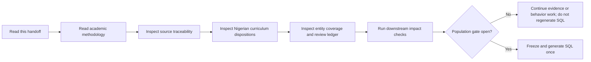
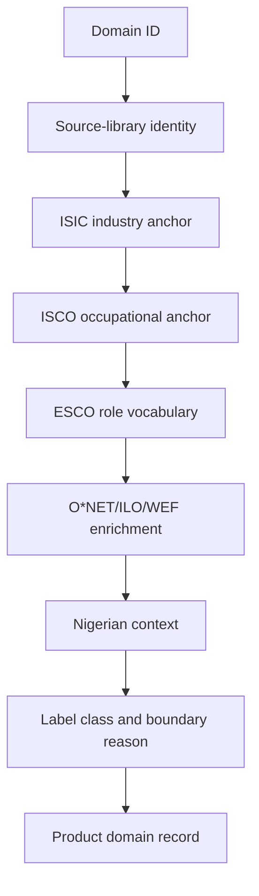
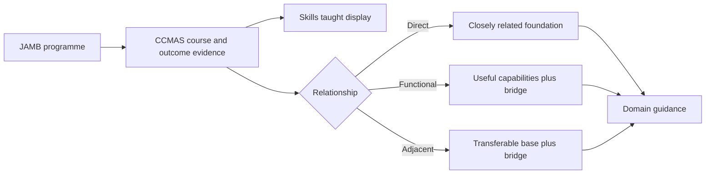
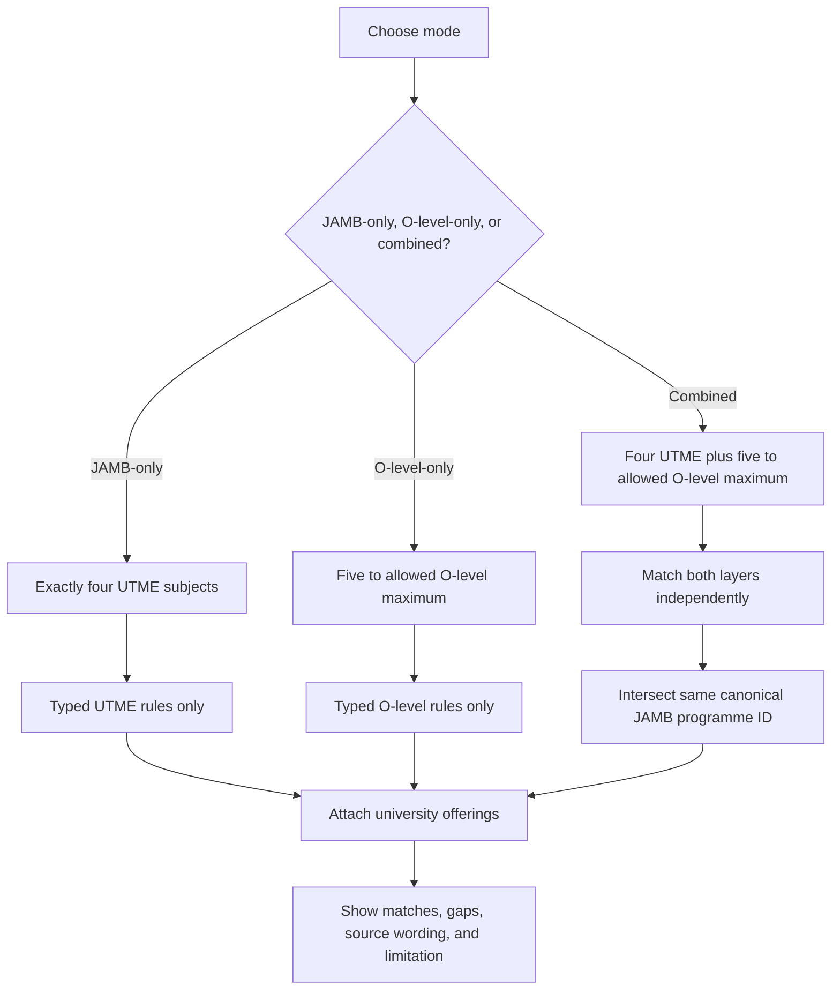
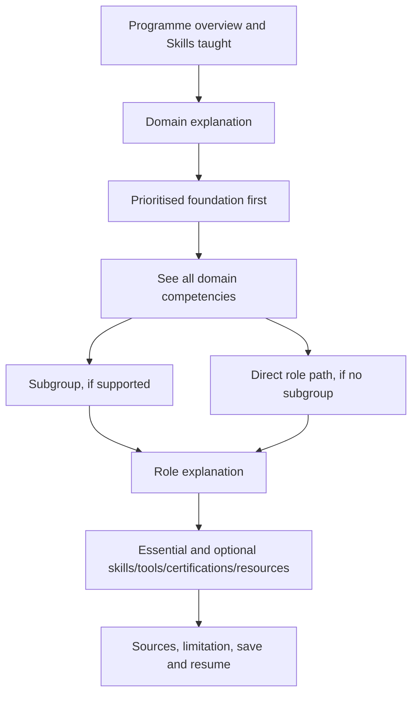
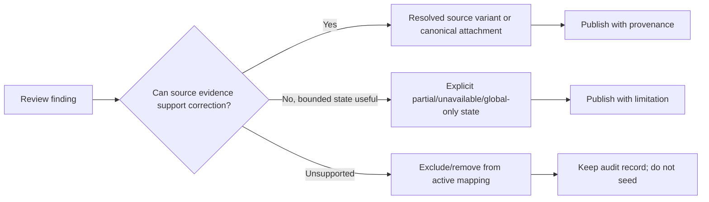

# Sifter Career Taxonomy — Personal Handoff

**Document ID:** `HANDOFF-2026-09-01`  
**Audience:** the next Codex account, maintainer, or reviewer  
**Purpose:** transfer the current evidence state without confusing historical
diagnostics, active product data, and deferred SQL deployment

## 0. Handoff path



| Handoff key | Follow this link |
|---|---|
| `HANDOFF-METHOD` | [Academic methodology](CAREER_TAXONOMY_ACADEMIC_METHODOLOGY.md) |
| `HANDOFF-SOURCES` | [Complete source and behavior inventory](CAREER_TAXONOMY_SOURCE_INVENTORY_2026-09-01.md) |
| `HANDOFF-DOMAIN` | [Domain source traceability](../data/career-mapping/_audit/DOMAIN_SOURCE_TRACEABILITY_AUDIT_2026-08-31.md) |
| `HANDOFF-NAMING` | [Domain naming provenance](../data/career-mapping/_audit/DOMAIN_NAMING_PROVENANCE_AUDIT_2026-08-31.md) |
| `HANDOFF-CCMAS` | [Reviewed Nigerian CCMAS/JAMB links](../data/career-mapping/_audit/CCMAS_NIGERIAN_REVIEWED_LINKS_2026-09-01.md) |
| `HANDOFF-ENTITIES` | [Nigerian context coverage](../data/career-mapping/_audit/NIGERIAN_CONTEXT_COVERAGE_REPORT.md) |
| `HANDOFF-REVIEW` | [Review-state dispositions](../data/career-mapping/_audit/REVIEW_STATE_DISPOSITIONS_2026-09-01.md) |
| `HANDOFF-GATE` | [Population gate](../data/career-mapping/NIGERIAN_ENTITY_POPULATION_GATE.md) |

## 1. Current state at a glance

| State key | Current result | What it means |
|---|---:|---|
| `STATE-DOMAIN` | 168 total; 160 visible | 7 exact source terms, 159 source-supported umbrellas, 2 curated later additions |
| `STATE-SUBGROUP` | 555 provenance rows; 542 visible | All visible subgroups have actual Nigerian local enrichment |
| `STATE-ROLE` | 5,209 merged role records | Every merged role has some recorded source evidence |
| `STATE-ROLE-ANCHOR` | 5,130 explicit anchors; 5,090 work-profile links | Different anchor types are intentionally not collapsed into one claim |
| `STATE-NG-ROLE` | 5,093 visible role-context entries; 5,089 locally enriched | Four visible roles are explicit global-only exceptions |
| `STATE-CCMAS` | 711 candidate occurrences dispositioned | 547 certified, 163 guided bridges, 1 removed |
| `STATE-REVIEW` | 1,538 dispositions; 0 follow-up | The inventory is reviewed; bounded states remain explicit |
| `STATE-SQL` | Open for regeneration | The current 5,795-row audit and review ledger reconcile cleanly; generated SQL still requires transport and deployment verification |

## 2. The three things that must stay separate

<a id="handoff-three-layers"></a>

| Layer key | Definition | Example | Evidence location |
|---|---|---|---|
| `LAYER-REFERENCE` | A pointer to a source | URL, file, page, section, or row locator | Source registry and source traceability |
| `LAYER-CONTENT` | What the source actually says | Course outcome, task, occupation title, rule, or extracted competency | CCMAS and entity audit JSON |
| `LAYER-DECISION` | Why Sifter uses the content for a relationship | Direct, functional, adjacent, subgroup, role, or explicit limitation | Mapping and disposition artifacts |

Never describe a URL alone as proof of a mapping. Never use global content as
Nigerian demand evidence. Never turn an unresolved or unavailable state into an
invented local title, licence, credential, or market claim.

## 3. Domain handoff



| Domain row key | Must be present | Current evidence |
|---|---|---|
| `DOMAIN-ID` | Stable D-number; do not rename by display text alone | D001–D168 |
| `DOMAIN-SOURCE` | Source-library label, cluster, raw ISIC/ISCO values, ESCO role count | [Traceability JSON](../data/career-mapping/_audit/domain_source_traceability_2026-08-31.json) |
| `DOMAIN-CLASS` | Exact, source-supported umbrella, or curated addition | [Naming provenance](../data/career-mapping/_audit/DOMAIN_NAMING_PROVENANCE_AUDIT_2026-08-31.md) |
| `DOMAIN-LIMIT` | Revision/code mismatch or evidence limitation | [ISIC crosswalk](../data/career-mapping/_audit/ISIC_DOMAIN_CROSSWALK_2026-08-31.md), [ISCO crosswalk](../data/career-mapping/_audit/ISCO_DOMAIN_CROSSWALK_2026-08-31.md) |

Historical note: the earlier report described the eight raw ISCO values using
official parent/sibling candidates. That report has been superseded; the
source-closed decisions documented below.

## Source-closed correction of eight occupational values

The eight previously questionable occupational values have now been closed by
an official International Labour Organization source review. Two were mapped
from the older ISCO-88 classification to valid ISCO-08 groups, one was removed
from a domain where it did not belong, and five invalid values were removed
from canonical anchors. No value remains pending. See the [source closure
report](../data/career-mapping/_audit/ISCO_DOMAIN_CODE_SOURCE_CLOSURE_2026-09-04.md)
for the decisions and evidence links.

## 4. Nigerian curriculum handoff



| Mapping key | Rule | Display wording |
|---|---|---|
| `MAP-DIRECT` | At least two specific Nigerian CCMAS course/objective anchors closely support the domain foundation | “Your programme teaches a foundation closely related to this domain.” |
| `MAP-FUNCTIONAL` | At least two specific Nigerian CCMAS course/objective anchors support capabilities used in the domain | “Your programme gives you useful preparation, but you will need additional domain-specific capability.” |
| `MAP-ADJACENT` | At least one domain-specific prerequisite plus relevant transferable evidence | “This is a possible pivot. Your current foundation helps, but you need this bridge before specialising.” |

The former 153 insufficient occurrences are part of the historical before-state.
The final active disposition is 547 certified, 163 explicit bridge links, and
one unsupported candidate removed. The active reviewed overlay has 710
published links and no `review_required` rows.

### Subject matcher handoff

The complete source and behavior inventory is in
[CAREER_TAXONOMY_SOURCE_INVENTORY_2026-09-01.md](CAREER_TAXONOMY_SOURCE_INVENTORY_2026-09-01.md).
The executable matcher has three separate modes:



- **JAMB-only:** Use of English plus three other UTME subjects; match only
  `utme` rules and their required/one-of groups.
- **O-level-only:** At least five O-level subjects; match only `olevel` rules
  and enforce the source's named credits and minimum where structured.
- **Combined:** Match UTME and O-level independently, intersect by the same
  canonical JAMB programme ID, and report O-level gaps instead of flattening
  both exams into one score.

The matcher fails closed if the subject catalogue, structured options, typed
rule records, programme ID, requirement ID, exam type, or source text do not
agree. It does not turn an unparsed brochure sentence into an exact match.
University rows are attached after the canonical programme match and add
address, requirements, and notes; they do not create a new programme version.

Worked example: with UTME `ENG, CHEM, BIO, PHY`, a rule requiring `CHEM` and
`BIO` plus one of `MATH/PHY` matches. With O-level `ENG, BIO, MATH, CHEM, GEO`
plus another subject, a rule requiring the four named credits plus one of
`GEO/HSC/PHY/STAT` matches. In combined mode, the programme is retained only
when its same JAMB ID appears in both sets; missing O-level credits remain
visible as a gap. See the [academic worked examples](CAREER_TAXONOMY_ACADEMIC_METHODOLOGY.md#5-2-domain-identity-and-occupational-boundary-d023-medicine)
and [matcher audit](manual-review/subject-selection-matrix-run-2026-08-18.md).

## 5. Entity and product handoff



| Product key | Required behavior | Data source/verification |
|---|---|---|
| `PRODUCT-OVERVIEW` | Keep the programme preview concise; use **Skills taught** for the programme learning summary | CCMAS/JAMB evidence |
| `PRODUCT-DOMAIN` | Explain what the domain does, show the portable foundation first, then retain all available competencies behind “See all” | Domain record plus global/Nigerian context |
| `PRODUCT-SUBGROUP` | Explain what the specialization adds beyond the domain foundation; show priority items then all items | Subgroup record and source lineage |
| `PRODUCT-ROLE` | Explain work, outputs, progression, entry/mid/senior positioning, essential versus optional preparation, and evidence limits | Role profile plus Nigerian context |
| `PRODUCT-FALLBACK` | Use domain → role when no defensible subgroup exists | Structure and role attribution audit |
| `PRODUCT-LINKS` | Make source/resource links inspectable; show an offline connect state rather than pretending the external page is cached | Source IDs and URLs |

### Nigerian entity counts

| Entity | Visible total | Local enrichment | Explicit exception |
|---|---:|---:|---|
| Domain | 160 | 160 | None |
| Subgroup | 542 | 542 | None |
| Role context | 5,093 | 5,089 | 4 global-only: snowboard instructor, ski instructor, snow-clearing worker, hop farmer |

Local enrichment means at least one source-backed local skill, tool, competency,
credential, regulation, or role-family record. It does not mean Nigerian demand,
exact local title equivalence, or automatic licensure.

## 6. Review handoff



| Review key | Count | Status |
|---|---:|---|
| `REVIEW-TOTAL` | 1,538 | Dispositioned |
| `REVIEW-FOLLOWUP` | 0 | No ledger follow-up rows |
| `REVIEW-PARTIAL` | 220 | Intentional partial source definitions |
| `REVIEW-VARIANTS` | 445 | Source variants preserved for university-specific display |
| `REVIEW-NOCANDIDATE` | 135 | No source candidate explicitly preserved |
| `REVIEW-WEF` | 28 | 26 unmatched/aggregate signals and 2 ambiguous signals; no invented roles |
| `REVIEW-GLOBALONLY` | 4 | Global role retained without direct Nigerian counterpart claim |

Full row-level detail is in [REVIEW_STATE_DISPOSITIONS_2026-09-01.md](../data/career-mapping/_audit/REVIEW_STATE_DISPOSITIONS_2026-09-01.md).

## 7. Verification and SQL gate

### Verification sequence

```text
1. Source/domain traceability
2. CCMAS/JAMB evidence and reviewed overlay
3. Nigerian entity extraction and review ledger
4. Review-state inventory and dispositions
5. Subgroup/role source traceability and role attribution
6. Domain identity downstream impact
7. Nigerian population gate
8. Freeze the source/content contract
9. Generate SQL once, audit it, then apply in a controlled environment
```

The current integrity checks pass for 5,795 audit entities and 5,795 ledger
entities, with zero follow-up rows and zero provenance/state reconciliation
errors. The exhaustive-search declaration has now been reconciled to that
current evidence, so the SQL gate is open for regeneration. Existing
compressed seed files remain pre-freeze snapshots until the newly generated
transport is audited.

### Reproducibility commands

```text
python data/career-mapping/_audit_domain_source_traceability.py
python data/career-mapping/_audit_review_state_inventory.py
python data/career-mapping/_audit_review_state_dispositions.py
python data/career-mapping/_audit_subgroup_role_source_traceability.py
python data/career-mapping/_audit_role_attribution_reconciliation.py
python data/career-mapping/_audit_domain_identity_downstream_impact.py
python data/career-mapping/_validate_nigerian_entity_population_gate.py
```

## 8. Safe continuation rules

- Preserve stable domain IDs; display labels are not primary keys.
- Preserve raw source codes and source revisions; use explicit crosswalks.
- Do not turn source references into source content without extraction.
- Do not use global/remote evidence as Nigerian demand evidence.
- Do not create a subgroup merely to make the UI symmetrical.
- Keep bridge, unavailable, partial, global-only, and no-counterpart states
  visible with plain-language limitations.
- Do not apply SQL until the generated transport, checksums, schema order, and
  production preflight are verified. The population gate is now open for
  regeneration.
