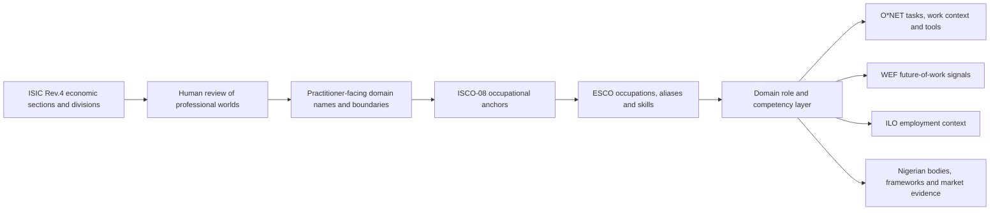
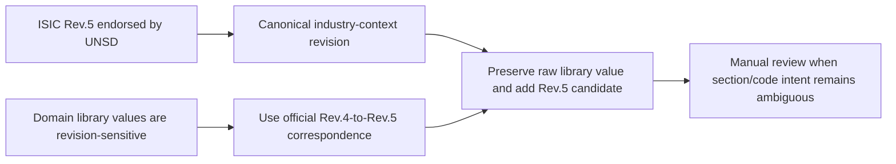

# Sifter Career Taxonomy: Source Lineage and Derivation Documentation

**Status:** source-lineage audit and reconstruction, 31 August 2026  
**Audience:** co-founders, academic reviewers, curriculum partners, data reviewers, and implementation stakeholders  
**Scope:** domains first; subgroup and role lineage is documented as the next layer and must not be inferred merely from a domain count.

## 1. Executive finding

The original `D001–D166` domain sequence can be traced to the supplied **Sifter Professional Domain Definition Library**. That library does not copy one taxonomy directly. It combines:



This establishes **structural lineage**: the current domain IDs and order correspond to the 166-domain library. It does not yet establish perfect field-level provenance because the current `domain_meta.json` projection dropped the source codes, source pages, and individual domain decisions.

The current repository contains 168 domain records. `D167` and `D168` are later additions for XR/immersive technology and esports/creator economy; they were not part of the original 166-domain library.

## 2. The source documents inspected

### 2.1 Local project documents and extracts

The audit was performed from the repository and local Downloads archive before relying on web search.

| Layer | Local evidence | What it contributes |
|---|---|---|
| Domain definition | `C:\Users\USER\Downloads\sifter_domain_definition_library_v2 (1).docx` | 166 sequential domains, 34/36 cluster presentation, ISIC section/division fields, ISCO anchors, ESCO role counts, WEF/ILO/enrichment fields, and human-readable definitions |
| Domain method | `C:\Users\USER\Downloads\CCMAS_Domain_Mapping_Plan_v3.0.md` | Direct/Functional/Adjacent definitions for programme-to-domain mapping; P3/P5/P7/P8/P14 evidence chain |
| ISIC | `C:\Users\USER\Downloads\drive-download-20260702T164001Z-3-001\ISIC5_Exp_Notes_11Mar2024.xlsx` | Actual local Rev.5 experimental workbook used for revision comparison |
| ISCO | `C:\Users\USER\Downloads\drive-download-20260702T164001Z-3-001\ISCO-08 EN Structure and definitions.xlsx` | Actual local ISCO-08 hierarchy, definitions, tasks and unit groups |
| ESCO | `C:\Users\USER\Downloads\drive-download-20260702T164001Z-3-001\ESCO dataset - v1.2.1 - classification - en - csv.zip` | Occupations, ISCO links, aliases, descriptions, skills and occupation-skill relations |
| WEF | `C:\Users\USER\Downloads\drive-download-20260702T164001Z-3-001\WEF_Future_of_Jobs_Report_2025_copy.pdf` and `data/career-mapping/taxonomies/wef_2025_roles.json` | Growth/decline and skills-on-the-rise signals; not a complete occupation dictionary |
| CCMAS | `C:\Users\USER\Downloads\ccmas original documents\*.pdf` and `data/career-mapping/ccmas/*.json` | Nigerian programme curriculum, stated outcomes, course content and source page references |
| Current domain authority | `data/career-mapping/domain_meta.json` | Current IDs, names, clusters, institution types, flags and descriptions |
| Current structure | `data/career-mapping/domain_structure.json` | Subgroups, roles, foundation skills and certification hints |
| Current source registry | `data/career-mapping/domain_role_source_registry.json` | Source routing and evidence-type rules; registry presence is not proof that every source was ingested |

Official reference points include [UN ISIC Rev.5](https://unstats.un.org/unsd/classifications/Econ/ISIC.cshtml), [UN ISIC Rev.5 explanatory notes](https://unstats.un.org/UNSDWebsite/statcom/session_55/documents/BG-4e-ISIC5_Exp_Notes-E.pdf), [ILO ISCO-08](https://isco.ilo.org/en/isco-08/), [ESCO](https://esco.ec.europa.eu/en/use-esco), [O*NET database](https://www.onetcenter.org/database.html), and the [WEF Future of Jobs Report 2025](https://www.weforum.org/publications/the-future-of-jobs-report-2025/). ISIC Rev.4 remains a historical correspondence source only.

The source-by-source claim boundary and review status are recorded in
`data/career-mapping/_audit/SOURCE_LAYER_REVIEW_2026-08-31.md`. It distinguishes
source presence, source review, and proof of a specific product claim.

The current-label evidence candidates are recorded in
`data/career-mapping/_audit/DOMAIN_NAMING_PROVENANCE_AUDIT_2026-08-31.md`.
That audit currently finds 158 source-supported umbrella candidates, 8
specialist/context-supported candidates, and 2 later curated additions. These
are deliberately not promoted as final naming decisions until the boundary
review is recorded.

Programme-fit evidence is kept separate from domain identity evidence. The
current Nigerian curriculum supplement is
`data/career-mapping/_audit/ccmas_external_domain_complements_2026-09-01.json`.
It joins exact Nigerian CCMAS course codes, titles, learning outcomes, and
content summaries to the 86 JAMB rows whose candidate domain links remain under
review. It reports 547 link occurrences meeting the current link gate, 153
with Nigerian curriculum material but insufficient evidence, and 11 without a
matched CCMAS course anchor. Domain references from ISIC/ISCO/ESCO/O*NET/WEF
are not used as substitutes for those Nigerian curriculum gaps.

## 3. How the domains were derived

### Step 1 — ISIC supplied the completeness survey

ISIC is an economic-activity classification, not a career taxonomy. The intended workflow used its sections and divisions to ask: *which professional worlds operate in this economic area, and have we overlooked an economic area entirely?*

The domain-definition document then applied human judgment. For example, one economic section can contain software engineering, cybersecurity, data, cloud, product, and digital-media professional worlds. They are separate domains when their learning foundations, entry routes, work outputs, and day-to-day practice are materially different.

The domain name is therefore deliberately practitioner-facing rather than a verbatim statistical label. The human review is part of the method, not an undocumented accident. It makes the result usable for students while retaining ISIC as the industry-context anchor.

### Step 2 — ISCO supplied occupational structure

After a professional domain was identified, ISCO-08 unit groups and sub-major groups supplied the occupational-function anchors. ISCO answers *what kind of work is performed and how occupations are hierarchically grouped*. It does not decide the Sifter domain name by itself.

### Step 3 — ESCO supplied normalized occupations and skills

ESCO occupations were selected under the relevant ISCO anchors. Preferred labels, alternative labels, descriptions, stable URIs, and occupation-skill relations supplied the normalized role and skill layer. A role may be relevant to more than one domain only where its principal work output and evidence justify that relationship.

### Step 4 — O*NET and WEF enriched the occupational view

O*NET contributes task statements, work activities, software/technology signals, job zones, work context, and related occupations. In this product it is a global/US proxy and must never be represented as Nigerian demand.

WEF contributes future-of-work signals: growing/declining role families and skills on the rise. It is a trend signal, not a full role taxonomy and not proof of a Nigerian vacancy.

### Step 5 — ILO and Nigerian sources supplied context

ILO provides international occupational and employment context. Nigerian professional bodies, regulators, government agencies, curriculum documents, verified vacancy samples, and Nigerian frameworks provide local context, terminology, regulatory signals, and—only where directly evidenced—local market signals.

The evidence types must remain distinct:

| Evidence label | Safe claim |
|---|---|
| Global taxonomy | “This is a recognized occupation/skill or occupational grouping.” |
| Global proxy | “This source describes tasks, tools or preparation used in a comparable labour market.” |
| Nigerian context | “This field or activity is recognized/operates in Nigeria.” |
| Nigerian market signal | “The checked Nigerian source contains this role or demand signal.” |
| Nigerian regulator/licence | “This source explicitly establishes registration, licensing, examination or statutory scope.” |
| Registry reference | “This source is a routing target for review.” It is not evidence by itself. |

## 4. What the reverse trace proves

The reproducible audit is:

```text
python data/career-mapping/_audit_domain_source_traceability.py
```

It writes:

- `data/career-mapping/_audit/domain_source_traceability_2026-08-31.json`
- `data/career-mapping/_audit/DOMAIN_SOURCE_TRACEABILITY_AUDIT_2026-08-31.md`

The current audit found:

The machine-readable audit now carries `source_record_refs` for every domain. For
the original library this includes the exact domain-definition record locator,
the recorded ISIC and ISCO values, the ESCO archive/filter scope, and the
official reference URL for each taxonomy layer. D167 and D168 retain their
later-addition source IDs and are explicitly not presented as members of the
original 166-domain source library.

| Check | Result |
|---|---:|
| Current `domain_meta.json` records | 168 |
| Original source-library records | 166 |
| Original IDs match `D001–D166` in sequence | Yes |
| Later additions outside original library | `D167`, `D168` |
| Original-library cluster matches | 165/166; the excluded gambling domain is the exception in the current projection |
| Current names exact | 7 |
| Current names related/shortened | 159 |
| Source-library records with ISIC detail | 166 |
| Source-library records with ISCO detail | 166 |

The 159 related/shortened names are not evidence of unrelated domains. They reflect the current repository shortening names such as “Data Engineering & Architecture” to “Data Engineering” while retaining the same ID and cluster lineage. The audit records the exact per-domain comparison.

## 5. Revision and code reconciliation finding

The pasted workflow says **ISIC Rev.4**. The domain-definition DOCX labels its fields **ISIC Rev.5**, but values such as `K620` and `K630` use section-prefixed three-digit values that can be revision-sensitive. The official UNSD page confirms that Rev.5 is the endorsed current revision, while the Rev.4→Rev.5 correspondence table is the correct historical reconciliation source. Rev.4 is therefore not a competing canonical authority here.

Therefore the canonical interpretation is:



The explicit crosswalk is generated by `data/career-mapping/_build_isic_domain_crosswalk.py` and stored in `data/career-mapping/_audit/isic_domain_crosswalk_2026-08-31.json` with its stakeholder summary beside it. It uses the official UNSD table at `ISIC_Rev4_to_ISIC_Rev5_Correspondence_Table-17Jan2025.xlsx`. It covers 200 unique raw values: 148 through an exact Rev.4 group-prefix correspondence, 50 through a broader Rev.4 division-prefix correspondence, and two valid section-only anchors. This is a correspondence record, not a replacement operation. The current taxonomy must not silently receive new codes.

The local ISCO workbook check also found eight values in the definition library that are not present verbatim in the supplied ISCO workbook: `2121`, `2213`, `2214`, `2215`, `2216`, `2311`, `2321`, and `3330`. These must be corrected by preserving the original value, identifying the intended valid unit group, and recording the source decision. They do not automatically invalidate the domain name.

The parent and sibling candidates are recorded in
`data/career-mapping/_audit/ISCO_DOMAIN_CROSSWALK_2026-08-31.md`. The eight
values affect four domains: Artificial Intelligence, Medicine, Higher
Education, and Vocational. They remain source-review flags until the original
meaning is matched to an exact ISCO-08 unit group.

## 6. Why D167 and D168 were added

The original library contained 166 domains. The repository later added:

| ID | Addition | Why it is justified | Evidence boundary |
|---|---|---|---|
| `D167` | XR & Immersive Technology | The earlier taxonomy audit identified XR/VR/AR/spatial/immersive work as a real professional cluster not adequately represented in the original 166. Specialist role and competency frameworks were then registered, including JFF XR and related immersive sources. | Global specialist evidence establishes a role family; it does not by itself establish Nigerian vacancy volume or licensing. |
| `D168` | Esports & Creator Economy | The earlier audit identified competitive gaming, broadcasting, streaming, creator, event and community work as a distinct cluster not adequately represented in the original 166. British Esports, Pearson and creative-industry sources were used as specialist vocabulary. | This is a later product taxonomy addition, not an ISIC-derived original domain; local availability must remain separately evidenced. |

The additions are defensible as **documented gap closures**, not as claims that the original ISIC exercise contained them. Their industry context and occupational anchors should be retained in the final provenance layer.

## 7. Why eight domains are hidden from the university pipeline

The current career-resource scope excludes `D086`, `D087`, `D088`, `D089`, `D100`, `D101`, `D108`, and `D113`. This is an application-scope decision, not proof that those domains do not exist.

- `D086` is explicitly excluded in `domain_meta.json` because the current student product does not want to promote gambling/betting/lottery work.
- The other seven are present in the taxonomy and have roles/subgroups, but currently have no verified CCMAS/JAMB university-programme bridge in the generated programme-domain data. Several are more naturally reached through polytechnic, technical-college, vocational, or specialist routes.
- They should remain available for future institution types or a separate vocational pathway if the product chooses to expose them.

The user-facing rule is therefore: **hidden from the current university-guidance denominator, not deleted from the master taxonomy**. This distinction must remain visible to reviewers and in SQL comments.

## 8. Current elite flags are not yet source-proof

The current repository flags 21 domains as `elite_domain`. The source-definition document has its own explicit elite-pathway markings, and the two sets are not automatically equivalent. Elite status must be treated as a derived editorial decision requiring a stored rubric and evidence list, not as a fact inherited from a source.

The future evidence-backed elite decision should require, at minimum:

1. visible or explicitly justified domain scope;
2. global occupational backbone (ESCO/ISCO and/or O*NET);
3. specialist framework or sector evidence;
4. a strategic or emerging signal where relevant (WEF or equivalent);
5. Nigerian context evidence, kept separate from global evidence;
6. sufficient role/skill coverage for a meaningful student pathway; and
7. no invented prestige, salary, demand, licence, or employment claims.

The output should say **verified elite**, **candidate**, or **not established**, with the evidence IDs that caused the decision.

## 9. What is still required for full academic defensibility

The current audit establishes the domain lineage and preserves the available
per-domain source references, but it does not yet complete the whole provenance
package. The next required layer is:

- promote the reviewed per-domain source records into the canonical product
  provenance field without changing an ID unless a reviewed boundary decision
  requires it;
- retain the official Rev.4-to-Rev.5 correspondence artifact and manually resolve the values it flags as ambiguous;
- resolve the eight ISCO values without silently guessing;
- trace every subgroup to its ISCO/ESCO or specialist-framework record;
- trace every role to its exact ESCO URI, O*NET code/profile, ISCO anchor, specialist source, or reviewed manual source;
- distinguish source-backed, source-context-only, no-direct-local-counterpart, and unresolved records;
- document all human domain naming/splitting decisions;
- preserve the evidence in machine-readable JSON and the stakeholder document;
- preserve the reviewed domain naming/boundary decision alongside the source-backed occupational anchors; only then regenerate SQL after the source gate passes.

The defensible academic claim is therefore:

> Sifter is a human-reviewed, source-traceable synthesis that uses ISIC to survey industry coverage, ISCO to structure occupational work, ESCO to normalize occupations and skills, and O*NET/WEF/ILO/Nigerian/specialist sources for enrichment. It is not a direct copy of any one classification system.

That claim becomes fully auditable only when the remaining field-level provenance and code reconciliation are completed.
