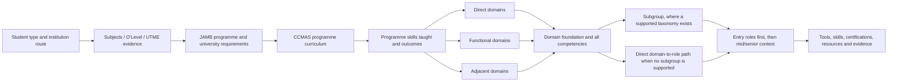
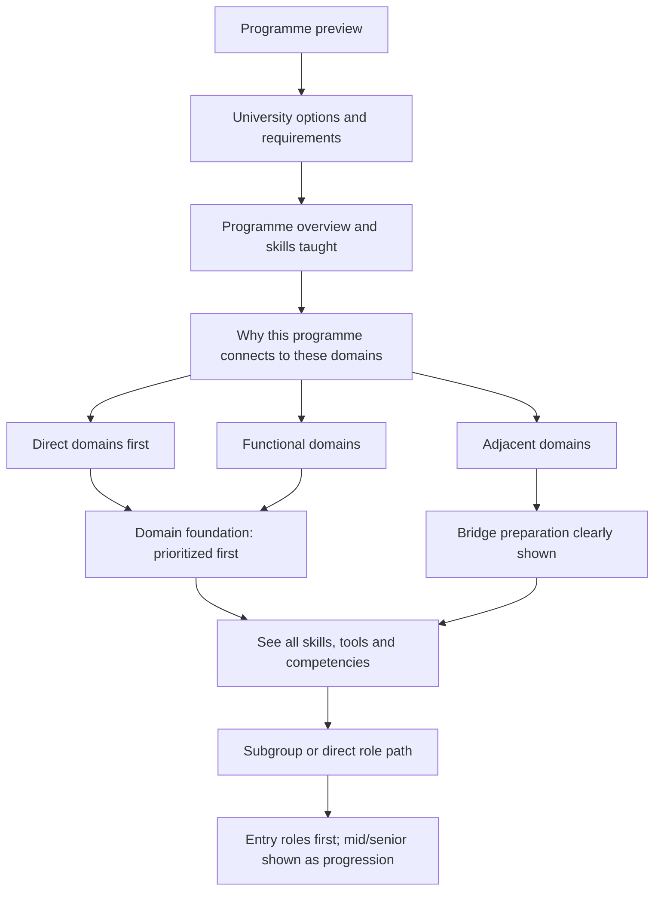

# Programme, Subject and Guidance Mapping Lineage

**Status:** mapping-lineage documentation, 31 August 2026  
**Purpose:** show how a learner’s entry evidence can connect to programmes, domains, subgroups and roles without presenting a similarity score as a guaranteed career outcome.

## 1. The complete evidence path



## 2. Source order

The source order is deliberately different from the student-facing order:

1. JAMB brochure and subject rules establish programme eligibility and requirements.
2. CCMAS documents establish the Nigerian programme curriculum, purpose, courses, outcomes and capabilities.
3. The domain-source lineage layer establishes what professional worlds are connected to the curriculum.
4. ISCO/ESCO/O*NET and specialist frameworks establish work, roles, tasks, skills and tools.
5. Nigerian sources add local context, regulation, professional bodies, credentials, and—only where directly shown—local role/demand evidence.

The student sees a guided explanation, not the raw join. The data must nevertheless retain every join and its evidence.

## 3. Programme-to-domain definitions

The current mapping rule combines the CCMAS evidence layers. The older local
`CCMAS_Domain_Mapping_Plan_v3.0.md` is retained as historical context; its
older three-anchor threshold is not the active gate.

### Direct

The programme’s P3/P5 purpose, curriculum and graduate outcomes are closely
aligned with the domain’s foundation and occupational anchors. The mapping is
not based only on a similar word in the programme title. The active gate is at
least two specific, source-backed CCMAS course or objective anchors.

### Functional

The programme’s P5/P14 curriculum teaches capabilities materially used in the
domain, but does not fully establish the domain’s occupational foundation. The
active gate is at least two specific, source-backed CCMAS course or objective
anchors; P7 alone is insufficient.

### Adjacent

The programme provides relevant transferable competencies from P7/P8 plus at
least one domain-specific conceptual prerequisite in P5/P14, but does not
directly teach the target domain’s full occupational foundation. The UI must
explain the bridge required. A generic phrase is not sufficient evidence.

“Strong” has one meaning across the three classes: named, source-backed CCMAS
anchors support the relationship. Direct and Functional links require at least
two specific course or objective anchors. Adjacent links require at least one
specific conceptual prerequisite plus the relevant transferable-competency
evidence. These are evidence gates, not employment predictions.

The plain-language display should say:

- **Direct:** “Your programme teaches a foundation closely related to this domain.”
- **Functional:** “Your programme gives you useful preparation for this domain, but you will need to build additional domain-specific capability.”
- **Adjacent:** “This is a possible pivot. Your current foundation helps, but you need this bridge before specializing.”

## 4. Programme mapping data currently present

Current repository artifacts include:

- `data/career-mapping/programme_domain_final.json` — 237 CCMAS programme keys and 1,683 retained links;
- `data/career-mapping/programme_domain_scores.json` — technical/transferable coverage and scoring evidence;
- `data/career-mapping/programme_role_scores.json` — programme/domain/role readiness and bridge skills;
- `data/career-mapping/_audit/programme_domain_evidence_2026-08-17.json` — course/source review flags;
- `data/career-mapping/_audit/ccmas_jamb_inheritance_audit_2026-08-17.json` — JAMB-to-CCMAS inheritance audit;
- `data/career-mapping/_audit/jamb_ccmas_inheritance_canonical_2026-08-17.json` — canonical JAMB inheritance layer;
- `data/career-mapping/jamb_domain_map.json` — JAMB-name-to-domain output;
- `data/career-mapping/_audit/jamb_domain_map_ccmas_derived_2026-08-17.json` — CCMAS-derived JAMB domain evidence.

The current `programme_domain_final.json` count is a data snapshot, not by itself proof that every link has complete P3/P5/P7/P8/P14 evidence. The final source gate must retain the exact CCMAS source file, page/section, anchor text, mapping class, and reviewer decision for each link.

### Nigerian curriculum evidence rule

The programme-to-domain side is anchored in Nigerian curriculum evidence. For
resolved CCMAS programmes, the evidence package in
`data/career-mapping/_audit/ccmas_external_domain_complements_2026-09-01.json`
joins each detected domain anchor back to the local CCMAS extract and preserves
the exact course code, course title, learning outcomes, and content summary.
This is the evidence for what the programme teaches. A global ISIC, ISCO,
ESCO, O*NET, ILO, WEF, or specialist source can explain the domain or
occupational context, but it cannot repair a weak Nigerian programme-to-domain
link by itself.

The complement audit is the before-state diagnostic and distinguishes three
states:

- `nigerian_ccmas_sufficient_for_link_gate`: the Nigerian CCMAS course evidence
  meets the current link-level gate;
- `nigerian_ccmas_present_but_insufficient_for_gate`: Nigerian curriculum is
  present, but the evidence is not yet enough to certify the candidate link;
- `nigerian_ccmas_anchor_missing`: the candidate has no matched CCMAS course
  anchor and must remain unresolved until Nigerian CCMAS, professional-body, or
  Nigerian-university curriculum evidence is found.

The before-state result was **547 sufficient**, **153 present but insufficient**,
and **11 missing** across 711 candidate-link occurrences. The completed
Nigerian review disposition resolves that queue as **547 certified links**,
**163 explicit bridge links**, and **1 removed unsupported candidate**. No
source-gap disposition remains. The full decisions and course/source evidence
are stored in
`data/career-mapping/_audit/ccmas_nigerian_reviewed_links_2026-09-01.json`,
and the active JAMB map uses the reviewed overlay. Bridge links must remain
visibly distinct from automatic qualification.

The downstream identity impact check is recorded in
`data/career-mapping/_audit/DOMAIN_IDENTITY_DOWNSTREAM_IMPACT_2026-09-01.md`.
It verifies that the domain-label cleanup did not change IDs, ownership, or
skill/tool/certification inheritance.

The completed review-state disposition audit covers 1,538 inventoried findings
with zero records still marked for follow-up. This includes the former 153
insufficient CCMAS occurrences: the full 711-occurrence candidate set is now
547 certified, 163 explicit Nigerian bridge links, and one unsupported
candidate removed. Bridge and no-direct-counterpart states remain visible and
are not treated as automatic qualification or Nigerian demand.

The role/subgroup source audit is separate from curriculum fit. It reports
5,209 merged role records with source evidence and 555/555 subgroup provenance
records. In the visible Nigerian scope, four roles remain explicitly
global-only because a direct Nigerian counterpart was not supported; this does
not block their global occupational explanation.

Additional Nigerian university and NUC curriculum sources checked for the
remaining gaps are recorded in
`data/career-mapping/_audit/nigerian_curriculum_gap_sources_2026-09-01.json`.
They define target-field requirements and possible bridges. They do not replace
the student's own programme evidence, and each gap disposition says whether the
candidate should remain under review or be removed from the certified set.

## 5. Guidance behavior

The correct product behavior is progressive disclosure, not a flat checklist:



At every level the product should show the priority set first, then retain all available source-backed data behind **See all**. “Optional” means useful but not required for the selected path; it must not mean unsupported.

## 6. Role positioning

Roles must be ordered by preparation stage:

- **Entry:** roles a learner can reasonably investigate first after foundational preparation;
- **Mid:** roles requiring meaningful experience or deeper specialization;
- **Senior/lead:** roles involving advanced responsibility, autonomy, supervision or strategic ownership.

The current role-score artifact already contains `entry`, `mid`, and `senior` labels in sampled records, but the canonical role library and role seed still require a dedicated provenance audit to prove how every tier was assigned. A title alone is not enough; use ISCO skill level, O*NET job zone/preparation, work profile evidence, and reviewed role-family rules.

## 7. Subgroup behavior

If the role library has a supported subgroup, the route is:

```text
programme → domain → subgroup → role
```

If no defensible subgroup taxonomy exists, the route is intentionally:

```text
programme → domain → role
```

The UI must never create a fabricated subgroup merely to preserve a visual pattern. Each subgroup needs a source anchor, a coherent work focus, and role membership evidence. ISCO sub-major grouping can provide the structural fallback, but the subgroup label and description must be reviewed for clarity.

## 8. Evidence shown to the learner

For a domain, subgroup or role, the platform can display:

- what the work is and what outputs it produces;
- the portable foundation and the prioritized preparation set;
- all additional skills/tools/competencies under **See all**;
- Nigerian context and global context as separate labels;
- certifications or registration only when the source establishes them;
- links to the original source with a prompt to open the detailed explanation;
- uncertainty labels such as “global evidence,” “Nigerian context,” “no direct Nigerian counterpart found,” or “review required.”

It must not present a source-role description as proof that a learner is competent, or present global taxonomy presence as proof of Nigerian demand.

## 9. Required acceptance evidence before final SQL

For each mapping row, the review package should be able to answer:

```text
What source text caused this mapping?
Which source file/page/URL contains it?
Which mapping rule was applied?
What did the programme teach that supports it?
What additional bridge is required?
What is the source confidence and evidence state?
Where is the link shown to the learner?
What happens if the source is unavailable or the mapping is disputed?
```

Only after those answers exist for the relevant domain/subgroup/role and programme links should the SQL generator be released from its evidence gate.
