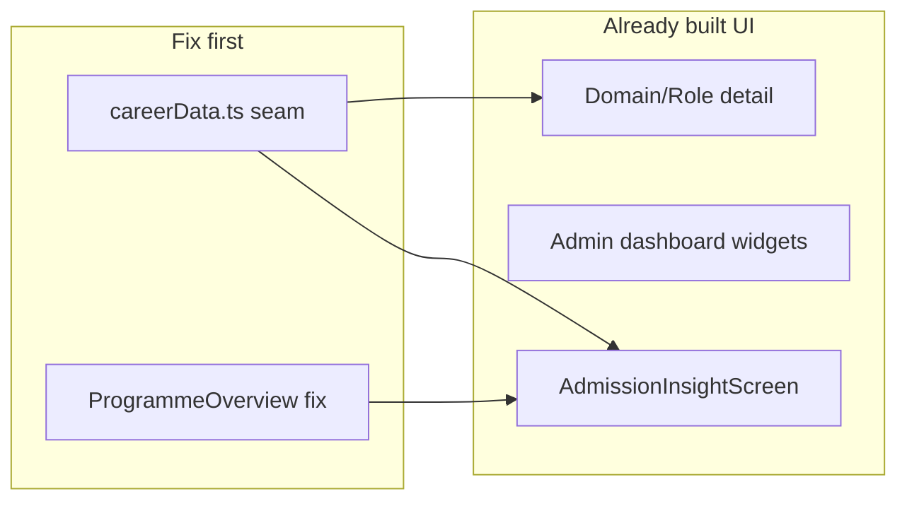

# Remaining Phases Build Plan

**Scope:** UI, routes, types, API wiring, admin surfaces, legal/UX shells for Phases 6–13.  
**Out of scope:** Data ingestion pipelines (Phase 7 cron, Phase 8 cut-off scraping, Phase 9 enrichment scripts, taxonomy regeneration).

**Last updated:** 2026-07-10

---

## Cross-Cutting Blocker (Fix First)

Most screens are composed but **cannot show live data** because the client seam is incomplete:

| Layer | Status |
|-------|--------|
| Backend routes | Largely **done** — `/api/career/*`, `/api/admission/*`, `/api/institutions/*` |
| Frontend screens | ~**70% built** |
| `src/lib/careerData.ts` | **Missing** methods screens already call: `getDomainV2`, `getRoleV2`, `searchCareer`, `getPivot`, `getPivotGap`, admission methods, live saved/notes |
| `ProgrammeOverviewScreen.tsx` | **Broken** — duplicate `admissionState`, duplicate `TrackCAdmission`, invalid `careerData.client` Supabase block |



---

## Phase 6 Audit — UI + Non-Student Entry + Auditor Review

| Item | Status | Key files | Gap |
|------|--------|-----------|-----|
| Domain detail (sub-groups, skills, tools, certs) | **DONE** | `DomainDetailScreen.tsx`, `RoleClusterSection.tsx` | Blocked by missing `getDomainV2` |
| RoleCard (aka, tier, readiness, elite) | **DONE** | `RoleCard.tsx` | `inDemandScore` unused; not wired on programme overview |
| SkillsBridge (3-tier) | **BUILT, NOT WIRED** | `SkillsBridge.tsx` | Not imported outside its own file |
| Programme overview | **PARTIAL / BROKEN** | `ProgrammeOverviewScreen.tsx` | Merge damage; no SkillsBridge; `demandIndicator` not on chips |
| Role detail | **PARTIAL** | `RoleDetailScreen.tsx` | No role-level certs/tools; blocked by `getRoleV2` |
| Disambiguation search | **DONE (UI)** | `ExploreScreen.tsx` | Blocked by missing `searchCareer` |
| CareerChanger pivot A/B1/B2 | **DONE (UI)** | `CareerChangerScreen.tsx` | B1/B2 need `getPivotGap` client |
| Two-gateway SS onboarding | **PARTIAL** | `SeniorSecondaryExploreSetupForm.tsx`, `JambSetupForm.tsx` | Programme/school selectors `comingSoon`; Explore doors 2/3 locked |
| Prior-field capture | **PARTIAL** | Onboarding forms + `POST /api/career/saved/prior-field` | Not persisted on onboarding complete |
| My World personal hub | **DONE** | `MyWorldScreen.tsx` | Saved/notes stubbed in `careerData` |
| Domain explorer filters | **PARTIAL** | `DomainExplorerScreen.tsx` | Text filter only |
| Expert review | **MISSING** | `ExpertDossierScreen.tsx` | No route; no per-edge flag UI |
| School data split | **PARTIAL** | Admin peers vs student admission | Peer viz empty; cut-offs not navigable |
| DataState envelope | **DONE** | `DataStateView.tsx` | — |

---

## Phase 7 Audit — Demand / Market Intelligence Display

| Item | Status | Key files | Gap |
|------|--------|-----------|-----|
| Admin dashboard (5 stats, table, rank, alerts) | **DONE** | `ProgrammeDashboardScreen.tsx` | No filters; no sparklines; no CSV |
| ProgrammeDemandTable | **DONE** | `ProgrammeDemandTable.tsx` | Backend sends `sparkline[]` — not rendered |
| DomainRankPanel + scope toggle | **DONE** | `DomainRankPanel.tsx` | `trendPct` unused |
| DomainIntelligence / RoleDemand / SkillsGap / Peers | **STUB** | Respective screens | Fetch data; `{() => null}` children |
| Trends / Salary / Remote / VsNational | **STUB** | Respective screens | Hardcoded `comingSoon`; not in AdminShell nav |
| DemandMetricsBlock | **PARTIAL** | `DemandMetricsBlock.tsx` | `ng_local` only; employers/certs not rendered |
| 3-lens demand on role cards | **MISSING** | `RoleCard.tsx` | — |
| Programme `demandIndicator` on chips | **MISSING** | `DomainChip.tsx` | Type + UI not connected |
| Elite badges | **PARTIAL** | Domain/role chips | Selective-entry callout missing |
| National benchmark | **MISSING** | `VsNationalScreen.tsx` | No backend route, type, or UI |
| Admin tooltips / loading polish | **MISSING** | — | No tooltip component |
| Export | **PARTIAL** | `PdfExportButton.tsx` | PDF only; no CSV |

---

## Phases 8–13 Audit (Non–Data-Fetching)

### Phase 8 — Admission UI

| Item | Status |
|------|--------|
| DB + read routes + types | **DONE** |
| `AdmissionInsightScreen.tsx` | **DONE (UI)** — orphaned, no expo route |
| `careerData` admission methods | **MISSING** |
| Programme admission tab | **BROKEN** |
| Explore door 2, onboarding pickers | **STUB** |
| JAMB domains `admissionInsight` badge | **MISSING** |

### Phase 9 — Enrichment Display

| Item | Status |
|------|--------|
| DB columns + base UI blocks | **DONE** |
| API serialization of enrichment fields | **MISSING** |
| URL/price/tier display in UI | **MISSING** |

### Phase 10 — UX / Comprehension

| Item | Status |
|------|--------|
| DomainMappingExplainer, DataSourceBadge, NotesWidget | **DONE** |
| Career tooltips, onboarding tour, global notes FAB | **MISSING** |

### Phase 11 — Offline (Career Scope)

| Item | Status |
|------|--------|
| Learning-track offline/resume | **DONE** |
| Career taxonomy cache, explore resume | **MISSING** |

### Phase 12 — Feedback

| Item | Status |
|------|--------|
| `mapping_feedback` POST | **DONE** |
| Mapping feedback UI, admin inbox, `user_feedback` | **MISSING** |
| ReviewModal | **ORPHANED** |

### Phase 13 — Legal

| Item | Status |
|------|--------|
| Terms, Privacy, DisclaimerFooter (learning) | **DONE** |
| Career disclaimers, T&C at signup, analytics consent | **MISSING** |

---

## Build Workstreams

### WS0 — Unblock Everything (P0, ~1–2 days)

1. Extend `src/lib/careerData.ts`:
   - `getDomainV2`, `getRoleV2`, `searchCareer`, `getPivot`, `getPivotGap`
   - Admission: `getAdmissionSnapshot`, `getJambFloor`, `getCutoffs`, `getSchoolFormula`, `getCompetitiveness`, `getAdmissionInsight`
   - Wire saved/notes/subscriptions to existing backend routes
   - `savePriorField` → `POST /api/career/saved/prior-field`
2. Fix `ProgrammeOverviewScreen.tsx` — remove duplicates and Supabase block
3. Extend `src/types/career.ts`: `DomainLink.demandIndicator`, `JambDomainResult.admissionInsight`, enrichment fields
4. **Gate:** `npx tsc --noEmit` clean; domain/role/search/pivot return `real`

---

### WS1 — Phase 6 Completion (~3–4 days)

1. Wire `SkillsBridge` on programme overview + role detail
2. Pass readiness/match/coverage into RoleCard from programme context
3. Persist `priorFieldDomainKey` on onboarding complete; seed CareerChanger `from`
4. Enable Explore door 3; wire SS forms to `searchProgrammes`
5. Domain explorer filter chips (in-demand, elite, cluster)
6. Expert review MVP: `MappingFeedbackButton` on DetailScaffold → `POST /feedback`; route + dossier screen; `GET /api/career/feedback`

---

### WS2 — Phase 7 Admin + Demand Display (~4–5 days)

**Shared components:**

| Component | Used by |
|-----------|---------|
| `MetricTooltip` | Stat cards, admin tables |
| `SparklineBar` | ProgrammeDemandTable |
| `ScopeToggle` | DomainIntelligence, Trends, VsNational |
| `AdminDataTable` | RoleDemand, SkillsGap, Salary, Remote |
| `PeerComparisonChart` | PeersScreen |
| `NationalBenchmarkPanel` | VsNationalScreen |

**Per-screen:**

- DomainIntelligence — reuse `DomainRankPanel`
- RoleDemand / SkillsGap — real tables
- Peers — side-by-side domain coverage viz
- Trends — domain demand over time
- Salary / Remote — filtered RoleDemand views
- VsNational — `NationalBenchmarkRow` + `GET /api/institutions/me/vs-national?scope=`
- Dashboard polish — filter bar, sparklines, CSV, nav entries

**Student demand display:**

- `DemandMetricsBlock` — 3-lens tabs + top employers/certs
- Compact demand chip on `RoleCard` and `DomainChip`
- Elite selective-entry callout

---

### WS3 — Phase 8 Admission UI (~2–3 days)

1. Route: `app/(tabs)/explore/admission/[jambName].tsx` + `exploreNav.admission()`
2. Programme admission tab CTA → full insight screen
3. Explore door 2 → `live: true`
4. JambSetupForm programme search; `GET /api/admission/schools?q=`
5. Backend camelCase fix; `admissionInsight` on JAMB domains

---

### WS4 — Phase 9 Enrichment Display (~1–2 days)

1. Extend `_cert()`, `_tool()`, role mapper in `career_routes.py`
2. CertPlacementList: `officialUrl`, price, `seniorityTier`
3. ToolGroupsBlock: `toolUrl`, demand score
4. FoundationSkillsBlock: ESCO `skillUrl` link
5. RoleDetailScreen: `currencyStatus` badge

---

### WS5 — Phases 10–13 Shells (~3–4 days)

| Phase | Build |
|-------|-------|
| **10** | `InfoTooltip`; first-run coachmarks; global notes FAB |
| **11** | AsyncStorage cache for domain/role; explore resume; queue save/note writes |
| **12** | `user_feedback` table + API; admin Feedback Inbox; ReviewModal; analytics gated on consent |
| **13** | Career disclaimer on explore/detail/admission/admin; T&C at signup; privacy consent toggle |

---

## Recommended Build Order

```
WS0 (seam fix)
  ├── WS1 (Phase 6) ──┐
  ├── WS2 (Phase 7) ──┼── WS5 (Phases 10–13)
  ├── WS3 (Phase 8) ──┤
  └── WS4 (Phase 9) ──┘
```

| Priority | Workstream | Est. |
|----------|------------|------|
| **P0** | WS0 Client seam + ProgrammeOverview fix | 1–2d |
| **P1** | WS2 Admin + VsNational + demand display | 4–5d |
| **P1** | WS1 Phase 6 gaps | 3–4d |
| **P2** | WS3 Phase 8 admission | 2–3d |
| **P2** | WS4 Phase 9 enrichment display | 1–2d |
| **P3** | WS5 Phases 10–13 | 3–4d |

**Total:** ~14–20 dev days for non–data-fetching scope.

---

## Acceptance Gates

- **WS0:** `tsc --noEmit` clean; domain/role/search/pivot return `real`
- **Phase 6:** SkillsBridge on programme overview; expert can flag one edge; prior-field persists
- **Phase 7:** All 9 admin screens render real content; VsNational side-by-side; sparklines; 3-lens demand on role detail
- **Phase 8:** Admission tab navigates to insight; Explore door 2 live
- **Phase 9:** Cert URL+price and tool URL render on domain detail
- **Phase 10–13:** Tooltips on 5 labels; T&C at signup; career disclaimer on explore; feedback form submits

---

## Explicitly Deferred (Separate Data-Fetching Plan)

- Phase 7 demand ingestion (MyJobMag RSS, Adzuna, monthly cron)
- Phase 8 cut-off CSV import / school scraping
- Phase 9 enrichment script re-runs
- Elite composite cron verification
- Domain/role library regeneration (Phase 0–2 taxonomy audit)
