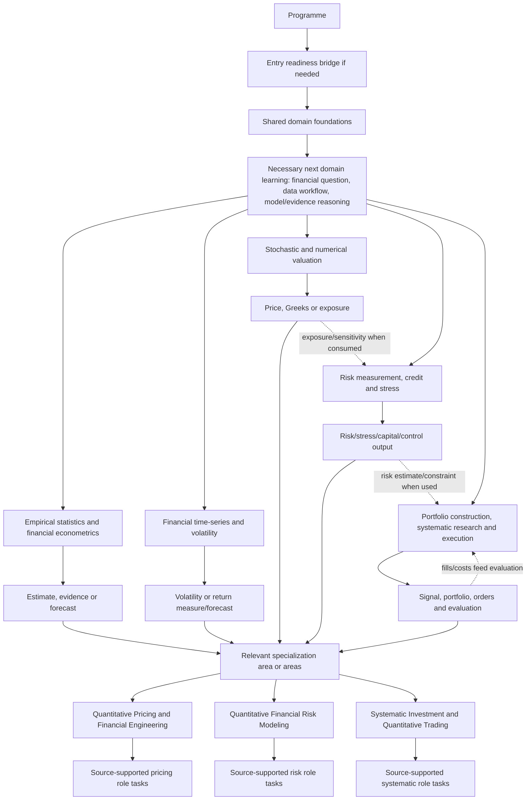

# D011 Quantitative Finance: learning graph design proposal

**Status:** Provisional sequencing idea for review. Full-scale D011 enrichment may change the branches, items, relationships, or order. This document does not change graph data, taxonomy, role fit, UI, SQL, or student visibility.  
**Scope:** Quantitative Finance and Financial Engineering (D011), from entry preparation through the three canonical areas and their recorded role links.  
**Evidence:** The D011 source index and area/role crosswalk named at the end of this document, plus the official programme prerequisites and curricula cited in the entry-readiness section. This is a bounded proposal based on those records, not a claim that every possible source or method has been discovered.

## Design decision

D078 shows how a domain can sequence learning through methods. D011 should use that pattern without asking a new learner to choose an area of specialization before seeing the domain learning. The proposed flow is: **entry readiness if needed -> shared domain foundations -> necessary next domain learning -> narrower domain method pathways -> relevant area(s) of specialization -> role-specific task learning**. Each method pathway has its own ordered knowledge, skill, competency, technique, tool, validation, and output nodes. The resulting outputs and source-backed task relationships then determine which areas and roles are surfaced.

The narrower domain pathways proposed from the D011 evidence are empirical statistics/econometrics; financial time-series and volatility analysis; stochastic/numerical valuation; risk measurement, credit and stress modeling; and portfolio construction, systematic research and execution. These are learning pathways within the domain, not new taxonomy areas. A student can learn domain content and stop before area selection, or combine pathways where outputs feed each other.

The current catalog contains three canonical D011 areas of specialization: Quantitative Pricing and Financial Engineering; Quantitative Financial Risk Modeling; and Systematic Investment and Quantitative Trading. These are downstream route destinations, not the first selection after foundations. Surface an area only after the selected domain pathway, its output, or an expressed learning goal supports the route, and explain the connection. Shared nodes remain in their original ownership and are reused rather than duplicated.

## The learning contract for every branch

Every branch, including a specialist or combined branch, should use this visible structure. The categories are separately labeled for learners even where the source matrix stores some together.

| Learning layer | What the student sees | Typical relationship |
|---|---|---|
| Knowledge | Concepts, assumptions, financial objects, data properties, and domain context needed to understand the question | `requires` when missing knowledge prevents the next step; otherwise `builds_on` or `useful_for` |
| Skills | Observable actions such as inspect data, calculate a payoff, estimate a model, calibrate parameters, write a backtest, or explain uncertainty | `builds_on`, then `produces` a demonstrable output |
| Competencies | Integrated ability to choose, apply, validate, and communicate a method in a stated context | Built through a sequence of skills and evidence; never inferred just from tool exposure |
| Methods and designs | The general modeling or decision approach appropriate to a question | `one_of` for genuine alternatives; `works_with` or ordered `output_feeds` for complements |
| Techniques, estimators, algorithms | Specific statistical, numerical, optimization, or computational procedures used by a method | `one_of` when substitutable under stated assumptions; `requires` or `output_feeds` when technically dependent |
| Tools, software, and data | Software, libraries, platforms, datasets, and infrastructure that implement a technique or supply its inputs | Tool alternatives are distinct from method alternatives; `implements` / `supports` links point to their technique or task |
| Standards and regulation | Applicable market conventions, model governance, reporting, prudential, or venue rules | Context-dependent `applies_in`; jurisdictional standards do not become universal method prerequisites |
| Certifications and credentials | Optional structured learning or professional credentials relevant to a path | `useful_for`; never a universal blocker or proof of competence by itself |
| Learning resources | Verified course, documentation, text, standard, or exercise for the selected node | A resource is displayed only for the node it teaches; it is not itself a credential or prerequisite |
| Output and downstream context | A tangible result, its assumptions and limits, the next valid consumer, and relevant area/role task links | `produces` and `output_feeds`; task-specific `useful_for` edges surface areas and roles |

### Relationship rules that determine sequence and surfacing

- `requires` is a hard blocker only where the later item cannot be meaningfully learned or performed without the prerequisite. Show why the prerequisite is needed.
- `recommended_before` gives a pedagogical order without blocking access. Use it for broad progression and optional preparation.
- `one_of` groups genuine alternatives for the same decision point. Selecting one alternative must not select its siblings. Name the conditions that distinguish them.
- `works_with` connects complementary items that can be learned together. It does not imply that both are required.
- `output_feeds` is an ordered dependency: the upstream item produces an input actually consumed downstream. This is the main relationship for combined paths.
- `implements` connects a tool to the method or technique it supports. Choosing a tool must not falsely select its method alternatives or other tools.
- `useful_for` is skippable and route-linked. It may surface an area or a specific role task, but never blocks general progression.
- `applies_in` scopes a standard or rule to a jurisdiction, instrument, institution, or task.
- `credential_for` marks a certification as optional evidence of structured study for a path; it is not an employment promise.

An edge with unresolved target, unsupported claim, or only a grouped prompt is not a student destination. It must be resolved to a canonical item or stay explanatory/audit-only. Source maturity labels (established/traditional, current, emerging, future) describe evidence horizon; they are not a learning order. Speculative/future items can be visible as clearly labeled optional horizons only when the evidence supports their relevance.

**Evidence gate:** the D011 source index explicitly says its 44 method-relationship notes are source-backed comparisons for later review; they are not canonical items, student-display approvals, or graph/sequence edges. Use each note to decide which item relationships are plausible and what limits to show. Promote an actual edge only after its item targets, context, and relationship are verified. Curriculum co-occurrence/order supports topic coverage and suggested pedagogy, not a hard prerequisite by itself. Use `requires` only for an explicit prerequisite or a method/input dependency; otherwise use `recommended_before`, a conditional alternative/complement, or no edge.

### Every selectable method gets its own mini-sequence

The domain learning branch is an orientation; it is not a substitute for a method-level learning path. When a student opens a selectable method, expand that method into its own ordered chain:

1. **Question and scope:** what the method answers, required inputs, output, assumptions, and where it is unsuitable.
2. **Prerequisite knowledge:** only the concepts and mathematics required for this method; link to a bridge item when the learner lacks them.
3. **Skills and competencies:** what the learner practices and what observable work demonstrates ability to use it.
4. **Method and technique:** the selected method, its procedures/estimators, and any genuine alternatives at the same decision point.
5. **Tool and data choices:** separately selectable implementations and relevant data. Explain why each tool fits this method; tool choice does not imply method mastery.
6. **Validation and interpretation:** diagnostics, benchmarks, assumptions, error or uncertainty, and claim limits appropriate to the method.
7. **Output and downstream links:** what the student produces, which other item can consume that output, and which area/role tasks have a supported connection.
8. **Optional depth:** standards, credentials, advanced techniques, emerging/future work, and resources that are relevant but not blockers.

For combined methods, keep the component paths visible and connect them only at the step where one output is used by another. A combination card can explain the design and integration, but must not mark all component methods, tools, or certifications selected automatically. Below are representative method-level chains showing the intended graph behavior; the eventual graph should instantiate this pattern for each selectable method supported by the source records.

| Method path | Sequenced learning and relationship logic | Result and route |
|---|---|---|
| Analytic derivative pricing | Payoff and market conventions -> probability/no-arbitrage and model assumptions -> select an analytic model only if its assumptions fit -> derive/implement price and sensitivities -> compare with an independent benchmark and explain limitations. A lattice/PDE/Monte Carlo engine is a `one_of` alternative when analytic assumptions or product features do not fit. | Price/Greeks -> pricing-area tasks; exposure output can `output_feeds` risk or margin work where that task needs it. |
| Monte Carlo pricing | Probability/random variables -> payoff/model specification -> stochastic-process and path simulation knowledge as required -> sampling estimator -> optional variance reduction (for example quasi-Monte Carlo or multilevel methods) -> software implementation -> convergence/error and benchmark checks. Variance reduction complements simulation; it is not another pricing model. | Price, Greeks where supported, and numerical uncertainty -> pricing tasks; selected exposure may feed a risk path. |
| Time-series risk forecast | Returns/data properties -> probability/statistics and time dependence -> define mean or volatility target -> choose a mean model (such as AR/ARIMA/VAR) and, if needed, a conditional variance model (such as EWMA/GARCH) -> estimate with statistical software -> residual and chronological forecast checks. Mean and variance layers can `works_with`/`output_feeds`; neither is universally required by the other. | Forecast or volatility estimate -> risk tasks; downstream allocation may use it when the portfolio objective calls for it. |
| Regression or classification in systematic research | Define target/estimand and data structure -> choose model family by outcome (for example OLS for a continuous outcome, binary logit/probit for a binary outcome, or an appropriate count/ordinal model) -> estimate and inspect assumptions -> compare a documented baseline -> test out of sample and account for repeated search when applicable. These are outcome-driven alternatives, not a single progression. | Estimate/prediction -> candidate signal only after a decision rule; signal can feed portfolio construction and selection-aware backtesting. |
| ML prediction branch | Data integrity and statistical baseline -> define target and time-aware validation -> choose an ML family that fits data and task -> implement in a suitable library -> compare against the baseline, inspect leakage/overfit and stability -> interpret prediction limits. Feature/model alternatives remain separate; an advanced model is not automatically the next required step. | Prediction may inform a candidate signal; it does not prove causality or profitability. Route to systematic research tasks only where the task disposition supports it. |
| Portfolio optimization | Mandate, return/risk concepts and constraints -> allocation objective -> covariance/forecast inputs and their assumptions -> choose optimizer/design (mean-variance, risk parity, robust/Bayesian, liability-relative, etc.) -> compute weights -> sensitivity, turnover, cost and constraint checks. Covariance estimators are input alternatives; the optimizer and estimator can be complementary. | Target weights -> portfolio and systematic tasks; risk constraints can link to risk modeling. |
| Multiple-testing/strategy-selection diagnostics | Candidate-search process and chronological returns -> identify the actual selection bias question -> select a suitable diagnostic (Reality Check/SPA, Romano-Wolf, MCS, DSR, or PBO/CSCV as appropriate) -> implement with correct resampling/assumptions -> interpret scope and limits. These are alternatives for different inferential questions, not a checklist and not substitutes for a clean test design. | Selection-aware evidence -> systematic strategy evaluation and research tasks. |

This means area/role surfacing follows the selected method's actual output and task context, not the method label alone. For example, learning logistic regression does not surface every quantitative-finance role; it may surface a relevant credit or systematic task only when the output, area ownership, and stored role-task evidence match.

## Student progression from entry through domain learning to specialization

### Stage 0: entry bridge for a learner who is not ready for university quantitative work

Do not assume that a senior-secondary learner already has undergraduate calculus, linear algebra, probability, econometrics, or coding. Offer a prerequisite bridge with a diagnostic and test-out path:

1. Arithmetic for finance: fractions, ratios, percentages, powers, roots, rates, simple and compound growth, and present/future value.
2. Algebra and functions: equations, rearranging formulas, functions, graphs, exponents, logarithms, and reading formulas with units.
3. Data and chance: tables and charts, mean/median/variation, proportions, elementary probability, conditional chance, and uncertainty.
4. Computing fluency: spreadsheets, formulas, data tables, reproducible files, and computational thinking; introductory Python can follow or run alongside this bridge.
5. Finance context: cash flows, returns, interest, basic instruments, and the difference between a price, a forecast, a risk measure, and an investment decision.

These are an entry bridge, not an assertion that every secondary curriculum contains the same topics. The NERDC portal exposes the Nigerian senior-secondary curriculum but its linked subject documents could not be verified in this review; therefore the proposal does not claim exact NERDC coverage. Use a placement check and let learners demonstrate prior knowledge.

### Stage 1: undergraduate quantitative preparation

For learners ready for university-level study, or after the bridge, show the quantitative and finance preparation relevant to the routes they may choose:

1. Single-variable calculus and functions; add multivariable calculus for optimization, continuous-time models, and PDE-based pricing.
2. Linear algebra: vectors, matrices, covariance, linear systems, eigenvalues, and numerical conditioning.
3. Probability and statistics: distributions, conditional expectation, estimation, sampling uncertainty, hypothesis tests, and regression foundations.
4. Programming and data practice: one general-purpose language, data structures, versioned/reproducible analysis, data cleaning, numerical libraries, and tests of calculations.
5. Financial foundations: time value, bonds/equities/derivatives, market conventions, portfolio return, and the institutional context of trading and risk.
6. Numerical methods: approximation, simulation, optimization basics, stability, and error measurement, introduced before a branch requires them.

MIT Sloan identifies linear algebra, multivariable calculus, probability/statistics/econometrics, and programming as helpful preparation while not requiring a particular undergraduate major. NYU's undergraduate Mathematics of Finance lists Calculus III, linear algebra, and introductory probability/statistics as prerequisites for that course. NUS's BSc progression places calculus, linear algebra, probability, computing, and numerical/data methods before or alongside advanced finance courses. These sources support a staged preparation menu and test-out route; they do **not** establish that all listed subjects are compulsory before every D011 pathway. Treat only the prerequisite for the selected method as a blocker.

### Stage 2: recommended shared domain orientation (not a universal blocker)

Before exposing narrower pathways, offer a short domain-wide orientation so a new learner can tell what different quantitative-finance outputs mean. The reviewed sources support these as useful shared context, but do not prove that every learner must complete all of them before starting a method. Mark them `recommended_before` or allow test-out; do not make them universal blockers.

| Recommended orientation | Why it helps | What the student can do afterward |
|---|---|---|
| Financial question and output literacy: distinguish valuation, statistical evidence/forecast, risk measurement, and investment/trading decision | CFA and university curricula place these topics in related but distinct finance applications; the distinction helps students choose a route without treating the outputs as equivalent | State a financial question and identify the output it needs |
| Financial data and quantitative workflow: market/return/cash-flow data, dates and frequency, units, data quality, reproducible analysis, and basic computation | Curriculum and implementation sources document data analysis across finance methods; chronology and point-in-time availability specifically matter for time-series validation and backtests | Inspect and prepare data; recognize when a data issue matters for the selected method |
| Model reasoning and evidence: assumptions, estimation/calibration, uncertainty/error, validation, baseline comparison, and claim limits | Source notes distinguish calibration from validation, prediction from causal inference, and model estimates from regulatory outputs | Explain what a result supports and what additional check its method requires |

These are proposed orientation outcomes, not claims of universal qualification requirements. Advanced calculus, measure theory, stochastic calculus, PDEs, optimization, or ML appear only where the selected method uses them.

### Stage 3: narrower domain method pathways

After the orientation, let the learner open one or more method pathways. Present each in everyday language, then show its first item and sequence; do not require an area or role choice. The source records support the listed method distinctions, but their notes are not themselves edges. Each path's actual order below is a proposal: only method-specific prerequisites and genuine input/output dependencies may block or order access.

| Domain method pathway | Sequence and choice point | Output that can lead to an area |
|---|---|---|
| Empirical statistics and financial econometrics | Define question/data/target -> association or regression family chosen by variable and estimand -> estimate and diagnose -> compare baseline/uncertainty -> optionally add ML for a defined prediction or nuisance-estimation task -> validate without claiming causality from prediction alone | Estimate, association, forecast or empirical evidence; usually useful to systematic investing and some risk tasks, with calibration use only where supported |
| Financial time-series and volatility analysis | Understand return frequency/dependence -> choose mean dynamics (AR/ARIMA/VAR) -> separately assess volatility target -> choose EWMA/ARCH/GARCH/stochastic-volatility or realized-volatility method -> optional ML comparison -> chronological forecast validation | Volatility/return forecast or realized measure; useful to risk and systematic paths, and to pricing when a volatility input is needed |
| Stochastic and numerical valuation | Define instrument/payoff -> choose valuation framework/model -> calibrate required market inputs -> choose analytic/tree/PDE/simulation engine based on payoff/model -> calculate price/Greeks -> check convergence, calibration and model assumptions -> optional learned approximation after benchmark | Price, calibrated parameters, Greeks, exposure or numerical error; leads primarily to Pricing, with Risk when a downstream task consumes exposures |
| Risk measurement, credit and stress modeling | Define exposure/target/horizon -> choose risk quantity -> select estimation/model alternative -> estimate and stress -> validate forecast/measure -> add jurisdictional capital/governance context only where applicable | VaR/ES, volatility, default or exposure estimate, stress loss, capital/control output; leads primarily to Risk and may support portfolio decisions |
| Portfolio construction, systematic research and execution | State mandate/constraints -> create point-in-time data and empirical signal -> select allocation method/input -> apply risk controls -> choose execution policy -> measure costs and evaluate chronologically -> add selection diagnostics if many candidates were tried | Signal, target portfolio, orders/fills/costs, performance evidence; leads primarily to Systematic Investment and Quantitative Trading, with Risk links when estimates constrain the portfolio |

**Area routing from these pathways:** empirical statistics/econometrics can support Risk and Systematic, and can support pricing calibration where the actual task needs it; time-series/volatility can support Risk and Systematic, and may supply pricing inputs; stochastic/numerical valuation leads to Pricing and may feed Risk through sensitivities/exposures; risk measurement leads to Risk and can inform portfolio sizing; portfolio/execution leads to Systematic and can consume Risk outputs. These are evidence- and task-dependent connections, not automatic area selections.

The pathway-specific prerequisite comes immediately before the node that needs it. Probability and numerical analysis gate some pricing techniques; they do not gate every empirical or portfolio item. Chronological data handling gates credible financial backtesting; it does not gate instrument valuation. This follows the indexed relationship claims. Oxford's derivatives course identifies probability as prerequisite and measure/martingale theory as useful preparation for advanced content; its curriculum order is one example, not a universal dependency. Toronto Metropolitan University's financial mathematics sequence is one example of progressing from senior-secondary mathematics into university calculus, linear algebra, probability/statistics and later stochastic/numerical/derivatives topics. Learners can test out of mastered preparation.

### Stage 4: area-specific learning after a supported route

The three canonical specialization areas are optional downstream routes, not the first choice after foundations. Each area should then have its own “learn this first -> learn these next -> choose among these methods/tools -> produce this output” sequence. Domain method items already learned should be carried into the area path, not repeated as new area-owned items. Show role tasks only after the area path reaches relevant outputs and the stored role-task evidence supports the link.

## Domain-to-area combinations and route behavior

When a learner selects multiple domain pathways, shared foundations appear once and their branches stay distinct until a real input/output dependency joins them. Representative combinations are: time-series forecast -> risk estimate -> portfolio sizing; pricing model -> price/Greeks -> counterparty exposure or margin; empirical signal -> portfolio construction -> risk constraints -> execution and cost-aware evaluation. The learner can stop after the domain pathway; selecting an area or role remains optional.

## Downstream specialization path: Quantitative Pricing and Financial Engineering

**Branch outcome:** explain assumptions and conventions, select a valuation approach that fits a product, calculate a price or exposure, and validate the result at the level required by the task.

### Ordered learning spine

1. **Financial object and knowledge.** Cash flows, payoff diagrams, exercise rights, market conventions, discounting, arbitrage, and the difference between pricing under a valuation measure and predicting real-world returns.
2. **Foundational skills and competencies.** Translate a term sheet into a payoff; inspect market inputs; calculate present value; explain assumptions; distinguish calibration fit from model validation.
3. **Model/design choices.** Select a model family by product and assumptions. Examples in the records include no-arbitrage/risk-neutral valuation, Black-Scholes-Merton/Black, binomial or lattice models, interest-rate term-structure models, and structural/reduced-form credit models. These form conditional branches, not one universal ladder.
4. **Calibration and market input branch.** Learn curve construction and calibration for rates products, volatility surfaces for options, or credit inputs for credit products only where the selected instrument needs them. Calibration output feeds valuation; it does not establish model validity or hedge quality.
5. **Pricing engine alternatives.** Once payoff and model are specified, choose among analytic/transform solutions, trees/lattices, finite differences, or Monte Carlo according to path dependence, exercise, dimension, model support, convergence, and compute limits. They are alternative or complementary computational engines for particular problems, not alternatives to the financial model itself.
6. **Technique and output branch.** Calculate price; then calculate Greeks or scenario/exposure profiles if the task requires them. For Greeks, finite differences, pathwise, likelihood-ratio/Malliavin, adjoint, and hybrid estimators have different payoff regularity, estimator, and computational requirements. Do not make all estimators compulsory.
7. **Validation competency.** Check market-data quality, calibration residuals, model assumptions, numerical error/convergence, sensitivity stability, and benchmark or independent implementation. Select the checks appropriate to the model and output.

### Item families, tools, and horizons in this branch

- **Knowledge:** payoff/cash-flow structure, no-arbitrage, risk-neutral valuation, stochastic models, rates/credit/volatility context.
- **Skills/competencies:** translate contracts, calibrate, implement/choose an engine, estimate sensitivities, measure numerical error, communicate model risk.
- **Methods/designs:** analytic valuation, lattice methods, PDE/numerical valuation, simulation, term-structure modeling, structural or reduced-form credit modeling.
- **Techniques/algorithms:** trees, finite differences, Monte Carlo, Fourier methods, quasi-Monte Carlo, multilevel Monte Carlo, calibration algorithms, and the Greek estimators above.
- **Tools/data:** Python, C++ or MATLAB as implementation languages where appropriate; QuantLib and OpenGamma Strata as pricing libraries/frameworks; market curves, volatility surfaces, and instrument data. These tools implement selected methods; a library choice is not a method prerequisite.
- **Standards/credentials/resources:** market conventions and product documentation apply by instrument; model-risk and governance rules apply by institution/jurisdiction. CFA/CQF and university stochastic/numerical-finance material are optional learning resources/credentials, not required gates.
- **Emerging/future:** neural pricing/PDE/BSDE methods and learned surrogates are advanced optional branches after a structural model, baseline, and validation benchmark. Quantum-finance items remain labeled future/research horizon where the index supports them; do not present them as job-ready prerequisites.
- **Outputs:** price, calibrated parameters, Greeks, exercise/hedge information, exposure profile, and numerical uncertainty. Only outputs actually needed by the selected task are required.

### Complementary and downstream paths

- `curve calibration output_feeds rate-product pricing`.
- `price/Greeks/exposure output_feeds hedging, counterparty exposure/CVA, or margin analysis` only when the downstream task consumes that output.
- Deep hedging is an optional control/policy branch after pricing/exposure, a stated risk objective, and transaction-cost assumptions; it is not an alternative pricing formula.
- Learned pricing surrogates follow a structural pricing model and benchmark validation; selecting a surrogate does not select every neural method.

The recorded task-supported role links are financial analyst, quantitative analyst, quantitative developer, quantitative researcher, securities analyst, and securities underwriter. Surface a role only beside an item/output whose task context is supported; do not imply that completing the area guarantees eligibility.

## Downstream specialization path: Quantitative Financial Risk Modeling

**Branch outcome:** define a risk question and produce a clearly scoped estimate, stress result, exposure, or control input with assumptions and validation.

### Ordered learning spine

1. **Risk question and knowledge.** Define the position/portfolio, target (loss, volatility, default, liquidity, counterparty exposure, or another risk), horizon, confidence/threshold, and decision that uses the result. Distinguish market, credit, liquidity/funding, model, portfolio, and counterparty risk.
2. **Foundational skills and competencies.** Map positions and data; calculate returns/exposures; inspect distributions and time dependence; explain uncertainty and limitations.
3. **Choose the measure and model target.** VaR, expected shortfall, volatility, default probability/loss, stress loss, exposure profile, and regulatory capital answer different questions. Do not collapse internal estimates, stress measures, accounting measures, suitability, and capital into one node.
4. **Market-risk method branch.** For a defined loss target, variance-covariance/parametric, historical simulation, and Monte Carlo are alternative estimation engines with different assumptions. Conditional volatility models can supply a variance forecast. Mean dynamics (AR/ARIMA/VAR) and variance dynamics (ARCH/GARCH/EWMA) are distinct layers and may compose when the target and diagnostics support it.
5. **Credit-risk method branch.** Structural and reduced-form approaches encode different default mechanisms. Risk-neutral quantities used in pricing and real-world default forecasts have different interpretations and must stay separate. Add portfolio dependence or recovery modeling only when needed by the chosen task.
6. **Liquidity, counterparty, and portfolio branches.** Add liquidity/cost assumptions, exposure paths, sensitivities, collateral, margin, or covariance analysis when the task requires them. For example, initial margin consumes sensitivities; it is not itself a pricing model or Basel market-risk capital.
7. **Stress and validation.** Scenario/stress analysis answers a different question from a statistical estimate. Add backtesting, forecast comparison, exception analysis, sensitivity analysis, outcome review, and model-risk controls suited to the selected measure. Regulatory rules and validation tests are separate contextual layers.
8. **Risk output.** Produce a scoped estimate/report, stress result, limit/control input, capital measure, exposure, collateral, or margin result as required by the consuming task.

### Item families, tools, and horizons in this branch

- **Knowledge:** loss distributions, volatility, credit/default, liquidity/funding, time series, portfolio covariance, exposure and margin concepts.
- **Skills/competencies:** estimate and compare risk, construct stress cases, backtest forecasts, investigate exceptions, document assumptions, explain risk to a decision-maker.
- **Methods/designs:** statistical market-risk estimation, time-series volatility modeling, credit-risk modeling, stress/scenario analysis, counterparty exposure and margin methods.
- **Techniques/estimators:** VaR and expected shortfall estimators; historical, parametric and simulation methods; CAViaR; EWMA/GARCH families; AR/ARIMA/VAR; structural/reduced-form credit methods; stress testing; forecast-comparison/backtest procedures.
- **Tools/data:** Python/R/statistical packages, `arch`, risk platforms and historical market/position data as recorded. RiskMetrics is a historical method/tool reference, not the sole modern platform. Tool choices are optional implementations of selected procedures.
- **Standards/credentials/resources:** Basel, CBN, OSFI, and other prudential material apply only in the relevant jurisdiction and institution; GARP FRM and CFA resources are optional structured learning. A standard does not replace understanding the risk measure.
- **Emerging/future:** ML forecasts can be optional alternatives or benchmarks for a specified risk target. They require chronological validation, a relevant baseline, and stated study limits. Show future methods as optional horizon items only where sourced.
- **Outputs:** risk quantile/expected shortfall, volatility forecast, stress loss, default estimate, backtest exceptions, capital/exposure/collateral/margin result.

### Complementary and downstream paths

- A mean model may feed a conditional variance model; do not make that pair mandatory if the target needs only one layer.
- A price/Greek/exposure from Pricing can feed counterparty/CVA/margin analysis; it does not convert a risk-neutral default quantity into a real-world forecast.
- Risk estimates and constraints can feed systematic portfolio sizing. The chosen risk measure remains distinct from the allocation objective.
- ML risk forecasts are compared with, and validated against, an appropriate traditional baseline; selecting one does not falsely select the other.

All 22 stored risk-area role links have conditional task support: asset manager, credit analyst(s), energy trader, financial analyst, financial broker, financial risk specialist, financial trader, foreign exchange broker, foreign exchange trader, futures trader, investment analyst, mathematician, mergers and acquisitions analyst, middle office analyst, mutual fund broker, quantitative analyst, quantitative developer, securities analyst, securities trader, securities underwriter, statistician, and stock trader. Surface each role through relevant task/output links, not as a blanket promise for every risk item.

## Downstream specialization path: Systematic Investment and Quantitative Trading

**Branch outcome:** move from a stated mandate and valid data to a researched signal, portfolio, implementation, and credible evaluation.

### Ordered learning spine

1. **Mandate and financial knowledge.** State objective, benchmark, constraints, horizon, decision frequency, universe, and whether the task is investment allocation, strategy research, execution, or market making.
2. **Data and computing competency.** Build a point-in-time dataset; understand timestamps, corporate actions, universe membership, missingness, survivorship, look-ahead, and leakage. Reproducible programming and data inspection come before performance claims.
3. **Empirical question and method choice.** Define an estimand or prediction target and choose by data type and question:
   - Pearson, Spearman, and Kendall correlations answer different association questions.
   - Chi-square and Fisher exact tests suit different contingency-table conditions.
   - OLS, binary logit/probit, ordinal/multinomial, count, and other regression families depend on outcome form and assumptions.
   - AR/ARIMA/VAR mean models differ from ARCH/GARCH/EWMA conditional-volatility models; they may be composed when justified.
   - Factor/econometric and machine-learning models can be alternatives or complements for a stated target. Prediction does not by itself establish causality or investment value.
4. **Signal or forecast.** Estimate, compare, and validate the selected model. Explain effect/uncertainty or prediction error and whether the result is stable out of sample. A model output becomes a candidate signal only with a specified decision rule.
5. **Portfolio construction.** Separate signal generation from allocation. Choose mean-variance, Black-Litterman, risk parity, robust/Bayesian, downside-risk, liability-relative, or another supported approach by objective and constraints. Sample, shrinkage, factor-structured, or ML-extended covariance estimators are input alternatives, not portfolio objectives.
6. **Risk and implementation.** Apply limits and risk controls, translate target weights into orders, then choose execution policy. Execution-cost measurement and execution policy are separate items. Microstructure, liquidity, and cost knowledge are prerequisites for credible execution evaluation.
7. **Backtest and selection validation.** Use chronological splits and realistic costs/constraints. If many models or strategies were tried, choose the diagnostic for the actual selection problem: Reality Check, SPA, Romano-Wolf, Model Confidence Set, Deflated Sharpe Ratio, and PBO/CSCV answer related but non-identical questions. They are not a mandatory bundle and should follow a documented multiple-testing/selection context.
8. **Monitor and communicate.** Compare realized outcomes with assumptions, benchmark, and risk budget. Document drift, costs, turnover, capacity, limitations, and the reason a research result is or is not actionable.

### Item families, tools, and horizons in this branch

- **Knowledge:** portfolio construction, market data integrity, return/time-series behavior, factor models, market microstructure, trading costs, allocation and execution context.
- **Skills/competencies:** construct point-in-time datasets, specify hypotheses, analyze data, estimate/validate models, create signals, optimize portfolios, manage risk, implement orders, evaluate and communicate backtests.
- **Methods/designs:** empirical asset pricing/econometrics, time-series research, factor investing, predictive ML, portfolio optimization, execution algorithms, market making, and reinforcement-learning policies where supported by the evidence.
- **Techniques/estimators:** the association tests, contingency tests, regression families, time-series/volatility models, portfolio/covariance estimators, Reality Check/SPA/Romano-Wolf/MCS/DSR/PBO-CSCV diagnostics, execution-cost methods, and optimization algorithms described above.
- **Tools/data:** spreadsheets for introductory analysis; Python/R and Jupyter for research; scikit-learn and suitable statistical libraries for estimation; LEAN/QuantConnect and Qlib for research/backtesting contexts; market, reference, and corporate-action data. Add specialist tools only where the record supports their specific task. Tool alternatives are displayed separately and do not substitute for method understanding.
- **Standards/credentials/resources:** venue and jurisdiction rules, data licenses, trading controls, and applicable investment mandates are context nodes. CFA, CQF, ARPM, QuantConnect/LEAN documentation and university curricula can be optional study routes; credentials are not mandatory gates.
- **Emerging/future:** reinforcement learning, deep portfolio policies, LLM-assisted research, autonomous allocation, and learned execution/market-making are advanced optional designs. Show traditional baselines, costs, leakage controls, and limits alongside them. Do not imply that a novel method is mature merely because it is named in a source.
- **Outputs:** research dataset, test result, forecast/signal, target weights, risk-controlled portfolio, orders/fills/costs, and performance/selection diagnostics.

### Complementary and downstream paths

- `valid point-in-time data output_feeds empirical estimate`.
- `validated estimate output_feeds a stated signal or forecast` only after a decision rule is added.
- `signal output_feeds portfolio construction`; `portfolio target output_feeds risk controls and orders`; `orders/fills/costs output_feeds strategy evaluation`.
- Multiple-testing diagnostics follow candidate search and backtest evidence; they do not replace out-of-sample testing or economic/implementation checks.
- A traditional method and ML technique can be learned together as baseline and extension, but selecting the combined card must not silently mark either as independently mastered.

### Optional advanced and combined branches

- **Quantitative research + systematic trading:** econometric/ML estimate -> signal -> allocation -> implementation -> selection-aware evaluation. Each transition is explicit.
- **Pricing + risk:** instrument/model -> price and sensitivities -> exposure/CVA/margin or hedge analysis. The downstream item appears only when those outputs are relevant.
- **Risk + portfolio construction:** risk estimate/constraints -> sizing or allocation -> limits/monitoring. A risk measure and optimizer are complementary, not alternatives.
- **Systematic + execution:** signal -> target portfolio -> order policy -> fills/costs -> net performance. Costs feed back into evaluation.
- **Traditional + ML:** retain the baseline, ML extension, and validation as separate nodes. Examples include econometric baseline versus nonlinear prediction, GARCH versus ML volatility forecast, classic covariance versus ML-augmented covariance, or structural pricing model versus learned surrogate.

## Area and role surfacing behavior

The three area cards are downstream specialization routes, not the next forced choices after the common foundation. Recommend them from the selected domain items' outputs and contextual links while preserving source ownership. A domain-owned item can support an area without becoming area-owned; an area-owned item can support a role without being relabeled as role-owned. A student may learn at domain level and stop there; area and role choices are optional downstream steps.

At an area, show its ordered path plus optional useful edges and the reason they matter. At a role, show only item/output-to-task links supported for that role in that area. Selection behavior should obey these rules:

1. A hard prerequisite blocks only the dependent item and explains the missing foundation.
2. An alternative selection suppresses sibling alternatives as “also selected,” while leaving them visible for comparison.
3. A complementary selection displays the next output consumer when its dependency condition is met.
4. An optional useful edge is skippable and never blocks the path.
5. Selecting multiple areas merges common nodes once, preserves each item's owner, and shows the distinct downstream branches.
6. Role links remain conditional task context; they do not imply eligibility, employment, or that every item in the area is needed for every role.

The catalog contains 51 stored area-role links across these areas. Pricing has six conditional task-supported links. Risk has 22 conditional task-supported links. Systematic has 23 links: three conditional task-supported, ten conditional downstream-task context, and ten with no direct systematic task established in this source pass. The last ten must not surface as proven systematic destinations. This distinction affects role surfacing, not the underlying area taxonomy.

## Current evidence limits and next graph-building step

The D011 index contains 455 domain-source records and 44 method-relationship notes. All three area searches have terminal dispositions within their recorded scope, and all 51 area-role links have dispositions. These figures describe the available evidence corpus; they do not mean the student graph is already complete or that every item has been mapped to a canonical learner node.

The current catalog marks the three area recommendations `recommendation_needs_role_and_context_integration` and `student_visible: false`. This document proposes a student flow; it does not claim that current UI or graph data implements it.

The next work should be a bounded node-and-edge mapping pass: map each proposed stage to existing D011 canonical IDs, record ownership, evidence IDs, inputs/outputs and claim limits, identify missing nodes, then validate path behavior for each area alone and for the combinations above. Add only nodes supported by the existing source corpus or a separately authorized evidence pass. Do not generate every method pair; use typed relationships and test representative path combinations plus conditional branch cases.

## Evidence anchors

### D011 local source index

Local source index: `data/career-mapping/_audit/D011_D166_IN_DEPTH_SOURCE_INDEX_2026_10_23.json`. Treat each source record according to its own source type, context, locator, and limits.

- Curriculum/progression: `D011-OXFORD-MCF-CURRICULUM-2026-27`, `D011-MIT-MFIN-CURRICULUM-2026`, `D011-BERKELEY-MFE-CURRICULUM-2026`, `D011-DUKE-QF-CONCENTRATION-2026`, `D011-CFA-CBOK-2026`, `D011-CFA-CURRICULUM-2026`, `D011-GARP-FRM-2026`.
- Pricing/calibration: `D011-CFA-CONTINGENT-CLAIMS-MODELS-2026`, `D011-CFA-ARBITRAGE-FREE-FIXED-INCOME-2026`, `D011-OPEN-GAMMA-RATES-CURVE-CALIBRATOR`, `D011-OPEN-GAMMA-CURVE-CALIBRATION`, `D011-OPEN-GAMMA-PRODUCT-COVERAGE`, `D011-QUANTLIB-OPTION-ENGINE-COMPARISON`.
- Portfolio, execution, evaluation, and role tasks: `D011-CFA-ASSET-ALLOCATION-2026`, `D011-CFA-ACTIVE-EQUITY-PORTFOLIO-2026`, `D011-CFA-TCA-2026`, `D011-LEAN-RESEARCH-GUIDE-LOOKAHEAD-SURVIVORSHIP-2026`, `D011-ONET-QFA-2026`, plus the source IDs attached to the role-task dispositions.
- The 44 `method_relationship_notes` supply the detailed claims for procedure alternatives/complements, regression and outcome type, time-series versus volatility models, traditional/ML comparisons, multiple-testing diagnostics, covariance/allocation, pricing/hedging, and Greek-estimator applicability. Preserve their individual limits; the note count itself is not evidence.

### External programme-readiness sources checked for this proposal

- [MIT Sloan MFin suggested background](https://mitsloan.mit.edu/mfin/admissions/suggested-background) — background in linear algebra, multivariable calculus, probability/statistics/econometrics, and programming is helpful; no single undergraduate major is required.
- [NYU undergraduate Mathematics of Finance](https://math.nyu.edu/dynamic/courses/undergrad/math-ua-250/) — lists Calculus III, linear algebra, and introductory probability/statistics as course prerequisites.
- [NUS BSc Quantitative Finance requirements](https://www.math.nus.edu.sg/wp-content/uploads/sites/4/2025/10/QF_2122_14102025.pdf) — staged curriculum across calculus, linear algebra, probability, computing/numerical methods, and advanced finance.
- [Oxford B8.3 Mathematical Models of Financial Derivatives](https://courses.maths.ox.ac.uk/course/view.php?id=6597) — probability prerequisite; measure/martingale theory is useful preparation for advanced derivative content.
- [Toronto Metropolitan University Financial Mathematics 2026–27](https://www.torontomu.ca/calendar/2026-2027/programs/science/financial_math/) — one example of senior-secondary entry expectations and progression to university calculus, linear algebra, probability, stochastic processes, numerical methods, and financial mathematics; not a universal admissions rule.
- [NERDC Senior Secondary Curriculum portal](https://www.nerdc.gov.ng/content_manager/new_senior_curriculum_home.html) — confirms the official curriculum portal exists, but the subject documents could not be retrieved in this review. Do not infer exact Nigerian secondary coverage from the portal landing page.

