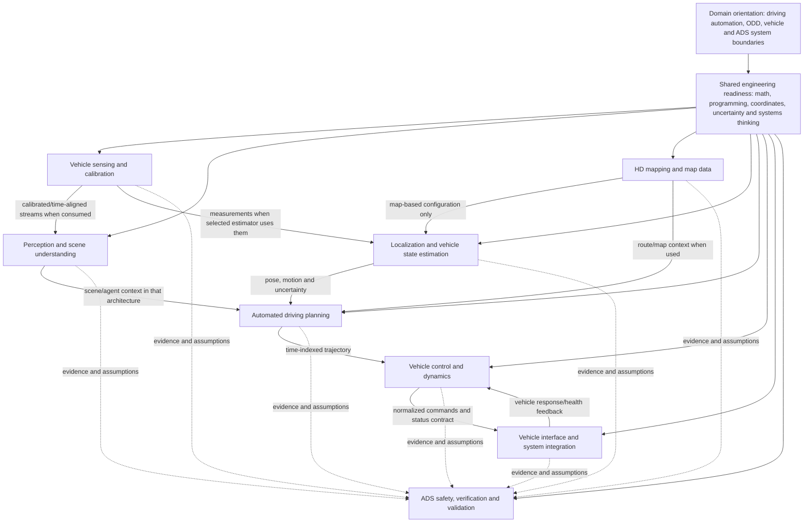

# D166 Autonomous Driving: Provisional Learning Graph

**Prepared:** 2026-10-29  
**Status:** Provisional curriculum proposal for review; not a canonical graph or approved student route.  
**Scope:** Reconcile the completed D166 source work and propose learning flow from domain foundations through technical specialization areas and conditional role assignments.

## 1. What the source work establishes

The two D166 workpacks cover complementary technical slices:

| Source lane | Areas covered | Matrix result | Task tracks |
|---|---|---:|---:|
| Agent 1 | Vehicle Sensing and Sensor Calibration; Perception and Scene Understanding; High-Definition Mapping and Map Data; Localization and Vehicle State Estimation | 59 mapped cells; 37 bounded no-hit cells | 17 complete; 7 bounded no-hit |
| Agent 2 | Automated Driving Planning; Vehicle Control and Dynamics; Vehicle Interface and System Integration; ADS Safety, Verification and Validation | 96 mapped cells | 24 complete |
| **Combined** | **All 8 source-index areas** | **155 mapped; 37 bounded no-hit across 192 fixed cells** | **41 complete; 7 bounded no-hit across 48 tracks** |

The master source index records all eight area searches as `complete` within their bounded scopes, with `no_material_gap` counter-searches. The workpacks and index retain claim limits, source locators, query IDs, and access limitations. This closes the finite source-review work; it does **not** prove that a proposed course sequence is universal, that a route is approved, that a vehicle is safe, or that it meets a particular jurisdiction's rules.

Primary local evidence records:

- [D011/D166 in-depth source index](../../data/career-mapping/_audit/D011_D166_IN_DEPTH_SOURCE_INDEX_2026_10_23.md) and its JSON source registry.
- [Agent 1 source workpack](../../data/career-mapping/_audit/agent_workpacks/D166_AGENT1_SOURCE_WORKPACK_2026_10_24.md), [reviewer reconciliation](../../data/career-mapping/_audit/agent_workpacks/D166_AGENT1_REVIEWER_RECONCILIATION_2026_10_24.md), and [coordinator reconciliation](../../data/career-mapping/_audit/agent_workpacks/D166_AGENT1_COORDINATOR_RECONCILIATION_2026_10_24.md).
- [Agent 2 source workpack](../../data/career-mapping/_audit/agent_workpacks/D166_AGENT2_SOURCE_WORKPACK_2026_10_24.md) and [closeout handoff](../../data/career-mapping/_audit/agent_workpacks/D166_AGENT2_HANDOFF_2026_10_29.md).

## 2. Area and role data reconciliation completed

The selected D166 set is the **eight detailed areas** in the source index and specialization catalog. The four broader entries formerly stored in `domain_structure.json` have been retained in an audit-only `areas_of_specialization_superseded` field and each maps to two of the selected areas:

| Superseded broad proposal | Reconciled detailed areas |
|---|---|
| Perception, Sensing and Scene Understanding | Vehicle Sensing and Sensor Calibration; Perception and Scene Understanding |
| Localization, Mapping and Vehicle State Estimation | High-Definition Mapping and Map Data; Localization and Vehicle State Estimation |
| Planning, Control and Automated Driving Software | Automated Driving Planning; Vehicle Control and Dynamics |
| Vehicle Integration, Safety and Verification | Vehicle Interface and System Integration; ADS Safety, Verification and Validation |

The eight area records are now the `domain_structure.json` D166 set and retain their source boundaries, evidence, and area IDs. The old four are no longer active area destinations. The four retired ISCO-derived subgroup records were removed from the active D166 structure and preserved in an audit archive; they are distinct from both area sets and were not promoted or renamed. Area student visibility remains off pending the existing student contract/UI approval state.

The role evidence is reconciled as **9 canonical role records and 20 conditional role-area task assignments**. The source index previously had 18 task records; it now contains the two additional workpack-specific assignments with their explicit source and condition records, for 20 reconciled tasks. The resulting set removes the unsupported generic Software Analyst to Vehicle Interface listing and adds the source-backed Optomechanical Engineer to Vehicle Interface assignment. Role links now carry task condition, boundary, and source references. All nine canonical D166 roles are marked **conditional** in the role library and have conditional domain/area routes. Conditional means the role is useful in D166 only for the stated assignment; generic occupation work outside that assignment remains outside D166. These records do not say that every person with the title performs ADS work. Student visibility for areas remains off pending the existing student contract/UI approval state.

The data reconciliation is recorded in [the D166 area and conditional-role audit](D166_AREA_AND_ROLE_RECONCILIATION_2026_10_29.md) and is reproducible with [the reconciliation script](../../data/career-mapping/_audit/reconcile_d166_areas_and_conditional_roles_2026_10_29.py).
## 3. Why D166 branches differently from D078

D078's reviewed learning design branches around research methods and mixed-method designs. The D166 evidence instead organizes naturally around **vehicle-system functions, data contracts, and engineering lifecycle work**. Autoware and Apollo architectures distinguish sensing, perception, map/localization, planning, control, vehicle interface, simulation, and evaluation, while showing that implementations can combine or rearrange modules. The source index's relationship notes document specific input/output handoffs rather than one mandatory universal order.

So D166 should not begin with a single “choose your method” screen. A learner first gets the domain/system orientation, then follows one or more connected technical lanes. Methods and algorithms branch *inside* the relevant lane. Alternatives such as EKF versus factor-graph smoothing, or Pure Pursuit versus MPC, should be presented as choices for a defined problem, not as successive compulsory items. Complementary components can be learned together where their interfaces are meaningful.

## 4. Proposed high-level flow

**Reading the arrows:** solid arrows are proposed conditional data or interface dependencies documented in the source records; they apply when the chosen architecture uses that input. Dashed arrows show safety/V&V as cross-cutting evidence work, not a final course that can be postponed until the rest of the vehicle is “done.” The eight areas can be entered from the shared orientation according to interest and prerequisites. The flow is a connected graph, not a single eight-step ladder.

## 5. Domain-level sequence before area selection

### A. Domain orientation

Begin with what an automated-driving system does, its automation/actor terminology, the difference between driver assistance and ADS functions, and the idea that operation is bounded by an operational design domain (ODD). Introduce the major system functions and the fact that they exchange sensed data, scene/state estimates, maps, trajectories, actuation commands, and health/status information.

**Evidence basis:** SAE J3016 terminology; Autoware and Apollo architecture records; safety sources that frame ODD, system boundaries, fallback, and validation. SAE terminology helps define the system boundary; it does not prescribe a curriculum order or by itself establish regulatory compliance.

### B. Shared engineering readiness

Present this as a recommended common preparation set, not as a claim that every student must complete every advanced topic before exploring an area:

1. Vectors, matrices, coordinate frames, geometry, trigonometry, and basic calculus.
2. Probability, statistics, measurement error, uncertainty, and interpreting distributions/metrics.
3. Programming and software practice: data handling, version control, debugging, testing, and reproducible experiments; use Python for data/evaluation work and C++ where implementation/performance work calls for it.
4. Vehicle motion concepts: position, velocity, acceleration, steering, braking, tire/actuator limits, and feedback.
5. Systems thinking: interfaces, units, timestamps, latency, failure modes, and evidence traceability.

The exact entry level should be adapted for secondary-school discovery versus university/professional study. Advanced calculus, optimization, estimation, embedded systems, and functional-safety practice belong as prerequisites **inside the branches that need them**, rather than universal gates for every D166 learner. The workpacks establish these families as relevant; they do not establish one universal academic entry standard.

### C. Explain the system loop before asking learners to select a technical lane

Show one concise loop: sensors acquire/time-stamp measurements → perception and localization interpret them (with map context where configured) → planning chooses behavior and produces a trajectory → control tracks it → vehicle interfaces actuate and report status → the system monitors and evaluates the result. Explain that safety engineering and testing examine assumptions and evidence at every stage.

This gives a first-time learner enough context to choose an area without requiring them to already know whether they prefer “planning,” “state estimation,” or “scenario testing.”

## 6. Area pathways: learn first, then branch by problem

Each path below is provisional. “Next” means a useful learning order within that area; it is not a universal blocking edge. Tools are examples from reviewed source records, not required products.

| Area | First → next | Method/technique choices or combinations | Tools, data, and outputs to connect |
|---|---|---|---|
| **Vehicle Sensing and Sensor Calibration** | Sensor principles and measurement limits → coordinate frames, intrinsic/extrinsic calibration, time synchronization, data quality and health → sensor/vehicle integration and drift checks | Camera, LiDAR, radar, GNSS/INS and IMU are complementary modalities, not a checklist that every vehicle must use. Calibration order depends on sensor pair and configuration. Online drift monitoring is a branch after static calibration concepts. | Autoware calibration workflows and NVIDIA DriveWorks are implementation examples. Output: characterized, calibrated, timestamped measurements with frame and health metadata for downstream consumers. |
| **Perception and Scene Understanding** | Detection/classification and scene representation → tracking and temporal consistency → evaluation by object, environment, and operating conditions | Single-modality and multimodal fusion are alternatives/complements according to the stack. Classical geometric/rule components, learned detection/segmentation, occupancy representations, and transformer/foundation-model approaches are different families with different evidence and compute needs. Prediction may inform planning but remains a function/interface, not a ninth area. | Waymo Open Dataset, nuScenes, Argoverse 2 and CARLA are data/evaluation or simulation examples. Output: objects, tracks, occupancy/semantic scene, confidence and limits usable by planning or other consumers. |
| **High-Definition Mapping and Map Data** | Coordinate/geospatial reference and map representations → acquisition/reconstruction, feature extraction, semantics and topology → quality, versioning, change detection and controlled update/release | Surveying, SLAM-derived mapping, point-cloud maps, semantic/lane maps and online vector-map estimates solve different map needs. A prior HD map is optional in designs that do not rely on one. Map creation and map maintenance are distinct tasks. | Lanelet2 and Waymo/Argoverse map data are examples. Output: versioned geometry/topology/semantics with coverage and freshness information for localization, routing/planning, perception context, or simulation as configured. |
| **Localization and Vehicle State Estimation** | Frames, odometry, inertial/GNSS measurements and uncertainty → state estimation and sensor fusion → map matching and robustness/evaluation | EKF-style recursive filtering and factor-graph smoothing are alternative estimator formulations with different update/use cases. Visual, LiDAR, inertial, GNSS and wheel-odometry inputs may be fused; map-based matching is conditional. LVI-SAM is an example of a complementary LiDAR/visual/inertial design. Learned components are emerging options, not default replacements for geometric estimation. | KITTI, Oxford RobotCar and Boreas support different trajectory/condition evaluations. Autoware's documented output contract includes pose/motion with covariance, frames and diagnostics. Output: timestamped pose and motion estimate plus uncertainty/status for planning/control. |
| **Automated Driving Planning** | Map/mission route → behavior decisions and feasible path → time-indexed trajectory, constraints and validation | Search (e.g. A*/lattice), sampling (e.g. RRT families), optimization, and interpolation address different subproblems; a system can combine candidate search with optimization/refinement. Rule-based, learned, and end-to-end planners differ in representation and evidence needs. Prediction/planning can be one-way or interactive in selected architectures. None is a universal sequence of methods. | CommonRoad, nuPlan, Apollo/Autoware and CARLA are examples for planning contracts or evaluation. Output: a feasible time-indexed trajectory (often position/speed/acceleration) with constraints/status for control. |
| **Vehicle Control and Dynamics** | Kinematics, dynamics, state/actuator limits and feedback → trajectory tracking → constrained/robust control and degraded behavior | Pure Pursuit, PID, LQR, and MPC are context-dependent controller choices, not a beginner-to-advanced ladder. MPC adds model/constraint/optimization demands. Learning residuals, learning MPC, or RL are optional emerging branches with added data, generalization, stability and validation questions. | Vehicle model, simulator and track evidence have distinct fidelity limits; racing examples do not establish public-road transfer. Output: normalized steering/acceleration/braking or other control request, with feasibility and status for the vehicle interface. |
| **Vehicle Interface and System Integration** | Software/vehicle boundaries, units, frames and message contracts → timing, middleware, networks, diagnostics and command/status mapping → fault, degraded-mode and end-to-end integration tests | ROS 2/DDS, AUTOSAR, vehicle buses, service diagnostics, and vendor stacks belong to different implementation layers; do not teach them as interchangeable alternatives. SIL/HIL and vehicle integration complement component-level tests. The platform adapter is specific to the target vehicle. | Autoware vehicle-interface docs, ASAM OSI/XIL, CANoe and vendor SDKs are examples, each with its own scope. Output: traceable command-to-actuation and status/health behavior, timing and integration evidence for the configured vehicle. |
| **ADS Safety, Verification and Validation** | System boundary/ODD and hazard concepts → requirements and scenario design → simulation/software/hardware/vehicle evidence → system argument and residual-risk reporting | ISO 26262, ISO 21448/SOTIF, ISO 34502, ODD taxonomy, scenario generation, MIL/SIL/HIL, closed-course/road testing and safety-case approaches address different questions and scopes. They complement; they are not substitutes. Generated scenarios require plausibility and coverage checks. | ASAM interfaces support selected testbench exchanges; they do not certify simulator fidelity or safety. Standards/credentials are jurisdiction-, role-, edition- and access-specific; no reviewed credential is a universal prerequisite. Output: requirement-linked evidence, coverage/limits, failures, assumptions and residual risk. |

## 7. Cross-area ordering and non-blocking connections

| Relationship | Recommended graph treatment | Why |
|---|---|---|
| Sensing/calibration → perception | Conditional prerequisite for the multi-sensor methods that consume aligned streams; skippable for single-sensor paths | Calibration and timing matter for those fusion contracts; the source work explicitly limits this edge to the configured modalities. |
| Sensing → localization | Conditional input connection when the estimator consumes GNSS/INS/IMU or other selected sensor streams | Estimator inputs vary; do not force every sensor family first. |
| Mapping → localization | Optional/conditional dependency for map-based matching with compatible map coverage | Localization can use inertial/odometry/GNSS/visual methods without the same HD map. |
| Mapping → planning | Context link when the planner uses route topology, map geometry, rules, or drivable areas | Planning designs differ; map format and freshness matter. |
| Perception/scene → planning | Input connection when the planner consumes scene/agent estimates; joint/interactive architectures may integrate the stages | Do not make one predicted-agent interface mandatory for every planner. |
| Localization → planning | Typical data dependency: pose, motion and uncertainty inform route/motion planning | Specific output/interface is documented by the architecture records. |
| Planning → control | Strong output dependency where planning publishes a trajectory that control tracks | This is a clear documented handoff in Autoware and the source relationship notes. |
| Control → vehicle interface → vehicle | Strong platform-specific command/feedback loop | The interface translates normalized control intent to vehicle-specific actuation and returns status; it is not just a tool choice. |
| Safety/V&V ↔ every area | Cross-cutting complementary route and evidence links; never imply that completing one safety course certifies the stack | Hazards, ODD assumptions, testing, performance limits and evidence traceability touch each component, while standards have distinct scopes. |

Keep optional edge routes available after area selection: a learner can study perception without selecting every sensor; use GNSS/odometry estimation without an HD-map branch; study planning with a supplied trajectory/state dataset; or study safety scenario methods without first implementing a full vehicle. Explain the input assumptions on each branch so “skippable” does not hide what a later exercise requires.

## 8. Role-level endings supported as conditional task examples

Each entry below is conditional on the named kind of assignment. The role library now records conditional D166 fit and conditional domain/area routes; that status does not claim that everyone with the occupation title performs ADS work or qualifies for every item in the area.

| Area | Conditional role assignments |
|---|---|
| Vehicle Sensing and Sensor Calibration | Mechatronics Engineer; Optomechanical Engineer |
| Perception and Scene Understanding | Software Developer |
| High-Definition Mapping and Map Data | Software Developer |
| Localization and Vehicle State Estimation | Software Developer |
| Automated Driving Planning | Software Developer |
| Vehicle Control and Dynamics | Mechanical Engineer; Powertrain Engineer; Software Developer |
| Vehicle Interface and System Integration | Automotive Engineer; Mechanical Engineer; Mechatronics Engineer; Optomechanical Engineer; Powertrain Engineer; Software Developer; Telecommunications Engineer |
| ADS Safety, Verification and Validation | Automotive Engineer; Homologation Engineer; Software Analyst; Software Developer |

The role-task records specify the condition and boundary, for example: software development only when assigned perception, mapping, localization, planning, controls, integration, or autonomy-evaluation work; telecommunications only for AV vehicle-network/connectivity assignments; homologation only for ADS/ADAS requirements and approval evidence; sensor-engineering roles only for AV sensor hardware, packaging, calibration, or integration assignments. The machine-readable conditions and source references are stored per area in both reconciled D166 data files.

Role routes should therefore show the actual relevant task and then its item sequence. Do not treat a conditional role link as a role-wide prerequisite bundle. The 20 assignments reconcile the source index and both workpacks. Four index-supported tasks absent from the workpack pair list were retained; the two additional workpack software-task assignments were added to the index; the unsupported generic Software Analyst to Integration association was removed.
## 9. Design rules for the eventual graph

- Keep the reconciled eight-area set as the D166 area data. Student visibility remains behind the existing student-contract/UI approval gate.
- Use **item-level sequencing** within a selected area: prerequisites first, then next concepts/method families, then tools or implementations that depend on them, then outputs and downstream links. Do not group the whole screen by item type.
- Distinguish a method, algorithm/technique, tool, data resource, competency, standard/credential and output. For example: state estimation is a problem/function; EKF and factor graphs are estimator formulations; Autoware is an implementation/documentation example; KITTI is an evaluation dataset.
- A tool must appear under the task and method it supports. Listing Python, ROS, Autoware, CARLA or CANoe alone is not a learning path.
- Label alternatives only when they solve the same stated problem under different assumptions. Label complementary components when one supplies another's input or adds a different capability. Label outputs explicitly.
- Store the source context and claim limits with each proposed relationship. Architecture links from Autoware/Apollo are examples, not universal system laws.
- Mark established/current/emerging/future maturity separately from order. A future method is not “next” merely because it is newer.
- Preserve skippable useful edges. A useful method, dataset or tool should not block domain or area progress when the chosen route does not consume it.
- Treat safety work as cross-cutting learning and evidence; never display standards, simulation results, racing results or a certificate as proof that an ADS is safe or approved.

## 10. Provisional conclusion

The source-backed shape for D166 is a **domain orientation and engineering-readiness layer, followed by parallel system-function pathways with conditional data/interface dependencies, then area-specific learning and task-conditioned role endings**. The most defensible hard order in the reviewed architecture is the configured loop from state/scene/map inputs through planning trajectory, control request, and vehicle interface/feedback. Sensing, mapping and localization links depend on the chosen system configuration. Safety/V&V spans every branch. Methods and tools branch locally around their problem and assumptions.

This is enough to test the learning design conceptually. Full-scale enrichment can change item coverage, area boundaries, prerequisites, alternatives, roles, and edge strength. The bounded source review and the area/conditional-role data reconciliation are complete. Student visibility and live graph implementation still require the existing student-contract/UI approval.
