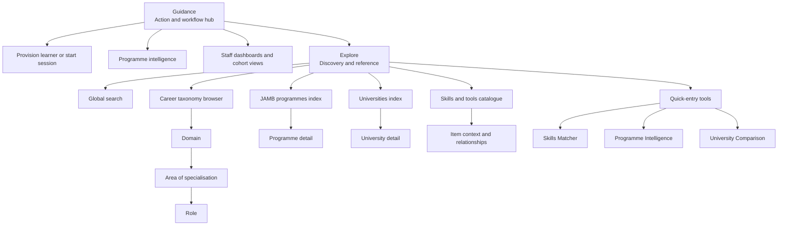

# Explore information architecture and pre-implementation mockups

**Status:** design and audit only — no implementation approval yet  
**Date:** 2026-10-17  
**Inputs:** `pasted-text-1.txt`, `pasted-text-2.txt`, current repository routes/components, `docs/BUILD_PLAN.md`, and the existing admin/navigation implementation.

**Reviewable visual mockup:** [explore-page-mockups-2026-10-17.html](./explore-page-mockups-2026-10-17.html)

## 1. Decision to preserve

Explore and Guidance are different products:

- **Guidance** answers “what should I do next?” It owns provisioning, a learner session, subject/programme decisions, requirements, staff dashboards and action follow-up.
- **Explore** answers “what exists, how is it connected, and what does it mean?” It owns discovery, search, browsing, comparison entry points and reference information.

Explore should therefore remain a distinct destination. It should not become a second provisioning flow, and Guidance should not be forced to carry the whole national catalogue.

There must be **two actual Explore pages**:

- **Student Explore** — discovery for a student or guest: simple browsing, plain-language explanations, personal saves/recent items, route exploration and student-safe actions.
- **Admin Explore** — a school-owner/university/provider catalogue and intelligence workbench: global catalogue search, facets, institution-safe context, saved searches, comparison entry points and links into admin tools.

They may share data adapters, query parsing, result-card primitives and detail-route contracts. They must not share one audience-switched page shell. Audience-specific information architecture is part of the product, not merely different introductory copy.

The same discovery model can serve students and administrators, but the framing, permissions, filters and actions must be audience-aware.

## 2. What the repository already contains

| Capability | Current evidence | Audit result |
|---|---|---|
| Student Explore route | `app/(tabs)/explore/index.tsx` → `src/screens/ExploreScreen.tsx` | Present |
| Admin Explore route | `app/(admin)/workspace-explore/index.tsx` and nested detail routes | Present |
| Distinct admin navigation destination | `src/lib/adminNav.ts`, `src/lib/exploreNav.ts`, `src/screens/admin/AdminShell.tsx` | Present |
| Guidance/Explore separation | `adminHomeForProfile`, Guidance routes, admin Explore stack | Present in navigation |
| Global search overlay | `ReferenceShell`, `searchLauncher`, `searchResults.ts` | Present for the student shell |
| Dashboard-to-Explore query handoff | `adminNav.explore(query)`, `GeneralDashboardScreen` | Present, but only as a dashboard entry |
| Admin persistent search | `AdminShell.tsx` has no `SearchBar`/`SearchOverlay`; only `GeneralDashboardScreen` exposes a search handoff | Missing |
| Programme/domain/area/role search result types | `ExploreScreen`, `searchResults.ts`, career search types | Present, but student-facing “subgroup” naming remains |
| Domain hierarchy routes | admin and student domain/area/role routes | Present |
| University comparison | admin comparison route and university surface | Partly present |
| Skills matcher entry | `SkillDiscoveryPanel` and school Explore surface | Partly present |
| Persistent admin global search | `AdminShell.tsx` has route/query state but no equivalent persistent search control | Missing |
| Four catalogue indexes | No unified JAMB, university, taxonomy and skills index surface | Missing |
| Advanced facets and saved searches | No complete Explore query/facet contract | Missing |
| Student recent/recommended personalization | Explore-local `recents` state is ephemeral; no complete viewed/saved/recommended contract | Incomplete |

The existing work is valuable and should be reused. The current admin route reuses `ExploreScreen` with `adminAudience` and `intro` props. That is useful as a transitional data reuse, but it does **not** satisfy the final design: the admin page needs its own workbench shell and information hierarchy. The student global overlay is wired through `ReferenceShell`; the admin shell currently has no equivalent persistent search control. The design must not be implemented by adding a parallel search engine or by cloning the current student screen into more routes. Share the underlying query/data primitives; keep the two Explore page compositions separate.

## 3. Explicit gaps before implementation

### A. Information architecture gaps

1. The current admin Explore surface delegates most of its body to the student `ExploreScreen`. That gives it a search and domain-cluster landing, but not the requested administrator catalogue/workbench. The final implementation must replace this audience-switched reuse with separate `StudentExplorePage` and `AdminExplorePage` compositions.
2. The admin landing does not expose four explicit primary indexes:
   - JAMB programmes;
   - universities;
   - occupational domains → areas of specialisation → roles;
   - skills/tools catalogue.
3. The student landing does not make those primary discovery doors equally clear. Admission/programme discovery, domain browsing and the skills matcher are present, but the route is still organised mainly around the existing cluster/prompt layout.
4. The current code still uses `subgroup` in search labels and route vocabulary. Student-facing copy must use **Area of specialisation**. Legacy subgroup identifiers may remain internal only where required for migration compatibility; they must not appear in the output.

### B. Search and filtering gaps

1. The dashboard has a search handoff, but an administrator cannot keep a lightweight global search available while moving between Guidance, Explore, students and intelligence screens.
2. Explore does not yet provide a single, explicit query contract for result type, faculty, university type, location, demand/availability state, domain, area of specialisation and role.
3. The proposed “search everywhere, deep-search in Explore” behavior is not yet expressed as one shared state model. The overlay, Explore search and dashboard handoff can drift if each owns different query parsing.
4. There is no reviewed design for saved searches, clear-all filters, query persistence on back navigation, or empty/error/offline states across all Explore indexes.

### C. Entity/action gaps

1. “What can I do with this?” is not a consistent action contract on every programme, university, domain, area or role result.
2. Search rows for skills/tools/certifications often deep-link to a domain, but the destination needs to preserve the item identity and explain why that item is shown there.
3. The admin requirements call for quick entry points to Skills Matcher, Programme Intelligence and University Comparison. Some routes exist, but their availability and context handoff are not yet unified.
4. The admin Explore design needs clear separation between national reference data and institution-scoped data. It must never substitute national totals for missing institution data.
5. The student view needs lightweight personalization—recently viewed, saved, and recommendations—without turning Explore into a mandatory workflow.

### D. Terminology and trust gaps

1. The student-facing term must be **Area of specialisation**, not “subgroup”.
2. Search results must distinguish “programme”, “university”, “domain”, “area of specialisation”, “role”, “skill”, “tool”, “certification” and “opportunity”.
3. Every result needs a plain-language explanation and context label. A title alone is not enough for a learner or adviser to know why it matters.
4. Empty states must say what is unavailable and what the user can do next; they must not imply that no data exists globally when only the current scope is empty.
5. Admin-only provenance, student-safe guidance, and institution-scoped intelligence must remain visibly distinct.

## 4. Refined information architecture



### Audience rules

| Surface | Student | Secondary school / tutorial centre | University administrator |
|---|---|---|---|
| Explore purpose | Discover routes for self | Browse national catalogue while advising learners | Reference catalogue and plan institutional coverage |
| Primary context | Personal, optional saving | National catalogue; learner session only when selected | Institution-scoped facts plus national reference |
| Student roster | Never exposed | Only consented/provisioned learner context | Only authorized institution context |
| Skills Matcher | Self mode | Self mode or selected learner mode | Self mode or explicitly selected learner mode |
| Programme intelligence | Read programme-to-career explanation | Open for a learner/programme | Institution/programme planning view |
| Peer comparison | Compare selected universities | Compare selected universities only as an advisory tool | Institution comparison workspace |

## 5. Screen mockups

These are structural mockups for agreement before implementation. They define hierarchy and behavior, not final pixel values.

### 5.1 Student Explore — desktop

This is a student page, not the admin page with a different heading.

```text
┌──────────────────────────────────────────────────────────────────────────────┐
│ LevelUp     Home   Explore   Opportunities   My World   Profile              │
│              [ Search programmes, careers, skills, or universities…       ]  │
├──────────────────────────────────────────────────────────────────────────────┤
│ EXPLORE                                                                    │
│ Find something to learn about                                               │
│ Browse freely. Choose a result only when you are ready to follow its route. │
│                                                                              │
│ [JAMB programmes] [Domains] [Areas of specialisation] [Roles] [Skills]     │
│                                                                              │
│ Start with a route                                                          │
│ ┌──────────────────┐ ┌──────────────────┐ ┌──────────────────────────────┐ │
│ │ Find a programme │ │ Explore a field  │ │ Match skills to possible work │ │
│ │ What is offered? │ │ What does it do? │ │ What do I already know?       │ │
│ │ [Browse]         │ │ [Browse domains] │ │ [Open Skills Matcher]         │ │
│ └──────────────────┘ └──────────────────┘ └──────────────────────────────┘ │
│                                                                              │
│ Recently viewed / Saved / Suggested for you                                 │
│ [Sociology] [Social Sciences] [Social researcher] [Python for analysis]     │
│                                                                              │
│ [Browse all programmes] [Browse all universities] [Browse the career map]   │
└──────────────────────────────────────────────────────────────────────────────┘
```

On mobile, the top search remains visible, the five discovery doors become a horizontal or wrapped row, and the three route cards become a vertical stack. No intent questionnaire is required before browsing.

### 5.2 Admin / school-owner Explore — desktop workbench

This is a separate admin page with its own shell, catalogue navigation, facets and institution/privacy rules. It is not a variant of the student card order.

```text
┌───────────────┬──────────────────────────────────────────────────────────────┐
│ Guidance      │ Explore                                                       │
│ Explore   ●   │ National catalogue and reference workspace                    │
│ Cohort        │ [ Search programmes, universities, domains, roles, skills… ] │
│ Intelligence  │                                                              │
│ Students      │ [All] [Programmes] [Universities] [Domains] [Areas] [Roles]  │
│ Feedback      │ [Skills/tools]                                               │
│               │                                                              │
│               │ ┌──────────────────────────────────────────────────────────┐ │
│               │ │ Browse the catalogue                                    │ │
│               │ │ [JAMB programmes] [Universities]                        │ │
│               │ │ [Domains → areas → roles] [Skills and tools]              │ │
│               │ └──────────────────────────────────────────────────────────┘ │
│               │                                                              │
│               │ Filters                                                       │
│               │ [Faculty] [State] [University type] [Domain] [Area] [Role]  │
│               │ [Clear filters]                                              │
│               │                                                              │
│               │ Results                                                       │
│               │ ┌──────────────────────────────────────────────────────────┐ │
│               │ │ Sociology                                                 │ │
│               │ │ JAMB programme · Social Sciences                          │ │
│               │ │ Browse universities · View programme intelligence        │ │
│               │ └──────────────────────────────────────────────────────────┘ │
│               │ ┌──────────────────────────────────────────────────────────┐ │
│               │ │ Social Sciences                                           │ │
│               │ │ Domain · 7 canonical areas · connected roles             │ │
│               │ │ Open domain map · View learning context                  │ │
│               │ └──────────────────────────────────────────────────────────┘ │
└───────────────┴──────────────────────────────────────────────────────────────┘
```

The admin landing does not ask “self or student?” The mode switch appears only inside Skills Matcher and other learner-specific tools.

### 5.3 Global search overlay and handoff

```text
┌──────────────────────────────────────────────────────────────┐
│ Search                                                     × │
│ [ Search programmes, universities, domains, roles, skills ]  │
│ [All] [Programmes] [Universities] [Domains] [Roles] [Skills] │
│                                                              │
│ PROGRAMMES                                                   │
│ Sociology                         Social Sciences  ›         │
│ A programme that studies society, institutions and change.   │
│                                                              │
│ DOMAINS                                                      │
│ Social Sciences                    7 areas                  ›│
│ Understand the field before choosing a focused area.         │
│                                                              │
│ ROLES                                                        │
│ Social researcher                  In Social Sciences      › │
│ See the work, route context and what to build next.         │
└──────────────────────────────────────────────────────────────┘
```

Behavior:

1. Search from any page uses the same query state and result mapping.
2. Pressing Enter opens Explore with the query and selected scope preserved.
3. Selecting a result opens the correct detail route and carries its context.
4. Back returns to the same query, scope and filters.
5. Search never silently redirects every result to the generic Explore landing.

### 5.4 Taxonomy detail flow

```text
Programme ── explains what the learner is studying ──┐
                                                     ▼
Domain ── explains the field and shared foundation ──┐
                                                     ▼
Area of specialisation ── explains focused route ────┐
                                                     ▼
Role ── explains work, outputs and preparation        │
                                                     ▼
Tools / skills / methods / knowledge / credentials     │
                                                     ▼
Open Skills Matcher · Save · Compare · Print/Share    │
```

Each transition must display why the next layer is being shown. It must not present a domain/area/role as an unexplained list of names.

## 6. Result-card contract

Every Explore result card or row should contain the following, with the detail level adjusted to the surface:

1. **Name and type** — for example, “Sociology · JAMB programme” or “Social researcher · Role”.
2. **Plain-language explanation** — what it is and what kind of question/work it represents.
3. **Context** — faculty, university, domain, area of specialisation or role context as applicable.
4. **Next action** — one primary action stated in user language.
5. **Related actions** — compare, see connected routes, open Skills Matcher, save, or view requirements where valid.
6. **Evidence/state notice** — only where necessary; distinguish source-backed, unavailable, institution-scoped and staff-only information.

The card should not expose internal IDs, review-only labels, legacy subgroup terminology, or raw provenance text to students. Admin detail views may expose provenance in a clearly separated evidence section.

## 7. Search/filter contract to design before coding

```ts
type ExploreQuery = {
  text: string;
  scope: "all" | "programmes" | "universities" | "domains" | "areas" | "roles" | "skills" | "tools" | "certifications";
  faculty?: string;
  state?: string;
  universityType?: "federal" | "state" | "private";
  domainId?: string;
  areaId?: string;
  roleId?: string;
  audience?: "student" | "secondary_school" | "tutorial_centre" | "university";
  learnerId?: string;
};
```

The final implementation should have one source of truth for this state. The student shell, admin shell, dashboard handoff, overlay and Explore page should all use the same parser/serializer and preserve the state through navigation.

Required behavior:

- `All` searches across the supported catalogue without mixing result types in an ambiguous row.
- A scope filter limits results but does not delete the query.
- Facets are only shown when they are meaningful for the selected scope.
- A filter with no matches explains which filter caused the empty state and offers “Clear filters”.
- Missing data is not replaced by national data, another institution’s data, or invented counts.
- Guest/student/admin permission boundaries remain enforced.

## 8. Implementation sequence after design approval

Do not start with visual polishing. Implement in this order after the mockup is accepted:

1. **Freeze vocabulary and route map**: canonical “Area of specialisation”, no legacy subgroup output.
2. **Create the shared Explore query contract**: parse, serialize, scope, facets, and back-navigation persistence.
3. **Build the shared result-card contract**: type, explanation, context, next action, related actions and state.
4. **Build the separate Student Explore page**: explicit discovery doors, browse sections, saved/recent/recommended states and contextual actions.
5. **Build the separate Admin Explore page**: four catalogue indexes, persistent search, facets, saved searches and audience-safe actions.
6. **Wire detail routes**: programme, university, domain, area and role preserve query context and return to results.
7. **Wire advanced-tool handoffs**: Skills Matcher mode selection, Programme Intelligence and University Comparison.
8. **Add tests for every state**: idle, loading, no result, filtered empty, error, offline, guest-limited, permission-limited and back-navigation.
9. **Only then perform rendered UI verification** across desktop, small laptop/tablet and phone widths.

## 9. Acceptance criteria for the design before implementation

The design is ready for implementation only when the reviewer agrees that:

- Guidance and Explore have clearly different jobs.
- Student Explore and Admin Explore are visibly and structurally separate pages, even when they reuse data and components.
- Students can browse without being forced into a workflow.
- Admins can search from anywhere and reach the full Explore catalogue.
- The four admin indexes are explicit and discoverable.
- Programme → domain → area of specialisation → role transitions explain themselves.
- Every result has a meaningful next action and a safe empty state.
- Skills Matcher, Programme Intelligence and University Comparison are linked without being embedded into the Explore landing.
- “Self vs provisioned student” is asked only in learner-specific tools.
- Saved/recent/recommended content is clearly distinguished from catalogue content.
- The design does not expose legacy subgroup terminology or internal review states to students.

## 10. Current conclusion

The repository has enough shared infrastructure to implement this without a new search engine or a second taxonomy. It is **not yet ready for implementation of the pasted design as-is** because the current admin surface is still a framed reuse of the student Explore screen, the four index doors and admin facets are not explicit, and the persistent admin search contract is incomplete.

This document is the pre-implementation handoff. The next action should be design review and approval of these mockups, followed by a separate implementation pass. No code, SQL, seed, migration or taxonomy changes are authorized by this audit alone.
