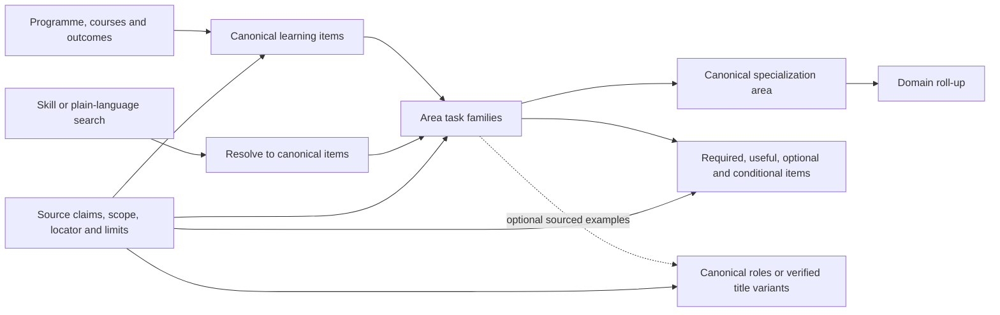

# Skills Matcher: shared evidence model, audience journeys and UI recommendation

**Prepared:** 2026-11-04

**Status:** Product and data recommendation with text wireframes; not a UI implementation or approval to change the live matcher contract.
**Purpose:** Design a skills-first way to show where a person's capabilities are used, what other learning items support the work, and when an independently offered service is evidenced. Ensure the same source-backed domain data can also serve programme-to-domain guidance.

## Recommendation in brief

Use one shared, source-backed learning and work graph with several entry points. A programme query and a skill query ask different questions, but they should reuse the same canonical items, area task families, relationships and source claims.

For a skill search, make the **task family inside a canonical area of specialization** the principal match. Show the area as context, the domain as a roll-up, and source-backed role titles as optional examples. A task family can be shown when no role record exists; the matcher must not invent the title.

Keep these claims separate:

1. **Use:** how the person's selected skill contributes to the task.
2. **Preparation:** which knowledge, skills, competencies, methods, tools or credentials are required, commonly paired, optional or conditional for that route.
3. **Work arrangement:** whether this kind of work is normally done in employment, contracts, independent services or more than one way.
4. **Market evidence:** whether an independent service or paid opportunity is evidenced in a named geography and time period.

Matching a capability to a task does not prove proficiency, employability, local demand or that the person can earn from the skill alone.

## Current repository baseline and the gap this proposal addresses

The current `SkillDiscoveryPanel` already has “I already know” / “I want to build,” a multi-item search, and a visible type legend for skills, competencies, tools, certifications, methods, knowledge and resources. But it adds the raw text as the selected item; it does not first resolve the phrase to a canonical item ID or offer a disambiguation step. Its accessibility text still says “four item types,” even though seven labels are rendered. The API client sends an array of strings rather than resolved item identities and types.

The backend currently compares those strings with item names using substring containment. Its `both` condition is evaluated against an aggregate of foundation, area/subgroup and role items in a domain. That can establish that each term occurs somewhere in the same domain, but not that all selected items contribute to one task family. The student-facing results are still labelled around domains, “SUBGROUPS” and roles. The D078 graph has a richer method → canonical area task-family → learning-item → supported-role path, but the generic skills matcher is not yet using task families as its result anchor.

This is why the proposal calls for canonical query resolution and task-family-level matching. The current percentage-style match score should not be presented as a probability of competence, hiring or income; any later score must be defined as a transparent evidence/match measure and explained accordingly. These are review findings about the current repository behavior, not edits to the existing contract or code.

## Audience journeys: different entry points, one graph

Do not make users select an audience type before they can search. Let them start with the question they can answer. Offer a programme route for people who know what they study, and a skills route for people who know what they can do. A person can use either route and add the other information later.

| User situation | Useful starting point | What the matcher should show |
|---|---|---|
| Secondary or university student who knows their programme | Programme, course or current learning item | Programme themes and outcomes that have source-backed links; the related domain learning path; area task families where those links are supported. Make clear that the programme provides learning context, not proof of personal proficiency. |
| Graduate who can name skills | Skills, tools, competencies, methods or experience | Area task families that use those items, what each item contributes, and source-backed next learning. Programme history is optional context. |
| Graduate who knows the degree but not what skills it gave them | Programme or course, with a “help me translate this” action | Candidate capabilities drawn from the curriculum evidence. Ask the person to confirm what they can use; do not silently label every course outcome as a mastered skill. |
| Professional or career changer | Skills and experience; optionally target area, location or work arrangement | Cross-domain task families and practical gaps. Education can be included as background, but should not be required or treated as verification of current ability. |
| Person who is exploring and cannot name a capability or deliverable | “Show me examples” / browse tasks | Familiar descriptions of work outputs grouped by area, plus an optional path to add a skill after they recognize something they can do or want to learn. “I’m not sure yet” must let them continue. |

Programme evidence can establish that a curriculum includes a topic or learning outcome. It cannot verify that a particular graduate retained, practised or can demonstrate it. Represent those states separately: **studied**, **practised**, **self-reported**, and **demonstrated**. A credential is its own evidence type; it does not automatically prove every related skill.

## What the matcher must connect

The matcher should accept all the learning-item families already relevant to the domain graph. A common search box can accept them together, while every suggestion and result is clearly labelled by type.

| Item family | How to explain its place in a task path |
|---|---|
| Knowledge | What the person needs to understand to perform or judge the work, such as materials, markets, data or system behaviour. |
| Skill | An ability the person can apply, such as drawing, programming, interviewing or statistical analysis. |
| Competency | The ability to combine knowledge, skills and judgment in a particular work situation. Do not use “competency” as a vague synonym for every item. |
| Method or design | A defined way of carrying out the work or producing evidence. Connect it to tasks where it actually changes the workflow; do not force every domain into a methods branch. |
| Tool or instrument | Software, equipment or a platform used to carry out part of the work. A tool is not automatically a method or a compulsory requirement; show supported alternatives separately. |
| Certification, licence or qualification | A formal credential. State whether a source establishes a legal or professional requirement, a common employer preference, or an optional learning signal. Keep issuer, level, jurisdiction and status. |
| Learning resource | A verified learning source for an item. Show it only where the existing resource approval rules permit it. A resource link is not itself evidence that the item is required. |

### Keep applicability separate from learning priority

Each skill-to-task-family link answers **how the skill is used**. A separate route record answers **what the learner should learn**. For example, drawing could be directly used to create a visual deliverable but still need to be combined with domain knowledge and a tool before a particular task is complete.

Use evidence-backed relation types such as:

- **Used directly:** the skill performs part of the task.
- **Supports the task:** it contributes but is not the main capability being exercised.
- **Works with:** the combination is useful in the stated context.
- **Needed before:** a documented prerequisite or dependency.
- **Alternative:** another valid way to perform the same step; alternatives are not additive requirements.
- **Conditional:** useful only under a stated task, method, sector, role or tool condition.

Preserve the requirement lane separately: compulsory/needed, useful, optional or conditional according to the approved route contract. Where a workflow needs A **and** B, represent that combination; where the learner can use A **or** B, represent an alternative group. Never infer a bundle by counting skill names.

## Shared data model and one evidence-acquisition pass

Do not run one source-enrichment project for programme matching and another for skills matching. Enrich each domain and area once; store the source claim and canonical relationship once; then build both matcher views as projections of that same evidence graph.



The evidence store should be able to represent at least:

| Record | Required information |
|---|---|
| Source record | Issuer/author, source family, URL or document ID, exact page/section/table/paragraph locator, publication/revision date, access date, geography, sector, access limits and credibility/use limits. Preserve the source that originally supported an area label or boundary, even when it is not a global occupational taxonomy. |
| Area record | Stable canonical area ID and domain ID, area name, boundary, included/excluded scope, source-backed rationale and current status. Do not derive student-facing areas from retired subgroup labels. |
| Task-family record | Stable ID and owning area; student-readable work/action and output; inputs or context where relevant; linked source task statements; maturity and geography; and known limits. A task family groups related work by outcome, not by job title. |
| Learning-item record | Stable canonical ID, item family, display name and aliases, plain meaning, context, owner, evidence, level or scope, and its own learning dependencies/alternatives. Preserve source-layer ownership when another area or role uses it. |
| Task-to-item relationship | Task-family ID, learning-item ID, relation type, route requirement lane, condition, sequence/dependency or alternative-group ID, a short explanation, and the exact evidence or reviewed inference supporting the link. |
| Programme-to-item relationship | Programme/course/outcome ID, canonical learning-item ID, relationship type, outcome/course locator, and confidence/limits. Curriculum presence is not a claim of learner mastery. |
| Task-to-role relationship | Optional link to a current canonical role or a separately source-backed title variant. Keep a supported task family usable when no role is recorded. Never promote a title from a query alone. |
| Work-arrangement evidence | Employment/contract/independent-service context, geography, date range, source type and strength. Keep this separate from skill relevance and task capability. |

Keep original source wording and normalized task-family wording together. The student sees the clear normalized explanation; reviewers can trace it back to the source statements and see where synthesis or inference was used.

Task coverage must come from area boundaries and work evidence across source families, not only from the current role list. Include materially distinct recurring tasks, specialist outputs, safety or regulatory tasks, and emerging or experimental work within the stated scope. Consolidate synonymous task statements into a family while keeping distinct outputs and workflows separate. Include independent-service or freelance outputs only when a source supports them. The goal is coverage of materially distinct task families within the bounded area scope, not one UI card for every wording in every vacancy or a claim that every future task is known. Disposition the defined task tracks and close using the current plan's single counter-search gate.

### Source coverage for each domain and area

Use the existing source lineage and specialist sources for the area as the starting inventory. Search relevant source families, not only O*NET and ESCO:

1. The source documents, professional communities and decisions that established the domain and area names/boundaries.
2. International occupational and economic classifications where useful, while preserving their geographic and conceptual limits.
3. National occupational standards, regulators, professional bodies, sector skills frameworks and licensing bodies relevant to that area and geography.
4. Education and qualification standards for curriculum content and learning outcomes.
5. Employers, operators, technical standards and public job descriptions for real work processes and outputs.
6. Peer-reviewed research, conference work and credible specialist grey literature for new, emerging and experimental work; label maturity and evidence limits.
7. Separate, current evidence for independent services or paid-work modes. An employer task description alone does not establish a freelance market.

Use each source only for the claims it can support. A vendor guide can establish how its tool works, not that the whole profession requires it. A job advertisement can provide an employer-specific signal, not a universal requirement. A curriculum can support taught content, not demand. A global framework does not prove Nigerian availability or local regulation.

The repository already has a bounded per-area matrix and task-track closeout process. Reuse its fixed item-family × maturity-horizon cells, six task tracks and one logged counter-search. Do not create a second denominator just for the matcher, impose a source-count quota, or reopen a closed source search because another unrelated source appeared. Add the task-family-to-item links and dual matcher projections to that same package. A material counter-search finding reopens only the affected item, task or relationship.

### Sources and claims must be reused, not re-verified twice

When one source supports multiple claims, store one source record with distinct claim records and locators. The programme matcher can use curriculum-to-item links; the skills matcher can use item-to-task links. They may display different explanations and filter by user intent, but they must not duplicate the source record or repeat the same research. A later display or route check validates compatibility and integrity; it does not repeat source verification already completed in the enrichment package.

## Resolving a plain-language search

Treat text such as “I can draw” as a sentence that expresses intent plus one or more candidate capability concepts. Do not search the sentence as a literal item name, and do not create graph edges from model-generated similarity alone.

1. **Read intent:** identify “I can,” “I have used,” “I studied,” “I want to learn,” or an open exploration request. Keep these evidence states distinct.
2. **Normalize wording:** handle spelling, common variants and aliases, then resolve to canonical IDs. Use exact matches first, followed by reviewed aliases and controlled fuzzy/semantic candidates.
3. **Clarify ambiguity without blocking:** if a phrase can mean materially different skills, show short examples in familiar words and allow “I’m not sure yet—show me examples.” The person can browse task families without choosing a technical term.
4. **Retrieve evidence-backed links:** find task-family links through canonical item IDs. Semantic search may retrieve candidates, but an approved/source-backed graph relationship is required before presenting a positive route.
5. **Match combinations at task level:** “use all” means all selected items connect to the same task family through supported relations. Do not combine one skill from one role and another skill from another area into a false fit. Show “use any” as a distinct exploratory mode.
6. **Explain the result:** identify the area, task/output, how each selected item contributes, what additional items support this particular task, optional verified role examples and the evidence scope. Rank by relation strength and evidence quality, not by an uncalibrated percentage.
7. **Show gaps without claiming employability:** indicate which requirements are met by the user's stated evidence, what remains to build, and which choices are alternatives. A skill match is a direction for exploration, not an employment or income guarantee.

If there is no canonical match, say that the phrase did not resolve yet. Offer close verified concepts or task examples and preserve the search phrase for later review; do not attach it to a convenient substring or silently discard it.

## UI box mockups

These are content/layout proposals, not pixel specifications. Use one clear action per control, plain-language examples and a separate explanation from the control label. On mobile, stack the same content in the same reading order.

### A. Skills-first entry, for graduates and professionals

```text
┌─────────────────────────────────────────────────────────────────┐
│ SKILLS MATCHER                                                   │
│ Find the kinds of work where your skills are useful              │
│                                                                 │
│ What can you already do, or want to learn?                      │
│ [ Try “I can draw”, “I use Python”, or “I organize events” ]     │
│                                                        [ Search ]│
│                                                                 │
│ Add one item at a time. You can add more to see where they work  │
│ together.                                                       │
│                                                                 │
│ [Start from my programme or course instead] [Browse work areas] │
│                                                                 │
│ Optional context: [My experience] [My tools] [My location]      │
└─────────────────────────────────────────────────────────────────┘
```

Do not ask someone to pick “professional” or “graduate” before using the feature. These labels should not affect the evidence graph. The optional context helps explain their route but does not prove skill by itself.

### B. “I can draw” when the user may not know the technical label

```text
┌─────────────────────────────────────────────────────────────────┐
│ We found a few kinds of drawing. Which sounds closest?           │
│ You can choose one, or keep it broad.                            │
│                                                                 │
│ ○ Sketching by hand                                             │
│   Making a quick picture to show an idea or shape                │
│                                                                 │
│ ○ Drawing to measurements                                       │
│   Making an accurate plan or diagram from sizes or instructions  │
│                                                                 │
│ ○ Making digital illustrations                                  │
│   Creating or finishing pictures with a tablet or computer      │
│                                                                 │
│ ○ Drawing clothes or product ideas                              │
│   Showing what a design could look like                          │
│                                                                 │
│ ○ I’m not sure yet — show me examples                            │
│                                                                 │
│                         [Continue] [Keep “drawing” broad]        │
└─────────────────────────────────────────────────────────────────┘
```

The examples should use the user's words first and optionally add the technical term in parentheses. The example “drawing clothes or product ideas” is intentionally broad; only show a narrower label such as “technical flats” after explaining it. The exact concepts shown must come from the enriched skill hierarchy and verified area routes; this mockup does not establish that each example is present or source-backed in the current graph.

The “not sure” choice must open a browsable example path, not an error or dead end. It could show task families such as “turn a design idea into a picture,” “make a precise plan,” or “create a digital image,” each with an area label when supported. Do not require the user to already know what job they want.

```text
┌─────────────────────────────────────────────────────────────────┐
│ What kinds of work would you like to look at?                   │
│ You do not need to know a job title. Start with an activity.     │
│                                                                 │
│ [Show an idea in a picture]                                     │
│  Explore design and visual communication work                   │
│                                                                 │
│ [Make a precise plan or diagram]                                │
│  Explore work that uses measurements and technical drawings     │
│                                                                 │
│ [Create a digital image or scene]                               │
│  Explore digital design, games and immersive work                │
│                                                                 │
│ [Browse examples from all areas]                                │
└─────────────────────────────────────────────────────────────────┘
```

These are plain-language browse prompts, not role claims. Populate each with task families already supported by the source graph, and show only area names whose task-family links have been verified. If no matching tasks exist in a particular area, omit that area instead of using a generic label as evidence.

### C. Task-family result when a relevant role title is missing

```text
┌─────────────────────────────────────────────────────────────────┐
│ FASHION DESIGN                                                   │
│ Work example: prepare design sketches                            │
│                                                                 │
│ What this work produces                                          │
│ A drawing that helps someone compare the shape and details of a  │
│ clothing idea before it is made.                                 │
│                                                                 │
│ How your skill fits                                              │
│ Drawing can contribute directly to showing the design idea.      │
│                                                                 │
│ To build this route                                              │
│ • Learn the clothing/material knowledge required for this task    │
│ • Add a suitable digital drawing or pattern workflow if needed   │
│ • Build examples of finished work for a portfolio                │
│                                                                 │
│ Work arrangement                                                 │
│ Independent commissions: show only if a separate market source  │
│ supports this claim for the selected location and date.          │
│                                                                 │
│ Related role titles: show only verified titles, when available  │
│ [See the area learning path]                                     │
└─────────────────────────────────────────────────────────────────┘
```

This is a copy/layout example, not a verified claim that fashion design currently has this task, route or independent market evidence. The actual task label, skills and market statement must come from the relevant source package. The task-family result remains valid when there is no canonical role title.

### D. A combination result for Python plus another item

```text
┌─────────────────────────────────────────────────────────────────┐
│ QUANTITATIVE FINANCE                                             │
│ Area: Risk analysis                                             │
│ Work example: test how a portfolio could behave under scenarios │
│                                                                 │
│ Python: used to prepare data or run the analysis                 │
│ Statistics: needed to interpret the results                     │
│ Risk concepts: needed to explain what the results mean           │
│                                                                 │
│ Your selected items: Python                                     │
│ Build next: statistics → risk concepts → model validation        │
│                                                                 │
│ This is a learning route, not a guarantee of job readiness.      │
│ [Why these items connect] [Open area learning path]              │
└─────────────────────────────────────────────────────────────────┘
```

This example illustrates the display rule. The route, order and labels must match the source-backed D011 graph; this mockup does not assert a new D011 prerequisite.

### E. Programme-first entry for students or graduates who need translation

```text
┌─────────────────────────────────────────────────────────────────┐
│ START FROM A PROGRAMME                                           │
│ What are you studying, or what did you study?                    │
│ [Search a programme or course]                                   │
│                                                                 │
│ Your curriculum includes evidence about these topics and        │
│ outcomes: [source-backed programme themes / outcomes]            │
│                                                                 │
│ These may connect to the following capabilities:                 │
│ [Knowledge] [Skills] [Competencies] [Methods]                    │
│                                                                 │
│ Which ones can you already use?                                  │
│ [I have practised this] [I have examples of my work] [Not sure]  │
│                                                                 │
│ [See related areas and work examples]                            │
│ Studying a topic does not by itself confirm current proficiency. │
└─────────────────────────────────────────────────────────────────┘
```

Programme matching should feed the same task-family graph when the evidence supports it. Keep the evidence path visible: curriculum outcome → canonical learning item → supported task family. Do not draw a direct programme-to-role edge merely because a role uses a broadly related skill.

## Display and interaction rules from established design guidance

- Use a visible label for the search field; do not rely on placeholder text as the only label. Keep examples as hint text or examples below the field. W3C WAI recommends explicit labels and a close, predictable relationship between labels and controls. [WAI form labels](https://www.w3.org/WAI/tutorials/forms/labels/)
- If suggestions appear while typing, use an accessible combobox/listbox interaction with keyboard support, selection state and a distinct accessible name. Follow the WAI-ARIA Authoring Practices combobox pattern; test the actual implementation with keyboard and assistive technology. [WAI-ARIA combobox pattern](https://www.w3.org/WAI/ARIA/apg/patterns/combobox/)
- Ask only what the user needs to answer at that point. Permit “I’m not sure” when it is a valid answer, and explain why a question is being asked. GOV.UK’s question-page pattern states both rules and recommends short hint text. [GOV.UK question pages](https://design-system.service.gov.uk/patterns/question-pages/)
- Keep search simple by default, with an explicit submit action and an accessible label. USWDS advises against making advanced search the default and recommends an accessible search label and submit button. [USWDS search](https://designsystem.digital.gov/components/search/)
- Use grouped task cards for results, not a giant unstructured list of tools, role names and skills. Keep the result heading, task output, skill contribution and next learning visually distinct. These groupings are product recommendations; they should be checked with students, graduates and working adults before final UI approval.

## Acceptance checks for a later implementation

1. A person can start from programme, skill, experience, or “show me examples” and reaches the same source-backed graph without duplicate evidence records.
2. “I can draw” offers understandable meanings and a useful “not sure yet” route. It never creates an unsupported skill or area link.
3. A task family can be returned without a role record. Any role title shown is independently source-backed.
4. The result explains the selected skill's contribution and distinguishes it from additional requirements.
5. All six item families—knowledge, skill, competency, method, tool and certification—can be linked and explained without conflating their types. Resources appear only under existing resource approval rules.
6. “Use all” combinations are checked against one task family and its valid alternatives/dependencies, not just a domain-wide bag of skills.
7. The UI separates technical task fit, personal proficiency evidence, work arrangement and market demand. It makes no income, hiring or employability promise from a skills match.
8. “I’m not sure yet,” no-match and low-confidence query states offer a useful next action, preserve the user's wording for review, and do not show fabricated matches.
9. Search suggestions and controls work at mobile widths, have visible labels, and are usable by keyboard and assistive technology.
10. Domain and area sourcing closes through the current bounded matrix/task/counter-search gate. The matcher does not open a second unlimited source search.

## Repository references reviewed

- `docs/manual-review/DOMAIN_FIRST_ENRICHMENT_SCALING_PLAN_2026_10_12.md` — bounded domain/area enrichment process; D078 is a depth benchmark, not a universal methods selector.
- `docs/manual-review/D078_METHOD_AREA_ROLE_ROUTE_GRAPH_2026_10_19.md` — D078 method → canonical area task-family → learning items → optional supported role path.
- `docs/CAREER_TAXONOMY_SOURCE_LINEAGE_DOCUMENTATION.md` — multiple source families behind domain identity and occupational structure; records source limits and later specialist additions.
- `docs/user-facing-mockups/SKILLS_MATCHER_BOX_MOCKUP.md` — current matcher contract reference. This proposal does not silently replace or implement that contract.
- `src/components/careerIntelligence/SkillDiscoveryPanel.tsx` and `backend/routes/career_routes.py` — current UI and matching behavior reviewed for this proposal.

## External design and data references

Accessed 2026-11-04. These sources inform the design; they are not all authorities for Sifter's taxonomy or for Nigerian market claims.

- [ILO ISCO-08 FAQ](https://isco.ilo.org/en/faq/) — definitions of jobs as task/duty sets and occupations as similar jobs.
- [O*NET 31.0 Tasks to DWAs](https://www.onetcenter.org/dictionary/31.0/csv/tasks_to_dwas.html) and [Task Statements](https://www.onetcenter.org/dictionary/31.0/json/task_statements.html) — examples of mapping occupation-specific task statements to shared activity categories.
- [ESCO: What is ESCO?](https://esco.ec.europa.eu/en/about-esco/what-esco) and [ESCO FAQ](https://esco.ec.europa.eu/en/about-esco/faq) — a linked skills/occupations classification used for job matching, skill-based discovery and training suggestions.
- [Jobs and Skills Australia: National Skills Taxonomy](https://www.jobsandskills.gov.au/data/national-skills-taxonomy) — notes the Australian Skills Classification's separate core competencies, specialist tasks and technology tools, and its skills and occupation views. Treat it as a design precedent, not a global authority.
- [NBTE National Occupational Standards catalogue](https://dms.nbte.gov.ng/nsqf/trades) — a Nigerian source for approved standards in its covered TVET trades; apply only where its scope fits.
- [WAI form labels](https://www.w3.org/WAI/tutorials/forms/labels/), [WAI-ARIA combobox pattern](https://www.w3.org/WAI/ARIA/apg/patterns/combobox/), [GOV.UK question pages](https://design-system.service.gov.uk/patterns/question-pages/) and [USWDS search](https://designsystem.digital.gov/components/search/) — accessible search, suggestion, label and “not sure” patterns.
